# Manual Pengguna RefPahang - Admin

Pentadbiran negeri dan pengurusan sistem

Edisi 20 Oktober 2026. Screenshot antaramuka sebenar dengan data contoh.

## Mula di sini: Cara menggunakan manual ini
Halaman PDF 3

Manual ini khusus untuk Admin. Gunakan portal https://refpahang.com pada komputer atau telefon; aplikasi mobile menggunakan akaun yang sama.

1. Cari tugas melalui Kandungan yang boleh diklik atau penanda buku PDF. Ikut nama menu dan butang yang dicetak tebal dalam arahan.
2. Screenshot ialah antaramuka aplikasi sebenar dengan identiti dianonimkan dan keadaan contoh. Nama, jumlah, tarikh, keputusan dan butiran bayaran dalam rajah bukan data operasi semasa.
3. Pada telefon, tekan butang menu untuk membuka navigasi. Jadual lebar boleh ditatal mendatar; tatal ke bawah untuk melihat dokumen, butang simpan dan halaman seterusnya.
4. Selepas menghantar atau menyimpan, tunggu mesej berjaya dan semak semula status rekod. Jika gagal, kekalkan maklumat ralat untuk rujukan sokongan.
5. Rujukan edisi: 20 Oktober 2026. Lampiran Akaun Tidak Aktif menerangkan sekatan akses dan pengaktifan semula oleh Admin.

## Mula di sini: Peranan, pendaftaran dan status
Halaman PDF 4

Empat perkara ini mempunyai maksud berbeza. Semak tahun atau sesi sebelum membuat kesimpulan tentang kelayakan seseorang.

| Istilah | Maksud kepada pengguna |
|---|---|
| Peranan akaun | Admin, PP Daerah, Pengadil atau Penilai. Menentukan panel dan menu. RA ialah Penilai Pengadil. |
| Jenis Pengadil | Kategori atau kelayakan pengadil; bukan bukti pendaftaran tahun semasa. |
| Pendaftaran tahunan | Permohonan pengadil atau penilai untuk sesi tertentu; kelulusan tahun lalu tidak meliputi tahun baharu. |
| Status permohonan | Contohnya Menunggu PP Daerah, Menunggu Admin, Lengkap atau Ditolak. |
| Seminar / kecergasan | Rekod berasingan. Kecergasan menentukan kelayakan patch / lesen negeri; seminar tidak menggantikan keputusan kecergasan. |
| KUP dan RA | KUP: R, AR1, AR2 dan pegawai keempat. RA menilai KUP dan bukan salah satu daripada empat pegawai tersebut. |

## Akses dan akaun: Log masuk dan buka panel sendiri
Halaman PDF 5

Buka https://refpahang.com. Gunakan emel akaun yang didaftarkan dan kata laluan peribadi.

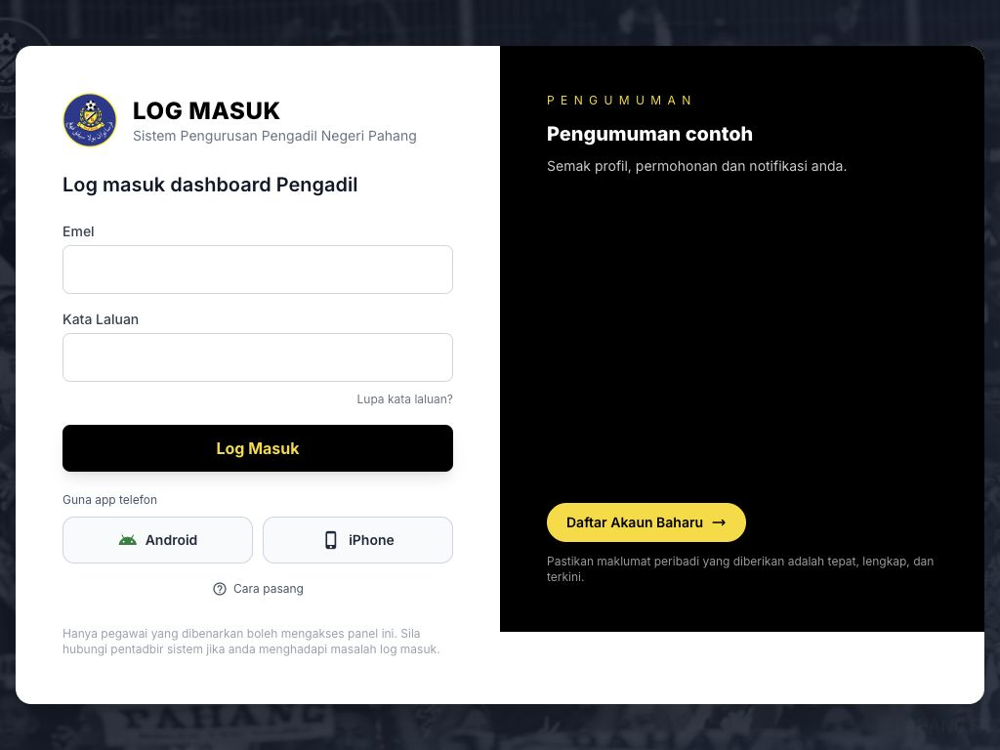

1. Isi Emel dan Kata Laluan, kemudian tekan Log Masuk. Semak ejaan emel dan elakkan ruang kosong yang tersalin bersama kata laluan.
2. Pastikan panel yang dibuka ialah Dashboard Admin. Jika sistem meminta pertukaran kata laluan kali pertama, lengkapkan proses itu dahulu.
3. Jika maklumat salah, betulkan emel atau kata laluan dan cuba semula. Cubaan gagal yang terlalu banyak boleh dihadkan sementara.
4. Jika akaun tidak aktif atau sistem dalam penyelenggaraan, baca mesej yang dipaparkan. Hubungi Admin jika akses memerlukan semakan.

## Akses dan akaun: Lupa kata laluan dan log keluar
Halaman PDF 6

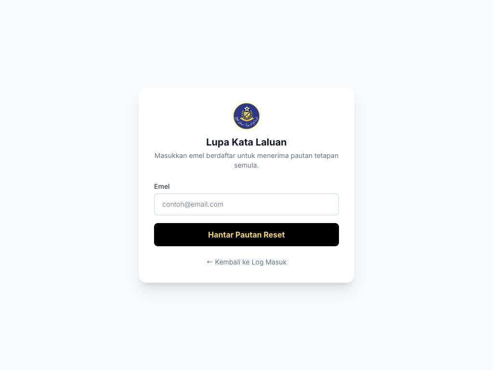

1. Pada halaman Log Masuk, tekan Lupa kata laluan?. Masukkan emel akaun dan hantar permintaan.
2. Semak peti masuk serta folder Spam / Junk. Buka pautan pemulihan yang dihantar kepada emel sendiri dan tetapkan kata laluan baharu.
3. Jika pautan tamat tempoh atau telah digunakan, minta pautan baharu. Jika tiada emel, semak alamat dengan Admin; jangan cipta akaun kedua untuk mengatasi masalah ini.
4. Selepas selesai bekerja, tekan Log Keluar. Pada telefon atau komputer yang dikongsi, pastikan halaman log masuk muncul semula.

> Jangan kongsi kata laluan, pautan pemulihan, pautan jawapan lantikan atau pautan laporan peribadi kepada orang lain.

## Akses dan akaun: Tukar kata laluan sendiri
Halaman PDF 7

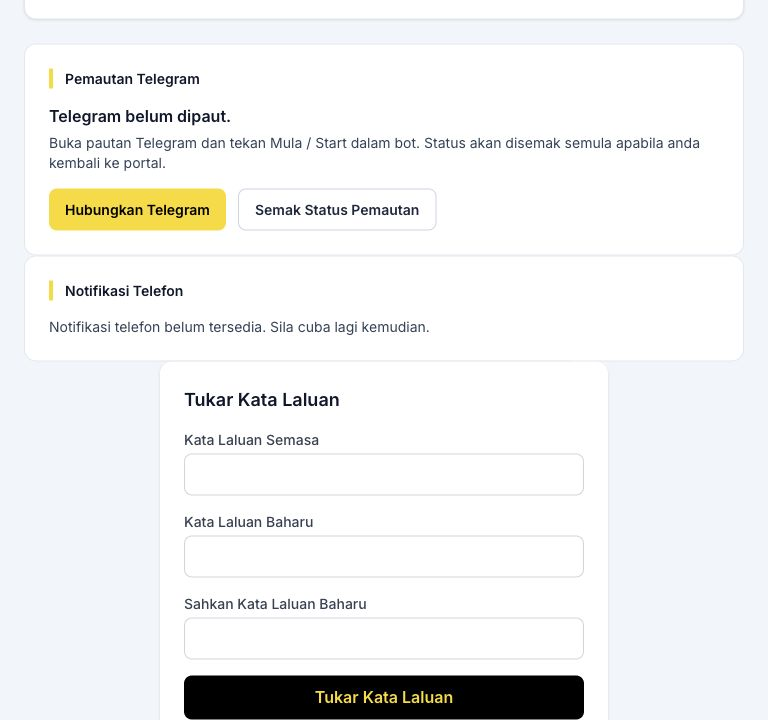

1. Buka Profil / Profil Saya dan cari bahagian Tukar Kata Laluan. Pada aplikasi, fungsi ini tersedia melalui Profil atau menu Lagi.
2. Masukkan kata laluan semasa, kata laluan baharu dan pengesahan kata laluan seperti diminta.
3. Patuhi syarat panjang dan pengesahan yang dipaparkan, kemudian tekan Tukar Kata Laluan.
4. Tunggu pengesahan berjaya. Jika sesi tamat atau diminta log masuk semula, gunakan kata laluan baharu.

## Aplikasi dan notifikasi: Pasang aplikasi pada Android
Halaman PDF 8

Gunakan pautan Android pada halaman Log Masuk atau https://refpahang.com/app/refpahang.apk.

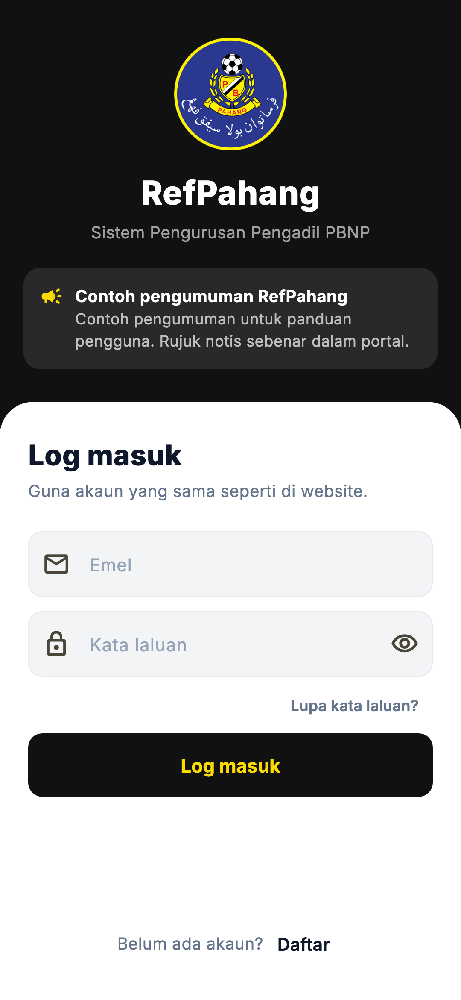

1. Muat turun APK rasmi dan tunggu fail selesai dimuat turun. Buka fail melalui Downloads / Files.
2. Jika diminta, benarkan Install unknown apps / Allow from this source untuk pelayar atau pengurus fail yang digunakan.
3. Kembali ke pemasang, tekan Install / Pasang dan kemudian Open / Buka.
4. Log masuk menggunakan akaun portal. Benarkan notifikasi apabila diminta dan semak panel peranan anda.
5. Jika pemasangan disekat oleh dasar peranti, simpan mesej ralat dan hubungi sokongan. Gunakan aplikasi web sementara menunggu bantuan.

> Nama tetapan Android berbeza mengikut jenama. Screenshot ini menunjukkan skrin aplikasi, bukan skrin tetapan setiap jenama telefon.

## Aplikasi dan notifikasi: Pasang aplikasi pada iPhone
Halaman PDF 9

iPhone menggunakan aplikasi web RefPahang yang ditambah ke skrin utama melalui Safari.

1. Buka Safari dan pergi ke https://refpahang.com/app/.
2. Tekan Kongsi / Share, pilih Add to Home Screen / Tambah ke Skrin Utama dan tekan Add / Tambah.
3. Jika pilihan Open as Web App dipaparkan, hidupkannya. Buka RefPahang melalui ikon skrin utama.
4. Log masuk, cari kad Aktifkan notifikasi pada Utama atau Profil, dan ikuti langkah pengaktifan pada halaman berikut.
5. Jika kad menyatakan aplikasi perlu dipasang, tutup tab biasa dan buka semula melalui ikon skrin utama.

> Pemasangan ini tidak menggunakan fail APK Android. Rajah menunjukkan mesej bantuan dalam aplikasi; paparan Share Safari boleh berbeza mengikut versi iOS.

## Aplikasi dan notifikasi: Aktifkan notifikasi telefon
Halaman PDF 10

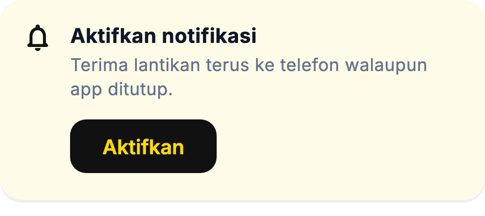

1. Buka RefPahang dan log masuk. Cari kad Aktifkan notifikasi pada Utama atau Profil.
2. Tekan Aktifkan notifikasi, kemudian pilih Allow / Benarkan apabila pelayar atau telefon meminta kebenaran.
3. Pada iPhone, lakukan langkah ini daripada aplikasi skrin utama. Pada Android APK, semak kebenaran notifikasi RefPahang dalam tetapan aplikasi.
4. Pastikan status kad bertukar kepada Notifikasi aktif. Kembali ke Profil jika perlu untuk menyemak keadaan semasa.
5. Buka ikon loceng dalam portal atau menu Notifikasi aplikasi untuk membaca butiran notis. Push, notis dalam portal, emel dan Telegram ialah saluran berasingan.

> Rajah kad kebenaran ialah render widget sebenar dengan keadaan contoh; ia bukan bukti kebenaran OS telah diberikan pada telefon anda.

## Aplikasi dan notifikasi: Notifikasi disekat atau tidak sampai
Halaman PDF 11

1. Jika kad menunjukkan Disekat, buka tetapan laman / aplikasi pada telefon dan benarkan notifikasi untuk RefPahang.
2. Semak Focus / Jangan Ganggu, mod senyap, sambungan internet dan had bateri. Buka semula aplikasi selepas mengubah tetapan.
3. Pada iPhone, pastikan ikon skrin utama digunakan. Pada Android, semak Settings > Apps > RefPahang > Notifications mengikut jenama.
4. Log masuk semula jika sesi telah tamat. Minta Admin menyemak bahawa notifikasi berkaitan benar-benar telah dihantar.
5. Jika masih gagal, laporkan jenis telefon, versi aplikasi, status kad notifikasi dan masa kejadian. Semak notis dalam portal sementara menunggu bantuan.

> Status Notifikasi aktif menunjukkan langganan tersedia; ia tidak membuktikan setiap notis telah dibaca. Jangan terlepas tarikh tindakan kerana hanya menunggu popup telefon.

## Aplikasi dan notifikasi: Hubungkan akaun Telegram
Halaman PDF 12

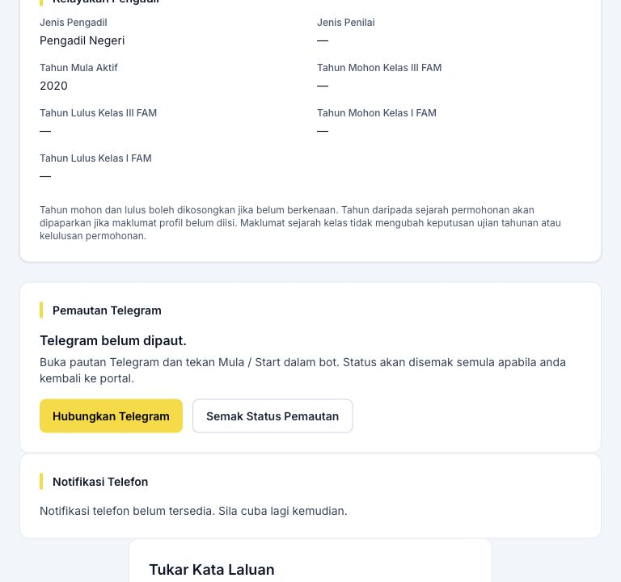

1. Buka Profil / Profil Saya dan cari Pemautan Telegram. Semak sama ada status menyatakan Telegram belum dipaut atau berjaya dipaut.
2. Tekan Hubungkan Telegram dan buka pautan peribadi dalam aplikasi Telegram.
3. Tekan Mula / Start pada bot. Kembali ke RefPahang dan tekan Semak Status Pemautan jika status belum berubah.
4. Pastikan status menunjukkan Telegram berjaya dipaut. Jika bot pernah disekat, nyahsekat bot dan mulakan semula pemautan.
5. Jika akaun Telegram lama dinyahaktifkan atau pautan tamat tempoh, dapatkan pautan baharu melalui profil atau hubungi Admin.

> Jangan gunakan pautan pemautan milik orang lain. Pemautan Telegram tidak secara automatik memberikan kebenaran push telefon.

## Aplikasi dan notifikasi: Kemas kini aplikasi
Halaman PDF 13

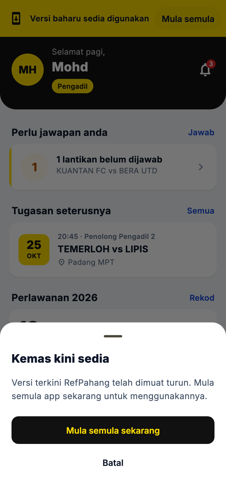

1. Jika aplikasi memaklumkan versi baharu, baca maklumat kemas kini dan tekan pilihan kemas kini yang tersedia.
2. Android: muat turun APK terkini daripada pautan rasmi dan pasang menindih aplikasi sedia ada. Lengkapkan pemasangan, kemudian buka semula.
3. iPhone / aplikasi web: tutup aplikasi dan buka semula ketika bersambung internet. Jika masih paparan lama, muat semula laman dan cuba lagi.
4. Log masuk semula jika diminta. Semak Profil, Tugasan dan notifikasi selepas kemas kini.
5. Jika versi minimum diwajibkan oleh sistem, selesaikan kemas kini sebelum meneruskan penggunaan.

> Simpan bukti atau draf yang belum dihantar sebelum menutup aplikasi. Versi dan saiz muat turun berubah mengikut keluaran; gunakan maklumat pada aplikasi semasa.

## Panduan Admin: Skop kerja dan menu Admin
Halaman PDF 14

Admin mengurus seluruh sistem: pengguna, permohonan, pendaftaran, kejohanan, lantikan, laporan, komunikasi dan tetapan.

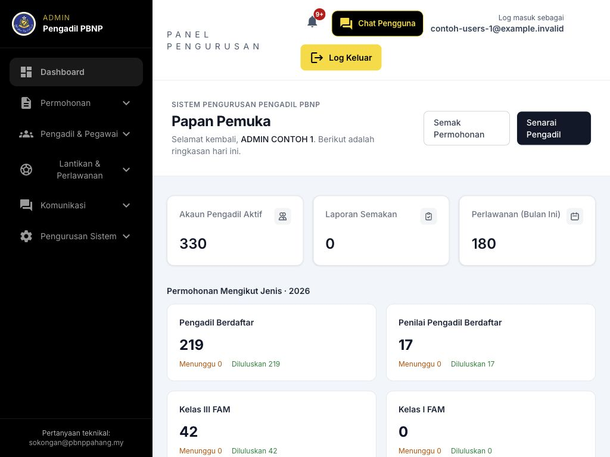

1. Dashboard: lihat perkara menunggu tindakan dan pilih pautan untuk membuka senarai berkaitan.
2. Permohonan: pilih Permohonan Pengadil atau Permohonan Penilai. Pengadil & Pegawai: buka senarai pengadil, penilai, PP Daerah dan Pengguna.
3. Lantikan & Perlawanan: urus kejohanan, rekod perlawanan dan Pengadil Luar. Komunikasi: buka Chat Pengguna, Pengumuman dan Peti Emel.
4. Pengurusan Sistem: buka Statistik, Tetapan dan Profil Saya. Pilih tahun atau sesi yang betul sebelum membuat semakan.

## Panduan Admin: Menu Admin dalam aplikasi mobile
Halaman PDF 15

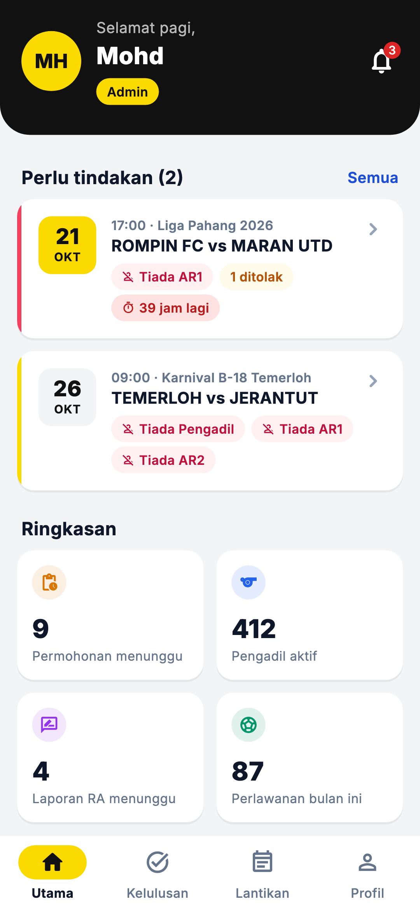

1. Utama: semak ringkasan dan perkara yang memerlukan tindakan.
2. Kelulusan: pilih jenis permohonan, buka butiran, kemudian semak tindakan Lulus / Tolak yang disediakan.
3. Lantikan: pilih kejohanan, jadual dan perlawanan untuk mengurus slot serta status pegawai.
4. Profil: semak akaun, Telegram, notifikasi dan menu Lagi / Website.
5. Gunakan portal web untuk pengurusan lanjutan seperti pengguna, pengadil luar, import pukal, peti emel, tetapan dan analitik.

## Pengguna dan pegawai: Tambah akaun Admin, PP dan pengguna
Halaman PDF 16

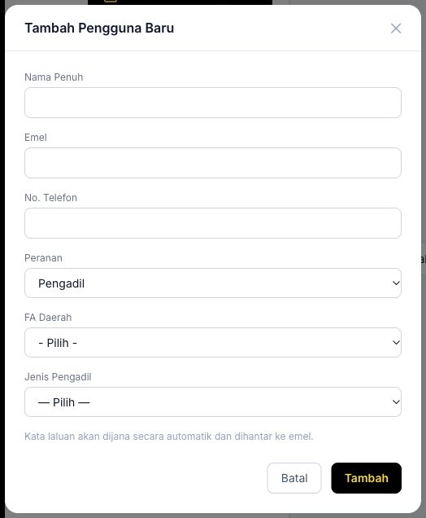

1. Buka Pengadil & Pegawai > Pengguna, kemudian tekan Tambah Pengguna.
2. Isi Nama Penuh, Emel dan No. Telefon. Pilih Peranan; jangan menganggap Jenis Pengadil menentukan kuasa panel.
3. Pilih FA Daerah bagi peranan yang memerlukannya dan pilih Jenis Pengadil yang sepadan dengan rekod sebenar.
4. Tekan Tambah. Sistem menjana kata laluan dan menghantar maklumat pendaftaran mengikut saluran yang tersedia.
5. Semak pengguna muncul pada senarai. Minta pengguna menukar kata laluan dan melengkapkan profil sendiri.

> Akaun awam Pengadil/Penilai juga boleh didaftarkan melalui /daftar. Penciptaan akaun bukan kelulusan permohonan tahunan.

## Pengguna dan pegawai: Cari, tapis dan kemas kini pengguna
Halaman PDF 17

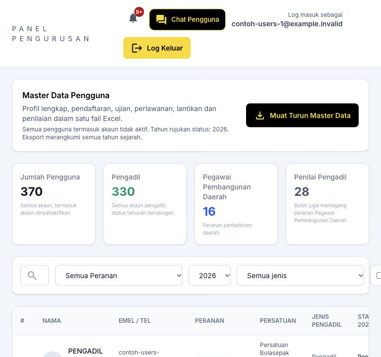

1. Buka Pengguna. Gunakan carian nama/emel, penapis peranan, jenis/status pendaftaran dan tahun.
2. Semak status tahunan pada tahun dipilih. Pengadil Tidak Aktif dalam penapis pendaftaran bukan semestinya akaun yang disekat log masuk.
3. Tekan Edit Profil untuk membuka profil penuh. Betulkan medan yang berkenaan dan tekan Simpan.
4. Jika menukar emel atau peranan, semak penerima dan akses selepas simpan. Pengguna mungkin perlu log masuk semula atau menggunakan emel baharu.
5. Tekan Muat Turun Master Data apabila memerlukan fail Excel lengkap. Penapis tahun menentukan rujukan status tahunan; eksport master merangkumi sejarah.

> Fail master mengandungi maklumat peribadi. Simpan dalam lokasi terkawal dan kongsi hanya untuk urusan yang dibenarkan.

## Pengguna dan pegawai: Reset kata laluan dan hantar emel semula
Halaman PDF 18

1. Cari pengguna melalui emel atau nama dan semak identitinya sebelum tindakan.
2. Tekan Reset Kata Laluan. Baca dialog pengesahan dan sahkan hanya untuk akaun yang betul.
3. Semak mesej hasil. Maklumkan pengguna supaya menyemak emel dan menukar kata laluan selepas boleh log masuk.
4. Untuk mengulang emel pendaftaran, tekan Hantar Semula Emel pada pengguna berkenaan dan sahkan dialog.
5. Jika emel masih gagal, semak alamat dan saluran penghantaran; tidak perlu mewujudkan akaun pendua.

> Jangan gunakan reset kata laluan untuk memintas akaun tidak aktif. Pengaktifan akses ialah tindakan berasingan.

## Pengguna dan pegawai: Senarai pengadil dan penilai berdaftar
Halaman PDF 19

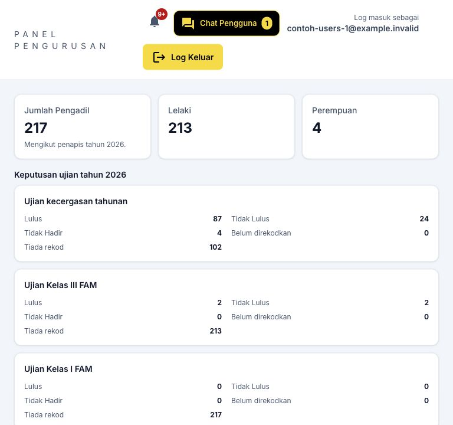

1. Buka Pengadil & Pegawai > Pengadil Berdaftar atau Penilai Pengadil Berdaftar.
2. Pilih tahun pendaftaran/ujian dan penapis yang berkaitan. Semak persatuan, jenis pengadil, keputusan ujian dan status tahun tersebut.
3. Buka profil pegawai untuk menyemak permohonan, rekod perlawanan dan maklumat kelayakan yang disediakan.
4. Gunakan Excel / Cetak bagi senarai yang diperlukan. Semak tahun dan penapis pada hasil eksport sebelum mengedarkan.
5. Jika butiran profil perlu dibetulkan, gunakan tindakan kemas kini yang disediakan atau menu Pengguna.

> RA berdaftar dan Pengadil berdaftar ialah senarai berbeza. Kehadiran seminar, lulus kecergasan dan kelulusan pendaftaran perlu dibaca berasingan.

## Pengguna dan pegawai: Urus Pegawai Pembangunan Daerah
Halaman PDF 20

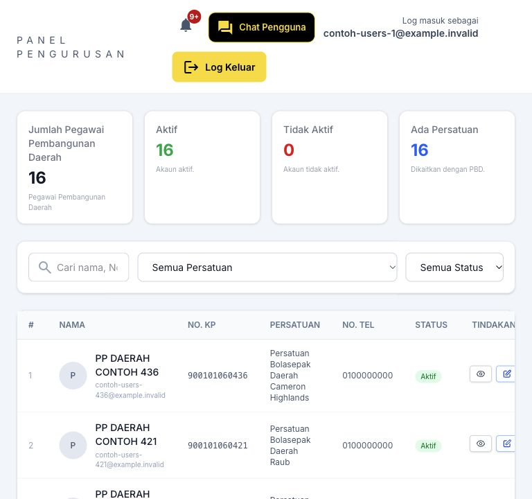

1. Buka Pengadil & Pegawai > Pegawai Pembangunan Daerah.
2. Cari nama atau tapis persatuan/status. Semak daerah pentadbiran sebelum menyunting.
3. Buka butiran untuk melihat profil. Gunakan tindakan edit untuk membetulkan maklumat akaun dan persatuan apabila diperlukan.
4. Semak keupayaan tambahan Pengadil atau RA daripada bukti kelayakan/pendaftaran yang sah; peranan PP sahaja tidak membuktikan kedua-duanya.
5. Minta PP log masuk semula untuk memastikan menu daerah dan tugasan sendiri sepadan.

## Pengguna dan pegawai: Admin yang turut berdaftar sebagai RA
Halaman PDF 21

Rajah menunjukkan borang R1 Penilai yang sama. Pilihan ini muncul untuk Admin dengan Jenis Pengadil Penilai Pengadil.

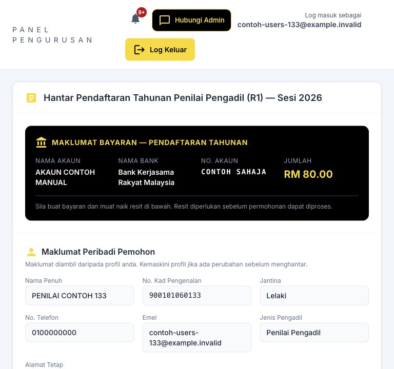

1. Semak menu Pendaftaran Penilai Pengadil Saya (R1) jika ia tersedia pada akaun Admin anda.
2. Buka borang dan semak sesi, profil, waris, dokumen, bayaran dan perakuan seperti pemohon Penilai.
3. Hantar permohonan dan semak sejarah/status melalui borang tersebut. Jangan cipta akaun awam kedua untuk orang yang sama.
4. Bezakan kuasa pentadbiran Admin daripada pendaftaran tahunan sebagai Penilai. Menu bersyarat tidak muncul untuk semua Admin.

> Jika kelayakan atau kategori akaun tidak sepadan dengan rekod rasmi, betulkan melalui pengurusan pengguna berdasarkan bukti yang sah.

## Permohonan dan keputusan: Tetapkan tempoh pendaftaran dan permohonan
Halaman PDF 22

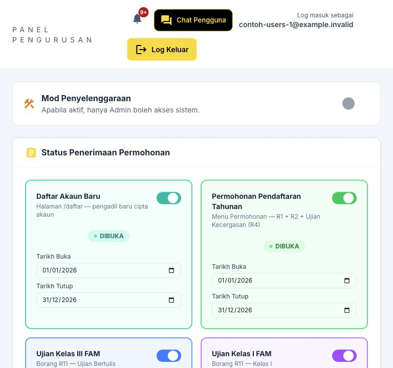

1. Buka Pengurusan Sistem > Tetapan. Cari Status Penerimaan Permohonan.
2. Tetapkan pembukaan Daftar Akaun Baru secara berasingan daripada pendaftaran tahunan, Penilai, Kelas III FAM dan Kelas I FAM.
3. Semak suis buka/tutup serta Tarikh Buka dan Tarikh Tutup setiap jenis. Tetapkan sesi/tahun permohonan yang betul.
4. Simpan tetapan menggunakan butang simpan pada halaman. Semak badge dibuka, belum dibuka atau ditutup.
5. Uji secara baca sahaja halaman pendaftaran / borang berkaitan untuk memastikan tempoh yang dipaparkan sepadan.

> Tarikh dan suis kedua-duanya penting. Perubahan satu jenis borang tidak semestinya membuka jenis borang lain.

## Permohonan dan keputusan: Tetapan bayaran, syarat dan penyelenggaraan
Halaman PDF 23

1. Tatal Tetapan untuk menyemak amaun yuran, maklumat akaun penerima, had umur, syarat Kelas I / III dan nilai kelayakan yang disediakan.
2. Masukkan nilai berdasarkan arahan rasmi semasa, kemudian simpan. Semak paparan borang selepas perubahan.
3. Untuk Mod Penyelenggaraan, semak suis pada bahagian atas. Apabila diaktifkan, akses pengguna bukan Admin dihadkan.
4. Gunakan mod itu hanya ketika kerja penyelenggaraan yang dirancang. Selepas selesai, matikan dan semak pengguna boleh mengakses semula.

> Amaun, akaun bank dan had dalam screenshot ialah keadaan contoh. Pemohon mesti merujuk maklumat pada borang sesi semasa, bukan menyalin nombor daripada manual.

## Permohonan dan keputusan: Semak permohonan mengikut jenis dan tahun
Halaman PDF 24

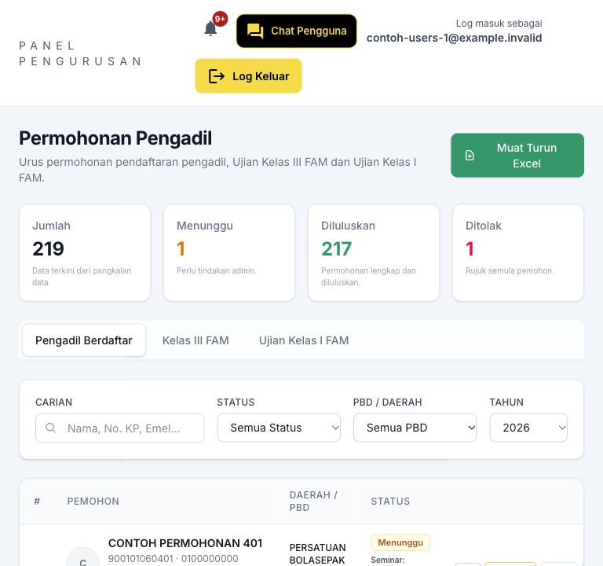

1. Buka Permohonan > Permohonan Pengadil atau Permohonan Penilai. Pilih tab yang betul: Pengadil Berdaftar, Kelas III FAM, Ujian Kelas I FAM atau Penilai.
2. Pilih tahun dan tapis status/persatuan. Cari nama atau nombor KP untuk mengelakkan tersalah pemohon.
3. Tekan Butiran Lanjut. Semak profil, tahun, dokumen/resit, perakuan dan catatan pengesahan PP Daerah.
4. Pastikan permohonan sudah berada pada Menunggu Admin sebelum meluluskan. Permohonan yang masih Menunggu PP Daerah perlu diselesaikan pada peringkat PP.

## Permohonan dan keputusan: Luluskan atau tolak permohonan
Halaman PDF 25

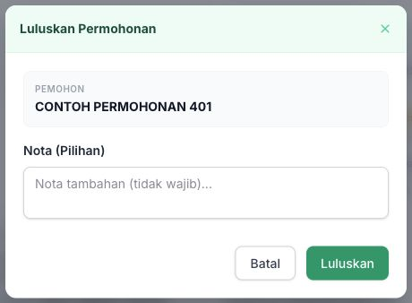

1. Pada permohonan yang betul, tekan Ubah Status dan pilih Lulus. Semak nama pada dialog.
2. Isi nota jika perlu dan tekan Luluskan. Semak mesej berjaya serta status selepas senarai dimuatkan semula.
3. Jika tidak memenuhi syarat, pilih Tolak, masukkan sebab yang jelas dan lengkapkan pengesahan.
4. Jika mesej menyatakan rekod telah diproses atau tidak ditemui, muat semula dan semak status terkini sebelum mengulang.

> Mulai sesi 2027 bagi pendaftaran Pengadil, kelulusan dokumen boleh menjadi Admin Diluluskan sementara menunggu kecergasan. Ini tetap pendaftaran diluluskan; kelayakan patch/lesen memerlukan keputusan kecergasan.

## Permohonan dan keputusan: Rekod seminar dan ujian kecergasan
Halaman PDF 26

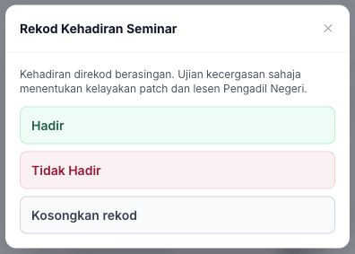

1. Pilih sesi dan permohonan Pengadil yang betul. Tekan Seminar untuk merekod Hadir, Tidak Hadir atau mengosongkan rekod jika pembetulan diperlukan.
2. Gunakan Ujian pada permohonan yang dibenarkan untuk merekod Lulus, Tidak Lulus atau Tidak Hadir.
3. Jika butang Ujian belum dibenarkan, semak kelulusan dokumen/status semasa dahulu. Jangan mengubah keputusan kategori borang lain.
4. Semak senarai berdaftar dan kelayakan patch/lesen selepas kemas kini. Rekod seminar tidak menggantikan lulus kecergasan.

> Data sesi lama boleh mempunyai rekod kecergasan berasingan; sesi 2027 dan seterusnya menggunakan keputusan pada pendaftaran tahunan. Semak tahun sebelum membetulkan.

## Permohonan dan keputusan: Keputusan Kelas III dan Kelas I FAM
Halaman PDF 27

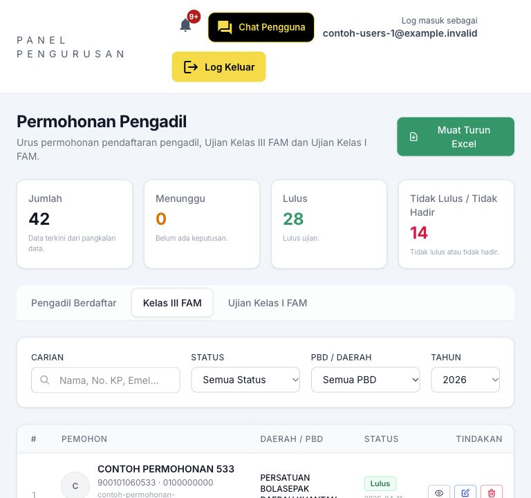

1. Pada Permohonan Pengadil, pilih Kelas III FAM atau Ujian Kelas I FAM dan tahun berkenaan.
2. Semak butiran pemohon, kelayakan, resit dan aliran pengesahan sebelum memproses.
3. Gunakan tindakan status/ujian yang disediakan untuk merekod keputusan atau Tidak Hadir berdasarkan keputusan rasmi.
4. Semak semula status dan rekod kelayakan tahun selepas tindakan. Bezakan keputusan peperiksaan daripada pendaftaran tahunan.

> Halaman tambahan /admin/ujian memaparkan kumpulan ujian lama. Untuk kerja biasa, gunakan tab jenis permohonan dan tahun supaya rekod berkaitan tidak tersalah diproses.

## Permohonan dan keputusan: Padam permohonan dan semak laporan ringkasan
Halaman PDF 28

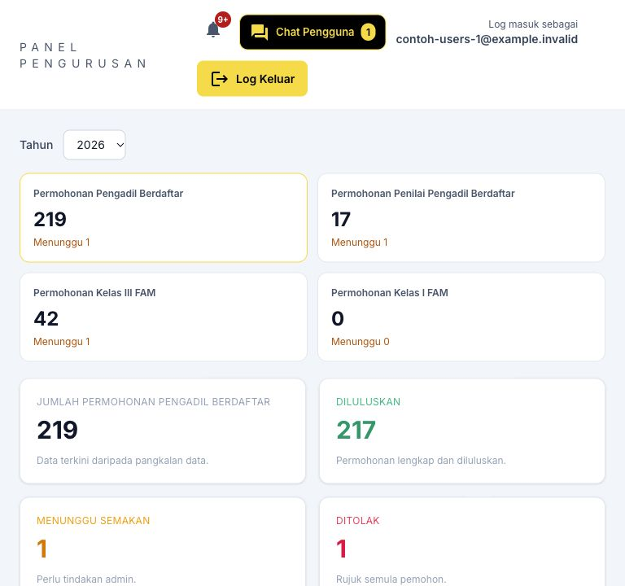

1. Jika rekod permohonan benar-benar perlu dibuang, cari permohonan tepat melalui jenis, tahun, nama dan nombor rujukan.
2. Tekan Padam, baca amaran dan sahkan hanya selepas semakan. Jangan gunakan pemadaman untuk menggantikan keputusan Tolak.
3. Semak senarai selepas tindakan. Sejarah perlawanan pengguna perlu kekal walaupun pautan permohonan tidak lagi tersedia.
4. Untuk ringkasan kategori, gunakan Statistik atau halaman tambahan /admin/laporan. Pilih tahun dan kategori sebelum membaca jumlah / mengeksport.

> Pemadaman mengubah rekod permohonan. Tindakan ini berbeza daripada menyekat akses akaun pengguna.

## Pengadil luar: Pengadil luar: maksud dan skop
Halaman PDF 29

Pengadil Luar menyimpan pegawai yang tidak didaftarkan sebagai pengguna portal bagi tujuan pool dan lantikan, termasuk pegawai jemputan.

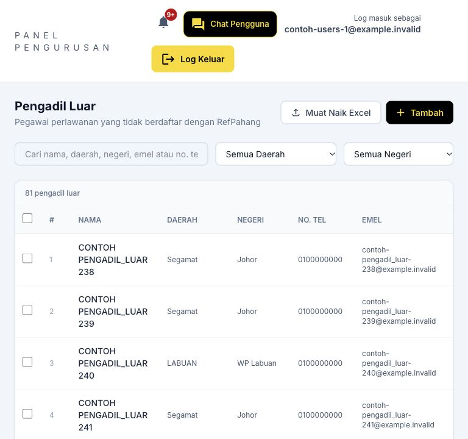

1. Buka Lantikan & Perlawanan > Pengadil Luar. Cari nama, daerah, negeri, emel atau nombor telefon.
2. Semak sama ada pegawai sebenarnya sudah mempunyai akaun pengguna RefPahang. Gunakan pegawai berdaftar dalam pool apabila identiti itu sudah wujud.
3. Rekod pengadil luar bukan akaun log masuk Admin/PP/RA/Pengadil. Pautan lantikan, Telegram dan laporan peribadi digunakan mengikut tugas yang diberikan.
4. Tapis daerah/negeri untuk menyemak senarai sebelum menambah, mengimport atau membetulkan maklumat.

## Pengadil luar: Tambah, edit dan padam pengadil luar
Halaman PDF 30

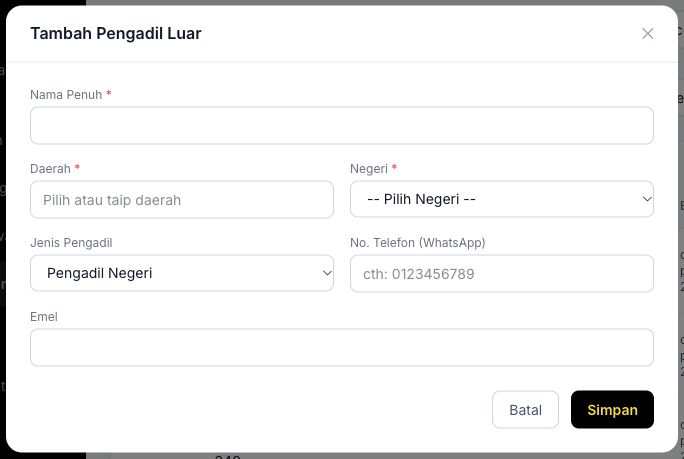

1. Pada Pengadil Luar, tekan Tambah. Isi Nama Penuh, Daerah dan Negeri yang diwajibkan.
2. Pilih Jenis Pengadil dan isi nombor telefon serta emel yang sah. Semak saluran hubungan sebelum tekan Simpan.
3. Untuk pembetulan, tekan Edit pada baris pegawai, kemas kini medan dan simpan.
4. Untuk Padam atau Padam Pukal, semak pegawai terpilih dan baca dialog. Pegawai turut dikeluarkan daripada pool yang berkaitan.

> Padam pengadil luar ialah tindakan berbeza daripada Tidak Aktif pada akaun pengguna. Jangan memadam pegawai untuk membatalkan satu lantikan sahaja.

## Pengadil luar: Import Excel pengadil luar
Halaman PDF 31

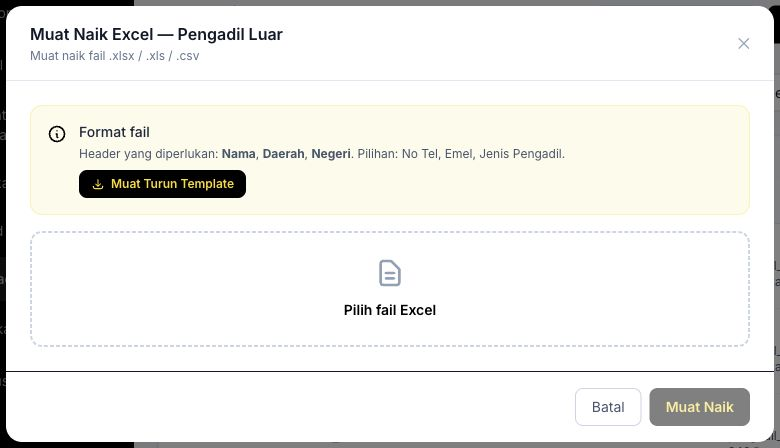

1. Tekan Muat Naik Excel dan Muat Turun Template. Gunakan lajur Nama, Daerah dan Negeri; lajur telefon, emel serta jenis pengadil membantu pemadanan.
2. Isi helaian pertama, semak ejaan negeri, nombor telefon dan emel. Pilih fail dalam dialog upload.
3. Semak pratonton sebelum tekan Muat Naik. Betulkan fail jika header wajib atau baris data tidak sah.
4. Baca keputusan inserted / skipped, senarai ralat dan padanan pengguna berdaftar. Sistem boleh memadankan telefon, emel atau nama dan mengelakkan rekod luar pendua.
5. Semak semula senarai selepas import. Betulkan hanya baris gagal; jangan menganggap semua baris dimasukkan hanya kerana fail berjaya dibaca.

> Gunakan template yang dimuat turun daripada versi semasa. Semakan pratonton di pelayar dan keputusan penerimaan pelayan ialah dua peringkat berbeza.

## Kejohanan, pool dan jadual: Cipta dan kemas kini kejohanan
Halaman PDF 32

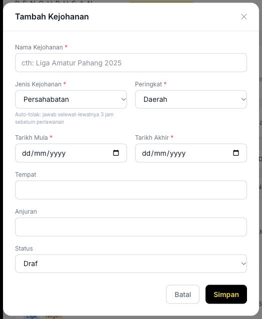

1. Buka Lantikan & Perlawanan > Lantikan Pengadil, tab 1 Kejohanan dan tekan Tambah.
2. Isi Nama Kejohanan, Jenis Kejohanan, Peringkat, tarikh mula/akhir, tempat, anjuran dan status.
3. Semak jenis Liga atau bukan Liga kerana ia mempengaruhi tarikh akhir jawapan lantikan. Simpan dan pilih kejohanan daripada senarai.
4. Gunakan Edit untuk pembetulan dan kawalan logo jika diperlukan. Semak pemilik lantikan Admin atau PP Daerah sebelum mengurus rekod.
5. Padam Kejohanan hanya selepas membaca amaran bahawa jadual dan lantikan berkaitan boleh terkesan.

## Kejohanan, pool dan jadual: Tambah pegawai ke pool kejohanan
Halaman PDF 33

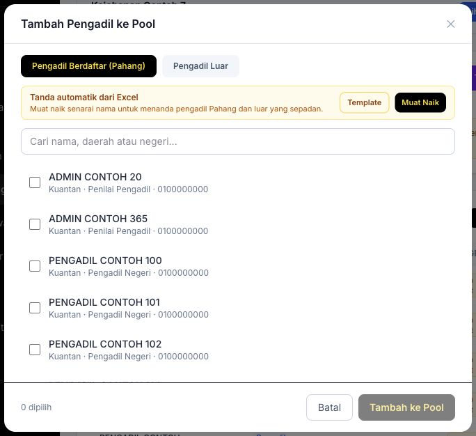

1. Pilih kejohanan, kembali ke tab 1 Kejohanan dan cari Pool Pengadil Kejohanan.
2. Tekan Tambah ke Pool. Pilih tab Pengadil Berdaftar (Pahang) atau Pengadil Luar.
3. Cari pegawai, tandakan pilihan yang betul dan tekan Tambah ke Pool. Semak nama, jenis, daerah/negeri serta saluran hubungan selepas ditambah.
4. Jika menggunakan padanan Excel, muat turun template, isi Nama atau No IC serta butiran sokongan, kemudian semak padanan sebelum memilih.
5. Buang daripada pool hanya jika pegawai tidak lagi perlu tersedia untuk kejohanan; semak lantikan sedia ada terlebih dahulu.

> Pool ialah senarai calon, bukan lantikan. Pegawai hanya mendapat tugas apabila dimasukkan ke slot perlawanan.

## Kejohanan, pool dan jadual: Pautan Telegram untuk pengadil luar dalam pool
Halaman PDF 34

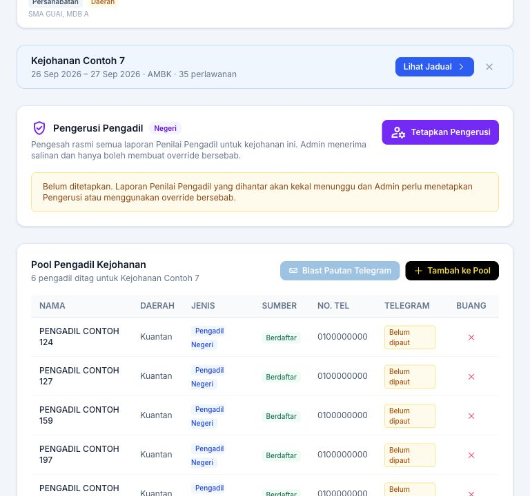

1. Pastikan pengadil luar dimasukkan ke pool dan mempunyai butiran emel yang sesuai untuk penghantaran pautan.
2. Pada Pool Pengadil Kejohanan, tekan Blast Pautan Telegram. Butang boleh tidak aktif jika pool tiada pengadil luar.
3. Semak ringkasan penerima, status sudah/belum dipaut dan pilihan penghantaran awal atau percubaan semula yang disediakan.
4. Sahkan penghantaran hanya selepas memeriksa sasaran. Pengadil luar perlu membuka pautan peribadi dan menekan Start pada bot.
5. Pantau hasil penghantaran serta status pemautan. Kegagalan emel, bot disekat atau akaun Telegram tidak aktif memerlukan pembetulan saluran.

> Blast pautan Telegram ialah bantuan pemautan, bukan notifikasi lantikan perlawanan. Jangan menghantar berulang tanpa menyemak keputusan percubaan sebelumnya.

## Kejohanan, pool dan jadual: Tetapkan Pengerusi Pengadil
Halaman PDF 35

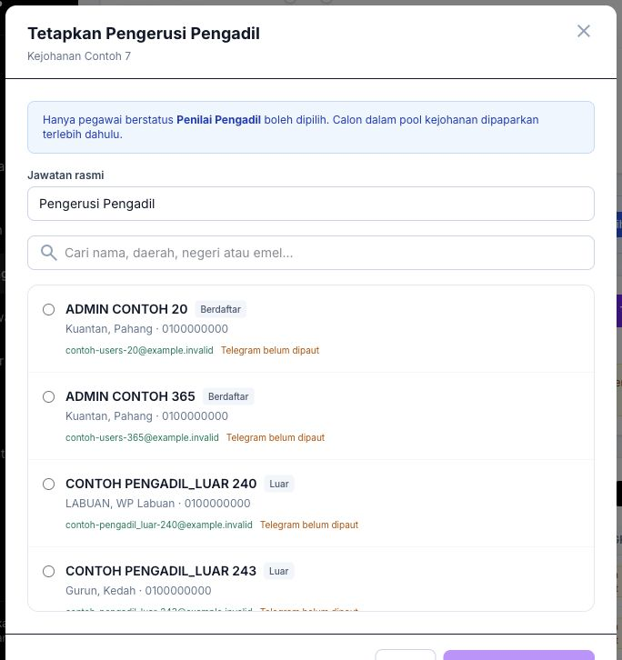

1. Pilih kejohanan dan buka tab 1 Kejohanan. Pada Pengerusi Pengadil, tekan Tetapkan Pengerusi.
2. Cari calon daripada pegawai berdaftar atau pengadil luar yang dibenarkan; pilih calon yang tepat.
3. Semak nama, jawatan dan butiran hubungan, kemudian lengkapkan pengesahan.
4. Jika menukar Pengerusi, baca amaran tentang pautan laporan yang masih menunggu. Semak nama Pengerusi pada kejohanan selepas simpan.

> Tetapan Pengerusi menentukan penerima pengesahan laporan RA. Jika belum ditetapkan, laporan boleh menunggu tindakan pentadbir sebelum penghantaran pengesahan.

## Kejohanan, pool dan jadual: Tambah dan edit jadual perlawanan
Halaman PDF 36

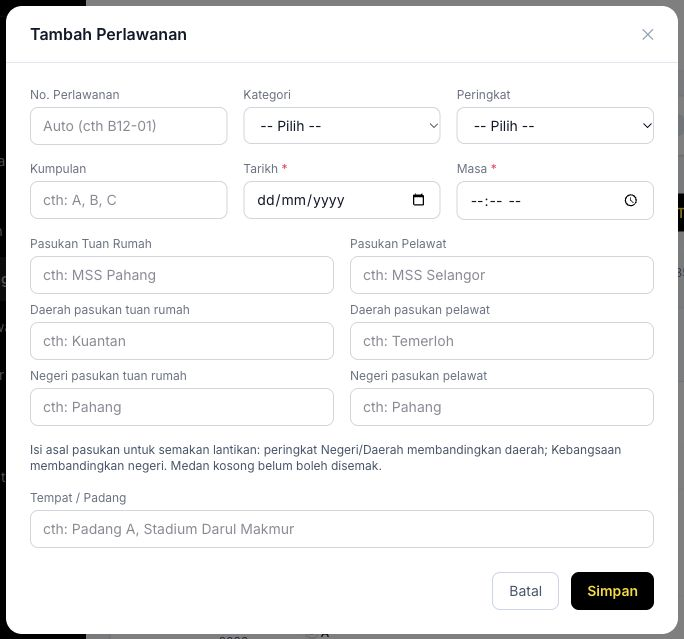

1. Pada kejohanan yang dipilih, buka tab 2 Jadual Perlawanan dan tekan Tambah Perlawanan.
2. Isi tarikh, masa, pasukan tuan rumah/pelawat, tempat, kategori, peringkat dan kumpulan jika berkenaan.
3. Isi daerah serta negeri pasukan apabila diperlukan untuk semakan pertindihan kawasan. Semak nombor perlawanan atau pilihan nombor automatik.
4. Tekan Simpan. Gunakan Edit pada baris untuk pembetulan dan semak semula tarikh, masa dan tempat sebelum melantik pegawai.

> Menukar jadual tidak bermaksud semua pegawai sudah membaca perubahan. Gunakan proses notifikasi dan semak status selepas perubahan penting.

## Kejohanan, pool dan jadual: Muat naik jadual melalui Excel
Halaman PDF 37

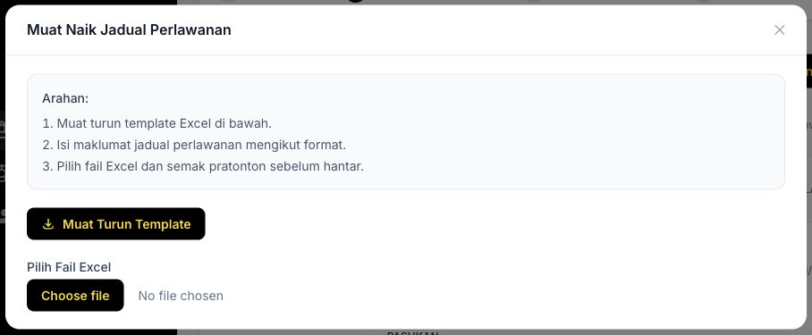

1. Pada tab Jadual Perlawanan, tekan Muat Naik Excel dan muat turun Template.
2. Isi No Perlawanan, Tarikh, Masa, Kategori, Peringkat, Kumpulan, Pasukan Home/Away, Padang serta Daerah/Negeri jika digunakan.
3. Pilih fail. Semak pratonton dan baris ralat, khususnya format tarikh, masa, pasukan dan kategori.
4. Hantar selepas betul dan baca keputusan import. Semak jumlah serta susunan jadual selepas dimuat naik.
5. Jika fungsi Nombor Semula disediakan, semak amaran kerana nombor perlawanan sedia ada boleh berubah.

> Tarikh dan Masa ialah header wajib pada pembaca semasa. Gunakan template portal; jangan menukar format lajur secara rawak.

## Lantikan dan penghantaran: Lantik KUP dan RA bagi perlawanan
Halaman PDF 38

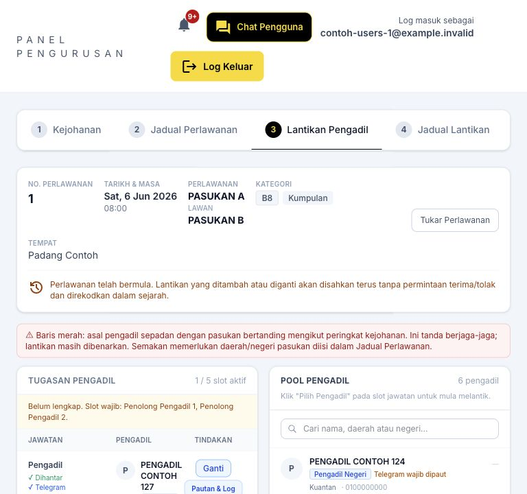

1. Buka tab 3 Lantikan Pengadil dan tekan Lantik pada perlawanan, atau Lantik Pengadil pada baris jadual.
2. Semak identiti perlawanan. Pilih pegawai daripada pool untuk R, AR1 dan AR2; tambah Pegawai ke4 dan Penilai Pengadil jika diperlukan.
3. Gunakan carian, daerah/negeri dan jumlah tugasan untuk menyemak calon. Semak amaran pertindihan sebelum mengesahkan.
4. Sahkan setiap slot dan pastikan nama serta status dipaparkan. Jangan gunakan RA untuk menggantikan salah satu tiga jawatan KUP wajib.
5. Lantikan disimpan belum bermaksud notifikasi sudah dihantar. Teruskan ke proses penghantaran dan audit.

## Lantikan dan penghantaran: Hantar notifikasi dan semak jawapan
Halaman PDF 39

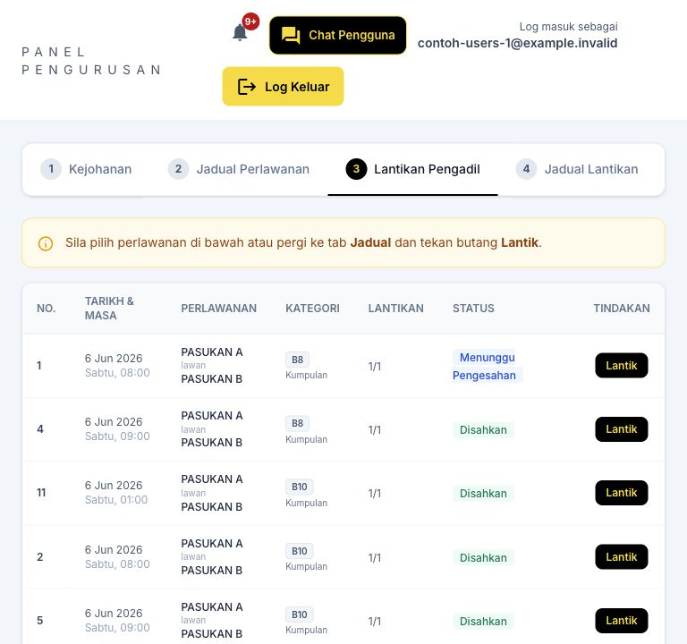

1. Semak semua slot, alamat emel/Telegram, tarikh dan masa perlawanan sebelum menekan Hantar Notifikasi.
2. Gunakan penghantaran per perlawanan atau pilihan pukal bagi perlawanan yang dipilih. Baca dialog sasaran sebelum mengesahkan.
3. Semak hasil penghantaran dan status Belum Jawab, Diterima atau Ditolak. Memilih pegawai sahaja tidak membuktikan mereka sudah dimaklumkan.
4. Jika Ditolak, gunakan Ganti untuk memilih pegawai pengganti, semak semula butiran dan hantar notifikasi yang berkaitan.
5. Untuk kegagalan saluran, buka Pautan & Log, betulkan hubungan atau gunakan pautan peribadi mengikut tatacara audit.

> Notifikasi boleh dihantar melalui emel, Telegram dan saluran portal/aplikasi yang tersedia. Status penghantaran bukan bukti pegawai telah membaca atau menerima tugas.

## Lantikan dan penghantaran: Pautan peribadi, log dan penghantaran manual
Halaman PDF 40

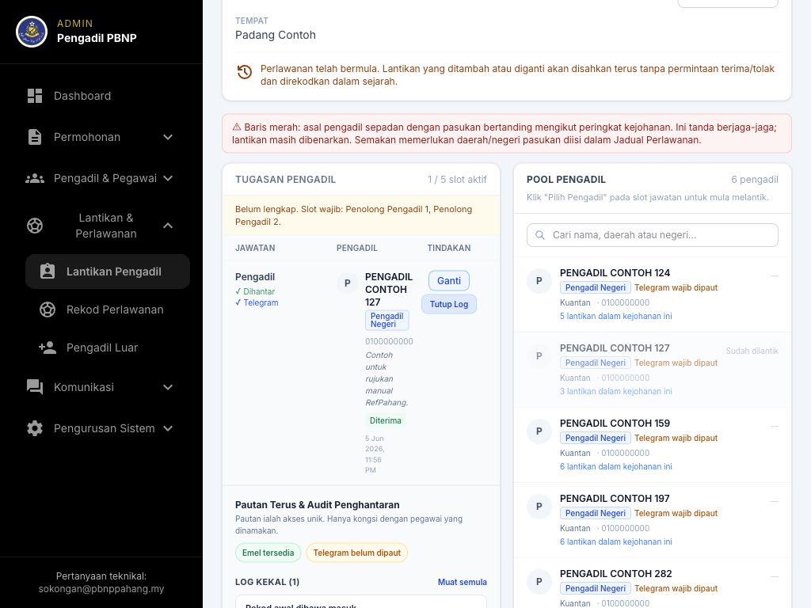

1. Pada pegawai yang dilantik, buka Pautan & Log dan semak sejarah percubaan, saluran dan status jawapan.
2. Jika perlu menghantar melalui saluran lain, gunakan pautan yang disediakan untuk pegawai/perlawanan tersebut.
3. Selepas benar-benar menghantar pautan, rekod penghantaran manual mengikut butang yang disediakan. Menyalin pautan sahaja tidak sama dengan menghantar.
4. Baca kesan pengesahan penghantaran pertama terhadap tarikh akhir jawapan. Simpan catatan yang boleh diaudit.
5. Override penerimaan atau tindakan khas memerlukan justifikasi yang jelas. Semak sejarah selepas tindakan.

> Pautan lantikan/laporan ialah akses peribadi. Jangan tampal dalam kumpulan awam atau menggunakan pautan milik pegawai lain.

## Lantikan dan penghantaran: Batal, tangguh atau buang lantikan
Halaman PDF 41

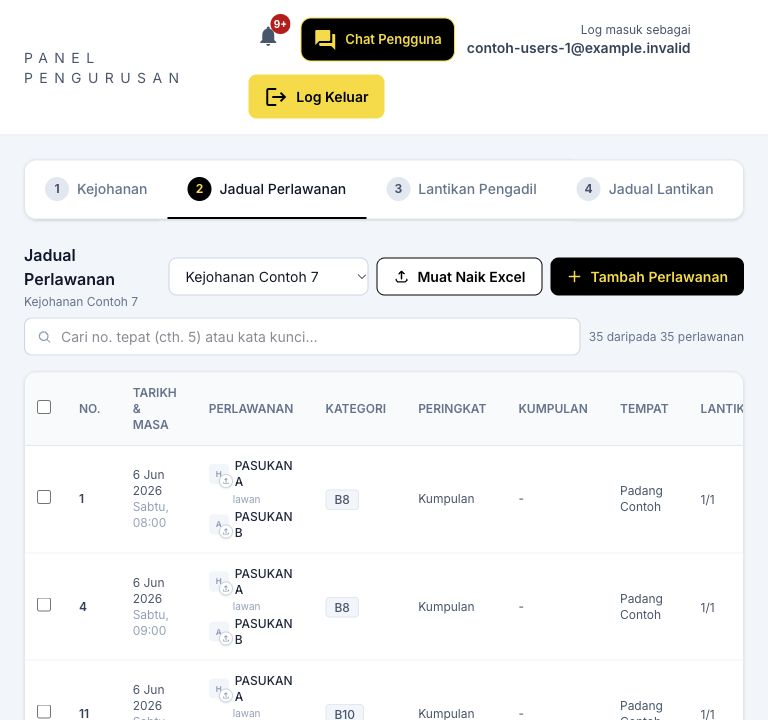

1. Cari perlawanan dan semak semua pegawai serta status sebelum membuka pilihan Status Perlawanan.
2. Pilih Dibatalkan atau Ditangguhkan, isi sebab dan sahkan untuk satu perlawanan atau pilihan pukal yang betul.
3. Semak status jadual dan lantikan selepas tindakan serta maklumkan pegawai melalui saluran yang disediakan.
4. Buang satu lantikan hanya untuk pembetulan slot yang tepat. Untuk penggantian ditolak, gunakan aliran Ganti.
5. Jika mahu memadam jadual, buang semua lantikannya dahulu. Perlawanan yang masih mempunyai lantikan atau laporan tidak boleh dipadam; rekod audit lantikan kekal sebagai sejarah.

## Lantikan dan penghantaran: Jadual lantikan dan pengesahan dokumen
Halaman PDF 42

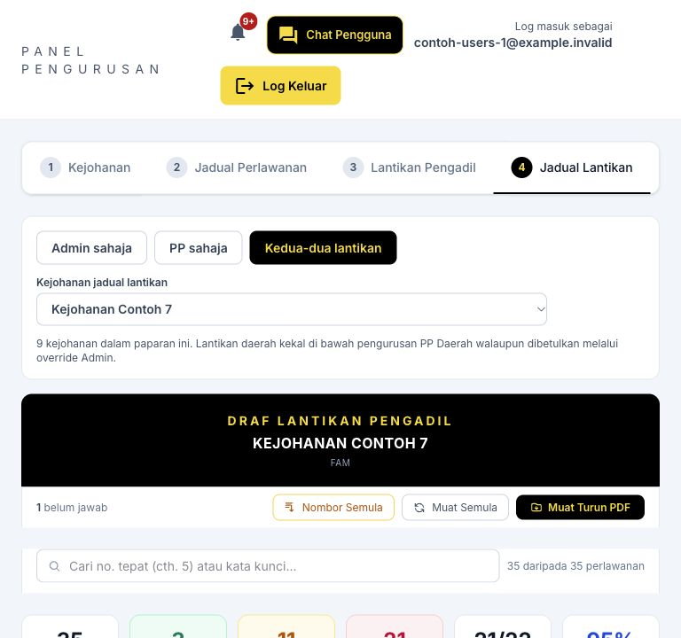

1. Buka tab 4 Jadual Lantikan. Pilih kejohanan dan penapis Admin sahaja, PP sahaja atau Kedua-dua lantikan.
2. Semak nama pegawai, jawatan, tarikh, masa dan nombor perlawanan dalam draf dokumen.
3. Isi nama/jawatan pengesah pada bahagian Pengesahan Dokumen dan sahkan apabila maklumat lengkap.
4. Gunakan Muat Turun PDF untuk dokumen. Jika pembetulan memerlukan Batal Pengesahan, semak amaran dan sahkan semula selepas membetulkan.
5. Cetak / edarkan hanya versi terkini selepas memastikan status perlawanan dan lantikan masih sah.

## Rekod dan laporan: Semak laporan RA dan pengesahan Pengerusi
Halaman PDF 43

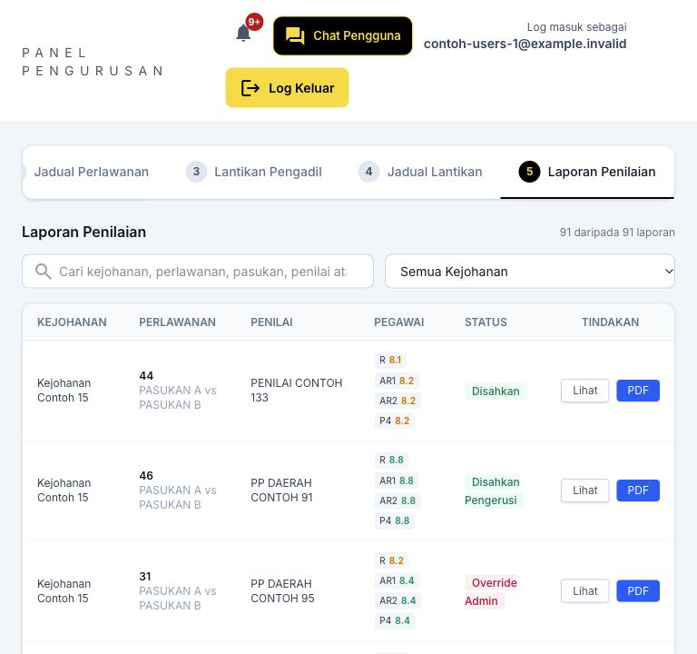

1. Buka tab 5 Laporan Penilaian pada Lantikan Pengadil. Cari kejohanan, perlawanan, penilai atau status.
2. Tekan Lihat untuk membaca laporan setiap pegawai, markah, kekuatan, kelemahan dan nasihat. Semak kelengkapan KUP.
3. Bezakan Draf, Dihantar dan Disahkan. Hantar oleh RA menghantar proses kepada Pengerusi, dengan salinan kepada Admin.
4. Jika pengesahan menunggu, semak Pengerusi kejohanan, log penghantaran, salin pautan atau cuba semula notifikasi Pengerusi mengikut keperluan.
5. Override Admin untuk mengesahkan memerlukan alasan. Semak rekod audit serta gunakan PDF bagi laporan yang betul.

> Admin menerima salinan tidak bermaksud Pengerusi sudah mengesahkan. Semak status pengesahan dan tarikh pada laporan.

## Rekod dan laporan: Pantau dan betulkan rekod perlawanan
Halaman PDF 44

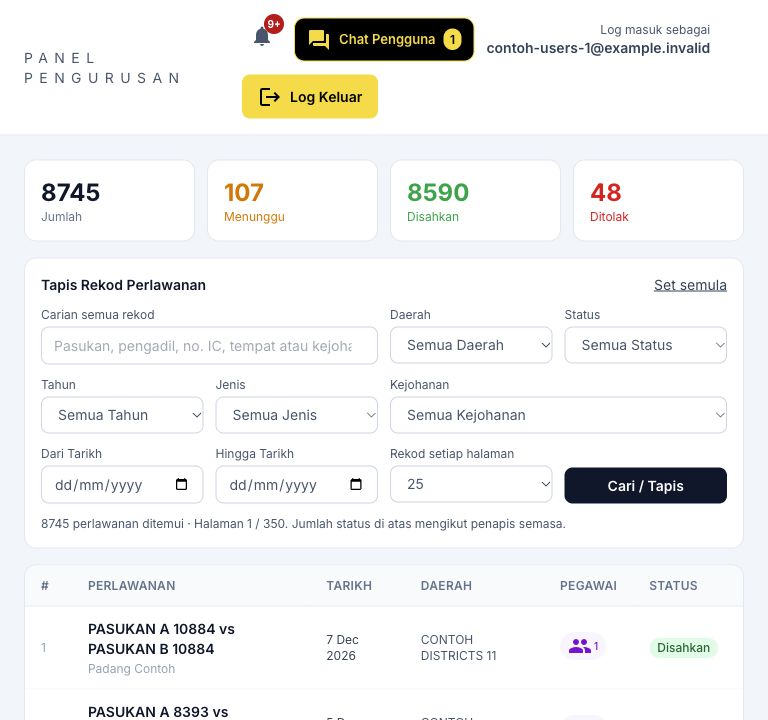

1. Buka Lantikan & Perlawanan > Rekod Perlawanan. Tapis tahun, status, daerah dan carian pasukan/pengadil/kejohanan.
2. Buka butiran rekod untuk menyemak anggota kumpulan, tarikh, tempat, lantikan dan status pengesahan PP.
3. Untuk override pengesahan, isi alasan yang boleh diaudit dan gunakan tindakan yang dibenarkan.
4. Padam hanya apabila rekod tersalah dimasukkan dan telah disemak. Baca amaran serta isi justifikasi pemadaman.
5. Semak senarai dan statistik selepas tindakan; satu perlawanan boleh mempunyai beberapa rekod pegawai.

> Jangan menyamakan jumlah rekod pegawai dengan jumlah perlawanan unik, khususnya rekod lama yang belum dipadankan.

## Komunikasi: Pengumuman kepada pengguna
Halaman PDF 45

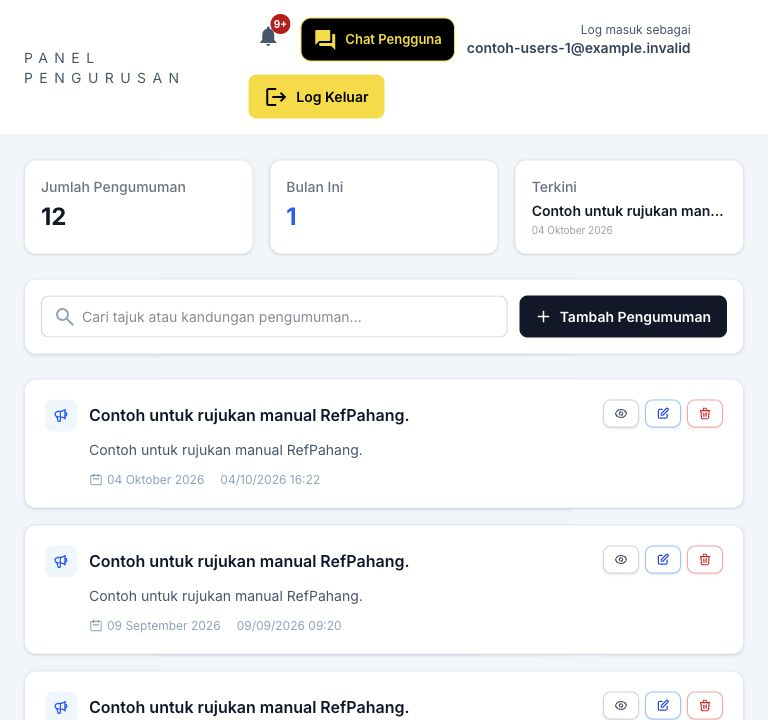

1. Buka Komunikasi > Pengumuman dan tekan Tambah Pengumuman.
2. Isi tajuk dan kandungan yang tepat. Semak pilihan paparan/keaktifan sebelum menyimpan.
3. Gunakan Edit untuk pembetulan. Semak sama ada pengumuman muncul pada senarai dan paparan pengguna.
4. Jika saluran penghantaran/Telegram disediakan, semak sasaran dan hasil. Paparan di dashboard tidak membuktikan semua penerima membaca.
5. Padam pengumuman hanya selepas semakan dan pengesahan. Gunakan pembetulan yang jelas jika maklumat lama perlu diganti.

## Komunikasi: Baca dan balas Chat Pengguna
Halaman PDF 46

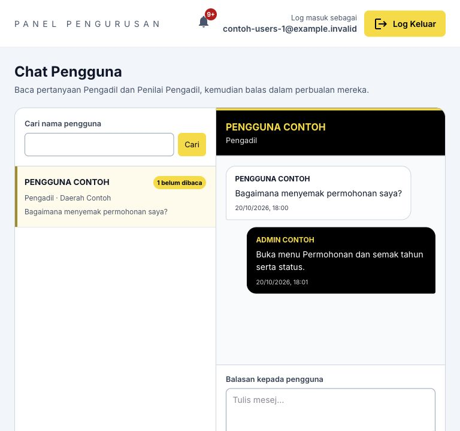

1. Buka Komunikasi > Chat Pengguna. Cari nama dan pilih perbualan pada senarai.
2. Baca konteks mesej; muatkan mesej lama jika diperlukan. Semak nama dan peranan pada panel perbualan.
3. Taip jawapan dan tekan butang hantar. Pastikan mesej berjaya muncul sebelum menghantar semula.
4. Jika sambungan terganggu, gunakan Muat semula. Simpan konteks kes tanpa meminta kata laluan atau pautan peribadi pengguna.
5. Gunakan emel/sokongan formal jika memerlukan lampiran atau tindakan di luar keupayaan chat.

> Chat ialah komunikasi sokongan; ia tidak menggantikan tindakan kelulusan, pengesahan atau perubahan rekod pada modul berkaitan.

## Komunikasi: Baca, segerak dan balas peti emel
Halaman PDF 47

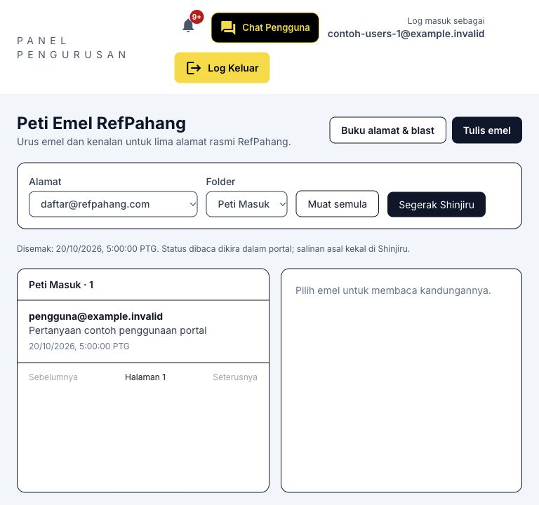

1. Buka Komunikasi > Peti Emel. Pilih alamat rasmi yang betul dan Folder Peti Masuk atau Dihantar.
2. Tekan Muat semula untuk bacaan terkini. Jika tersedia, gunakan Segerak Shinjiru dan semak status penyegerakan.
3. Pilih mesej untuk membaca penghantar, penerima, tajuk, kandungan dan senarai lampiran yang disediakan.
4. Untuk membalas, gunakan tindakan balas yang dipaparkan dan semak semula alamat penerima serta tajuk.
5. Semak folder Dihantar dan status penghantaran. Status dibaca pada portal tidak semestinya mengubah salinan asal di pelayan emel.

## Komunikasi: Tulis emel dan urus kenalan manual
Halaman PDF 48

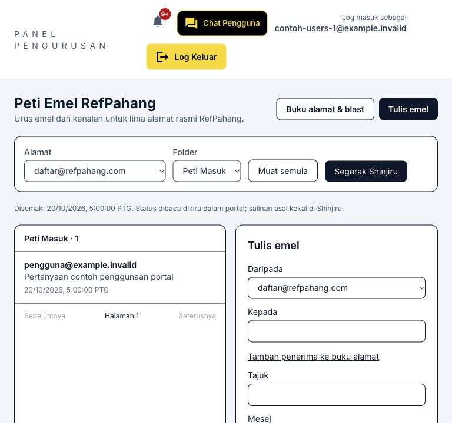

1. Pada Peti Emel, tekan Tulis emel. Pilih Daripada, isi Kepada, Tajuk dan Mesej.
2. Semak penerima dan kandungan sebelum menghantar. Gunakan alamat rasmi yang sesuai dengan urusan.
3. Untuk menyimpan penerima, gunakan Tambah penerima ke buku alamat atau buka Buku alamat & blast > Kenalan manual.
4. Isi Nama dan Alamat emel, tekan Simpan kenalan. Cari kenalan dan gunakan Tulis emel, Sunting atau pengesahan Padam apabila perlu.
5. Selepas hantar, baca hasil penghantaran dan folder Dihantar. Jangan ulang terus jika hasil belum pasti.

> Simpan kenalan tidak menghantar emel. Satu tindakan hantar ialah urusan berasingan dan perlu semakan penerima.

## Komunikasi: Blast emel: pilih, pratonton dan sahkan
Halaman PDF 49

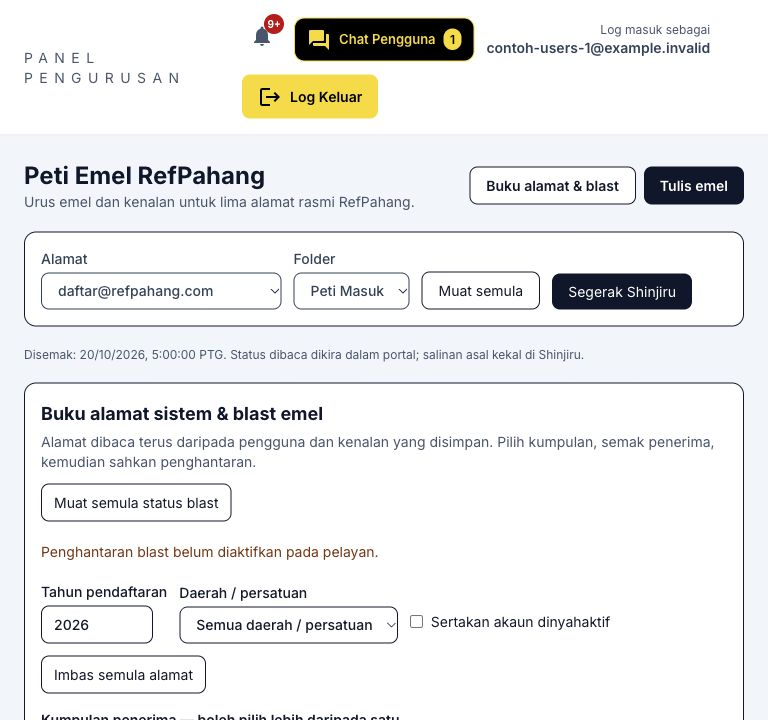

1. Buka Buku alamat & blast. Pilih tahun, kumpulan peranan/pendaftaran, daerah dan pilihan akaun tidak aktif jika diperlukan.
2. Semak senarai penerima unik. Cari atau nyahpilih penerima yang tidak berkaitan sebelum meneruskan.
3. Isi alamat penghantar, tajuk dan kandungan. Tekan Pratonton untuk menyemak set penerima dan kandungan.
4. Baca ringkasan akhir, kemudian sahkan penghantaran. Jika perlu ubah, batalkan pratonton dan bina semula pilihan.
5. Pantau job/kempen: menunggu, berjaya, gagal atau dibatalkan. Gunakan cubaan semula hanya untuk kegagalan yang telah disemak.

> Membatalkan kempen menghentikan penerima yang belum dihantar; ia tidak menarik balik emel yang telah dihantar.

## Komunikasi: Blast pautan Telegram pengguna berdaftar
Halaman PDF 50

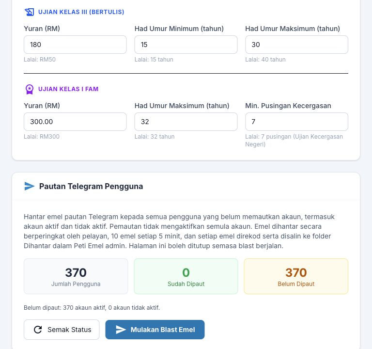

1. Buka Tetapan dan tatal ke Pautan Telegram Pengguna. Semak jumlah sudah/belum dipaut serta akaun aktif/tidak aktif.
2. Tekan Mulakan Blast Emel dan baca ringkasan penerima sebelum mengesahkan. Ini menghantar pautan pemautan melalui emel, bukan mesej Telegram terus.
3. Pantau kemajuan Menunggu, Dihantar, Gagal, Belum Pasti, Dilangkau atau Dibatalkan. Halaman boleh ditutup ketika kerja beratur berjalan.
4. Jika perlu, gunakan Batalkan Blast untuk penerima yang belum dihantar. Semak kegagalan sebelum Hantar Semula Gagal / Belum Pasti.
5. Semak log dan salinan dalam folder Dihantar Peti Emel Admin. Pengguna masih perlu menekan Start pada bot.

> Kadar yang dipaparkan: 10 emel setiap 5 minit. Cubaan semula Belum Pasti boleh menyebabkan penerima menerima emel kedua. Pemautan Telegram tidak mengaktifkan semula akaun yang disekat.

## Statistik dan rutin: Statistik dan penggunaan aplikasi
Halaman PDF 51

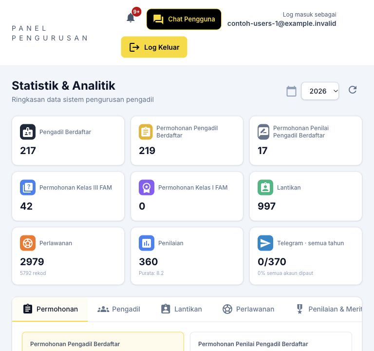

1. Buka Pengurusan Sistem > Statistik dan pilih tahun.
2. Tukar tab Permohonan, Pengadil, Lantikan, Perlawanan, Penilaian & Merit, Peperiksaan, Kelayakan atau App Mobile.
3. Tekan kad atau Buka senarai untuk meneliti rekod asal. Semak kategori sebelum membandingkan jumlah.
4. Pada statistik aplikasi, bezakan notifikasi tersedia, sudah log masuk dan belum menggunakan aplikasi; semak versi lama apabila dipaparkan.
5. Gunakan statistik untuk semakan susulan, bukan sebagai bukti bahawa semua notifikasi telah dihantar atau dibaca.

> Jumlah tahunan, sepanjang masa, rekod pegawai, perlawanan unik dan pegawai dinilai menggunakan unit berbeza. Baca label sebelum membuat laporan rasmi.

## Statistik dan rutin: App Mobile: versi dan status notifikasi
Halaman PDF 52

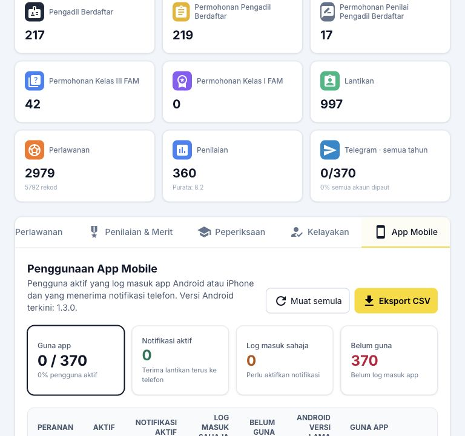

1. Buka Statistik, pilih tahun jika berkenaan dan tukar ke tab App Mobile.
2. Semak ringkasan mengikut peranan dan cari pengguna yang perlu dibantu.
3. Bezakan notifikasi tersedia, sesi aplikasi sudah log masuk tanpa push, dan belum menggunakan aplikasi.
4. Jika Versi lama ditandakan pada Android, minta pengguna memasang keluaran terkini melalui pautan rasmi.
5. Untuk notifikasi, minta pengguna mengaktifkan kebenaran pada telefon dan semak semula status.

> Sesi aplikasi, langganan push dan versi ialah petunjuk penggunaan; ia bukan bukti mesej diterima atau dibaca pada telefon.

## Statistik dan rutin: Profil Admin dan semakan kerja harian
Halaman PDF 53

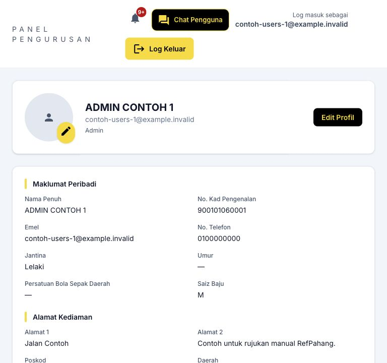

1. Buka Profil Saya, semak maklumat peribadi, emel, telefon dan Telegram; gunakan Edit Profil untuk pembetulan yang dibenarkan.
2. Setiap hari, semak permohonan Menunggu Admin, lantikan Belum Jawab/ditolak dan kegagalan saluran penghantaran.
3. Semak laporan Dihantar yang menunggu Pengerusi, pertanyaan chat dan peti emel.
4. Sebelum sesi baharu, semak tahun permohonan, tempoh buka/tutup, yuran, syarat dan senarai pegawai berdaftar.
5. Selepas perubahan penting, semak hasil melalui senarai asal, simpan bukti rujukan dan log keluar.

## Bantuan dan rujukan: Penyelesaian masalah harian
Halaman PDF 54

| Masalah | Tindakan pengguna |
|---|---|
| Menu tidak kelihatan | Semak peranan; buka menu telefon; fungsi tambahan PP memerlukan keupayaan yang diberikan. |
| Senarai kosong | Semak tahun, status, daerah, kata carian dan halaman senarai. Kosong tidak bermakna semua data telah dipadam. |
| Borang tidak boleh dihantar | Lengkapkan profil, dokumen dan perakuan; semak tempoh buka/tutup serta permohonan sedia ada untuk sesi sama. |
| Fail ditolak | Semak format dan saiz; resit JPG/PNG/PDF; gambar JPG/PNG yang berjaya diproses. Jangan sekadar menukar nama sambungan fail. |
| Sesi tamat | Log masuk semula. Semak dahulu sama ada tindakan terakhir berjaya sebelum menghantar semula. |
| Mesej rekod telah berubah | Muat semula butiran dan semak keadaan terkini. Elakkan mengulang tindakan daripada tab lama. |
| PDF tidak terbuka | Benarkan tab baharu / muat turun untuk portal; semak Downloads. Jangan kongsi PDF yang mengandungi data peribadi kepada umum. |

## Bantuan dan rujukan: Cara mendapatkan bantuan
Halaman PDF 55

Hubungi Admin atau Pegawai Pembangunan Daerah untuk urusan rekod, kelayakan dan permohonan. Sokongan teknikal yang tertera pada portal: sokongan@pbnppahang.my.

1. Sediakan nama peranan, menu yang digunakan, tahun / sesi, nombor permohonan atau nombor perlawanan dan masa masalah berlaku.
2. Sertakan screenshot mesej ralat. Lindungi kata laluan, pautan peribadi, nombor akaun dan data sensitif sebelum berkongsi.
3. Terangkan tindakan terakhir yang dibuat dan hasil yang dijangka. Nyatakan sama ada menggunakan web komputer, Android APK atau aplikasi skrin utama iPhone.
4. Jika berkaitan transaksi simpan / hantar, semak status semasa dan maklumkan jika rekod telah muncul. Elakkan membuat akaun atau permohonan pendua.
5. Selepas penyelesaian, buka semula rekod, sahkan status betul dan simpan nombor rujukan untuk susulan.

> Manual ini menerangkan tatacara pengguna. Ia tidak mengesahkan penghantaran emel/push pada setiap peranti atau memberi kuasa meluluskan di luar skop peranan.

## Lampiran kemas kini: Lampiran Admin: sekat dan aktifkan akaun
Halaman PDF 56

Admin boleh menyekat akses akaun dengan sebab dan mengaktifkannya semula melalui senarai Pengguna.

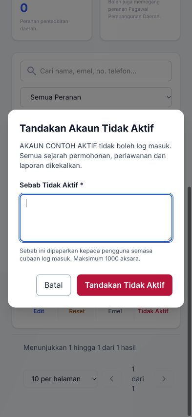

1. Buka Pengguna dan tekan Tidak Aktif pada akaun berkenaan. Isi sebab yang sesuai untuk dipaparkan kepada pengguna; maksimum 1000 aksara.
2. Tekan Tandakan Tidak Aktif. Pengguna tidak boleh log masuk; sesi lama dan pendaftaran peranti push dibatalkan. Admin tidak boleh menyekat akaun sendiri.
3. Tandakan Papar akaun tidak aktif untuk melihat sumber Admin atau Automatik serta sebab.
4. Tekan Aktifkan dan sahkan nama akaun untuk memulihkan akses. Pengguna perlu log masuk semula; sejarah dikekalkan.

> Pengaktifan semula memulakan tempoh baharu 8 bulan dan mengakui semakan pendaftaran tahun semasa. Semakan pendaftaran berikutnya pada tahun kalendar baharu.

## Lampiran kemas kini: Lampiran: sebab Akaun Tidak Aktif
Halaman PDF 57

Akaun Tidak Aktif tidak boleh log masuk. Popup menerangkan sebab sekatan selepas kata laluan disahkan.

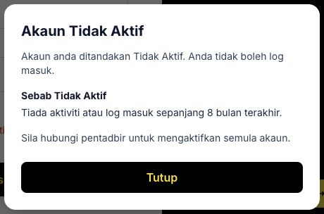

1. Pendaftaran: bagi akaun Pengadil yang melalui dua tahun kalendar penuh, sistem memeriksa dua tahun lengkap sebelumnya. Untuk 2026, tahun rujukan ialah 2024 dan 2025.
2. Permohonan yang telah dihantar sudah dikira walaupun belum diluluskan. Akaun baharu tidak dikenakan tahun sebelum melalui dua tahun penuh.
3. Manual: Admin boleh menandakan akaun Tidak Aktif dengan sebab. Aktiviti: semua pengguna kecuali Admin disekat selepas 8 bulan tanpa aktiviti atau log masuk.
4. Popup menunjukkan sebab apabila maklumat log masuk betul. Hanya Admin boleh mengaktifkan semula akaun; sejarah permohonan, perlawanan dan laporan dikekalkan.

> Pengaktifan semula memerlukan log masuk baharu. Tempoh 8 bulan bermula semula; semakan pendaftaran seterusnya berlaku pada tahun kalendar berikutnya.
