# Manual Pengguna RefPahang - PP Daerah

Pengurusan daerah dan tugasan sendiri

Edisi 20 Oktober 2026. Screenshot antaramuka sebenar dengan data contoh.

## Mula di sini: Cara menggunakan manual ini
Halaman PDF 3

Manual ini khusus untuk Pegawai Pembangunan Daerah. Gunakan portal https://refpahang.com pada komputer atau telefon; aplikasi mobile menggunakan akaun yang sama.

1. Cari tugas melalui Kandungan yang boleh diklik atau penanda buku PDF. Ikut nama menu dan butang yang dicetak tebal dalam arahan.
2. Screenshot ialah antaramuka aplikasi sebenar dengan identiti dianonimkan dan keadaan contoh. Nama, jumlah, tarikh, keputusan dan butiran bayaran dalam rajah bukan data operasi semasa.
3. Pada telefon, tekan butang menu untuk membuka navigasi. Jadual lebar boleh ditatal mendatar; tatal ke bawah untuk melihat dokumen, butang simpan dan halaman seterusnya.
4. Selepas menghantar atau menyimpan, tunggu mesej berjaya dan semak semula status rekod. Jika gagal, kekalkan maklumat ralat untuk rujukan sokongan.
5. Rujukan edisi: 20 Oktober 2026. Lampiran Akaun Tidak Aktif menerangkan sekatan akses dan pengaktifan semula oleh Admin.

## Mula di sini: Peranan, pendaftaran dan status
Halaman PDF 4

Empat perkara ini mempunyai maksud berbeza. Semak tahun atau sesi sebelum membuat kesimpulan tentang kelayakan seseorang.

| Istilah | Maksud kepada pengguna |
|---|---|
| Peranan akaun | Admin, PP Daerah, Pengadil atau Penilai. Menentukan panel dan menu. RA ialah Penilai Pengadil. |
| Jenis Pengadil | Kategori atau kelayakan pengadil; bukan bukti pendaftaran tahun semasa. |
| Pendaftaran tahunan | Permohonan pengadil atau penilai untuk sesi tertentu; kelulusan tahun lalu tidak meliputi tahun baharu. |
| Status permohonan | Contohnya Menunggu PP Daerah, Menunggu Admin, Lengkap atau Ditolak. |
| Seminar / kecergasan | Rekod berasingan. Kecergasan menentukan kelayakan patch / lesen negeri; seminar tidak menggantikan keputusan kecergasan. |
| KUP dan RA | KUP: R, AR1, AR2 dan pegawai keempat. RA menilai KUP dan bukan salah satu daripada empat pegawai tersebut. |

## Akses dan akaun: Log masuk dan buka panel sendiri
Halaman PDF 5

Buka https://refpahang.com. Gunakan emel akaun yang didaftarkan dan kata laluan peribadi.

1. Isi Emel dan Kata Laluan, kemudian tekan Log Masuk. Semak ejaan emel dan elakkan ruang kosong yang tersalin bersama kata laluan.
2. Pastikan panel yang dibuka ialah Pengurusan daerah. Jika sistem meminta pertukaran kata laluan kali pertama, lengkapkan proses itu dahulu.
3. Jika maklumat salah, betulkan emel atau kata laluan dan cuba semula. Cubaan gagal yang terlalu banyak boleh dihadkan sementara.
4. Jika akaun tidak aktif atau sistem dalam penyelenggaraan, baca mesej yang dipaparkan. Hubungi Admin jika akses memerlukan semakan.

## Akses dan akaun: Lupa kata laluan dan log keluar
Halaman PDF 6

1. Pada halaman Log Masuk, tekan Lupa kata laluan?. Masukkan emel akaun dan hantar permintaan.
2. Semak peti masuk serta folder Spam / Junk. Buka pautan pemulihan yang dihantar kepada emel sendiri dan tetapkan kata laluan baharu.
3. Jika pautan tamat tempoh atau telah digunakan, minta pautan baharu. Jika tiada emel, semak alamat dengan Admin; jangan cipta akaun kedua untuk mengatasi masalah ini.
4. Selepas selesai bekerja, tekan Log Keluar. Pada telefon atau komputer yang dikongsi, pastikan halaman log masuk muncul semula.

> Jangan kongsi kata laluan, pautan pemulihan, pautan jawapan lantikan atau pautan laporan peribadi kepada orang lain.

## Akses dan akaun: Tukar kata laluan sendiri
Halaman PDF 7

1. Buka Profil / Profil Saya dan cari bahagian Tukar Kata Laluan. Pada aplikasi, fungsi ini tersedia melalui Profil atau menu Lagi.
2. Masukkan kata laluan semasa, kata laluan baharu dan pengesahan kata laluan seperti diminta.
3. Patuhi syarat panjang dan pengesahan yang dipaparkan, kemudian tekan Tukar Kata Laluan.
4. Tunggu pengesahan berjaya. Jika sesi tamat atau diminta log masuk semula, gunakan kata laluan baharu.

## Aplikasi dan notifikasi: Pasang aplikasi pada Android
Halaman PDF 8

Gunakan pautan Android pada halaman Log Masuk atau https://refpahang.com/app/refpahang.apk.

1. Muat turun APK rasmi dan tunggu fail selesai dimuat turun. Buka fail melalui Downloads / Files.
2. Jika diminta, benarkan Install unknown apps / Allow from this source untuk pelayar atau pengurus fail yang digunakan.
3. Kembali ke pemasang, tekan Install / Pasang dan kemudian Open / Buka.
4. Log masuk menggunakan akaun portal. Benarkan notifikasi apabila diminta dan semak panel peranan anda.
5. Jika pemasangan disekat oleh dasar peranti, simpan mesej ralat dan hubungi sokongan. Gunakan aplikasi web sementara menunggu bantuan.

> Nama tetapan Android berbeza mengikut jenama. Screenshot ini menunjukkan skrin aplikasi, bukan skrin tetapan setiap jenama telefon.

## Aplikasi dan notifikasi: Pasang aplikasi pada iPhone
Halaman PDF 9

iPhone menggunakan aplikasi web RefPahang yang ditambah ke skrin utama melalui Safari.

1. Buka Safari dan pergi ke https://refpahang.com/app/.
2. Tekan Kongsi / Share, pilih Add to Home Screen / Tambah ke Skrin Utama dan tekan Add / Tambah.
3. Jika pilihan Open as Web App dipaparkan, hidupkannya. Buka RefPahang melalui ikon skrin utama.
4. Log masuk, cari kad Aktifkan notifikasi pada Utama atau Profil, dan ikuti langkah pengaktifan pada halaman berikut.
5. Jika kad menyatakan aplikasi perlu dipasang, tutup tab biasa dan buka semula melalui ikon skrin utama.

> Pemasangan ini tidak menggunakan fail APK Android. Rajah menunjukkan mesej bantuan dalam aplikasi; paparan Share Safari boleh berbeza mengikut versi iOS.

## Aplikasi dan notifikasi: Aktifkan notifikasi telefon
Halaman PDF 10

1. Buka RefPahang dan log masuk. Cari kad Aktifkan notifikasi pada Utama atau Profil.
2. Tekan Aktifkan notifikasi, kemudian pilih Allow / Benarkan apabila pelayar atau telefon meminta kebenaran.
3. Pada iPhone, lakukan langkah ini daripada aplikasi skrin utama. Pada Android APK, semak kebenaran notifikasi RefPahang dalam tetapan aplikasi.
4. Pastikan status kad bertukar kepada Notifikasi aktif. Kembali ke Profil jika perlu untuk menyemak keadaan semasa.
5. Buka ikon loceng dalam portal atau menu Notifikasi aplikasi untuk membaca butiran notis. Push, notis dalam portal, emel dan Telegram ialah saluran berasingan.

> Rajah kad kebenaran ialah render widget sebenar dengan keadaan contoh; ia bukan bukti kebenaran OS telah diberikan pada telefon anda.

## Aplikasi dan notifikasi: Notifikasi disekat atau tidak sampai
Halaman PDF 11

1. Jika kad menunjukkan Disekat, buka tetapan laman / aplikasi pada telefon dan benarkan notifikasi untuk RefPahang.
2. Semak Focus / Jangan Ganggu, mod senyap, sambungan internet dan had bateri. Buka semula aplikasi selepas mengubah tetapan.
3. Pada iPhone, pastikan ikon skrin utama digunakan. Pada Android, semak Settings > Apps > RefPahang > Notifications mengikut jenama.
4. Log masuk semula jika sesi telah tamat. Minta Admin menyemak bahawa notifikasi berkaitan benar-benar telah dihantar.
5. Jika masih gagal, laporkan jenis telefon, versi aplikasi, status kad notifikasi dan masa kejadian. Semak notis dalam portal sementara menunggu bantuan.

> Status Notifikasi aktif menunjukkan langganan tersedia; ia tidak membuktikan setiap notis telah dibaca. Jangan terlepas tarikh tindakan kerana hanya menunggu popup telefon.

## Aplikasi dan notifikasi: Hubungkan akaun Telegram
Halaman PDF 12

1. Buka Profil / Profil Saya dan cari Pemautan Telegram. Semak sama ada status menyatakan Telegram belum dipaut atau berjaya dipaut.
2. Tekan Hubungkan Telegram dan buka pautan peribadi dalam aplikasi Telegram.
3. Tekan Mula / Start pada bot. Kembali ke RefPahang dan tekan Semak Status Pemautan jika status belum berubah.
4. Pastikan status menunjukkan Telegram berjaya dipaut. Jika bot pernah disekat, nyahsekat bot dan mulakan semula pemautan.
5. Jika akaun Telegram lama dinyahaktifkan atau pautan tamat tempoh, dapatkan pautan baharu melalui profil atau hubungi Admin.

> Jangan gunakan pautan pemautan milik orang lain. Pemautan Telegram tidak secara automatik memberikan kebenaran push telefon.

## Aplikasi dan notifikasi: Kemas kini aplikasi
Halaman PDF 13

1. Jika aplikasi memaklumkan versi baharu, baca maklumat kemas kini dan tekan pilihan kemas kini yang tersedia.
2. Android: muat turun APK terkini daripada pautan rasmi dan pasang menindih aplikasi sedia ada. Lengkapkan pemasangan, kemudian buka semula.
3. iPhone / aplikasi web: tutup aplikasi dan buka semula ketika bersambung internet. Jika masih paparan lama, muat semula laman dan cuba lagi.
4. Log masuk semula jika diminta. Semak Profil, Tugasan dan notifikasi selepas kemas kini.
5. Jika versi minimum diwajibkan oleh sistem, selesaikan kemas kini sebelum meneruskan penggunaan.

> Simpan bukti atau draf yang belum dihantar sebelum menutup aplikasi. Versi dan saiz muat turun berubah mengikut keluaran; gunakan maklumat pada aplikasi semasa.

## Panduan PP Daerah: Skop dan susunan menu PP Daerah
Halaman PDF 14

PP Daerah mengurus rekod serta permohonan dalam skop daerah yang ditetapkan, di samping tugasan peribadi jika mempunyai kelayakan tambahan.

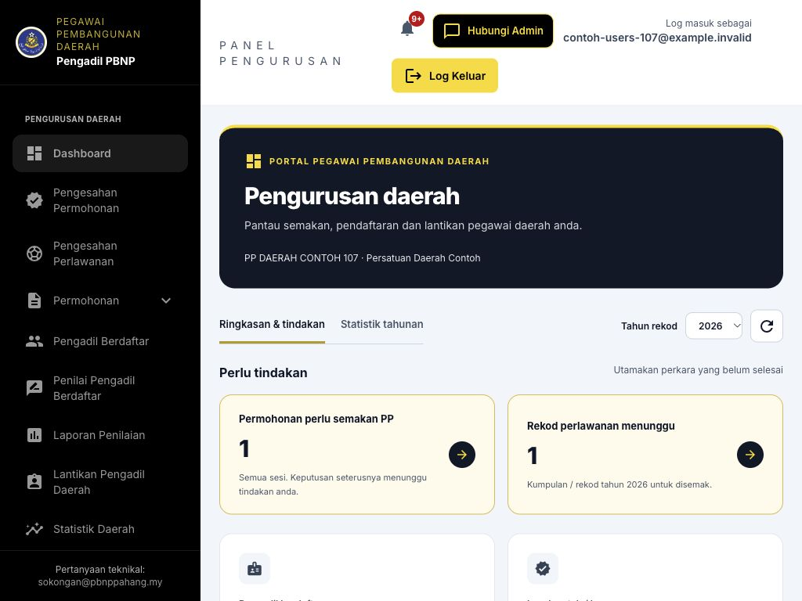

1. Pengurusan daerah: buka pengesahan permohonan, pengesahan perlawanan, senarai Pengadil/RA, laporan, lantikan daerah dan statistik.
2. Tugasan saya: buka Tugasan Lantikan Saya dan Profil Saya. Menu tambahan muncul mengikut keupayaan Pengadil atau RA pada akaun.
3. Pilih tahun sebelum membaca jumlah. Buka kad Perlu Tindakan untuk pergi ke senarai yang menunggu semakan.
4. Jika daerah salah atau menu tambahan tidak tersedia, minta Admin menyemak persatuan serta bukti kelayakan akaun.

## Panduan PP Daerah: Menu PP Daerah dalam aplikasi mobile
Halaman PDF 15

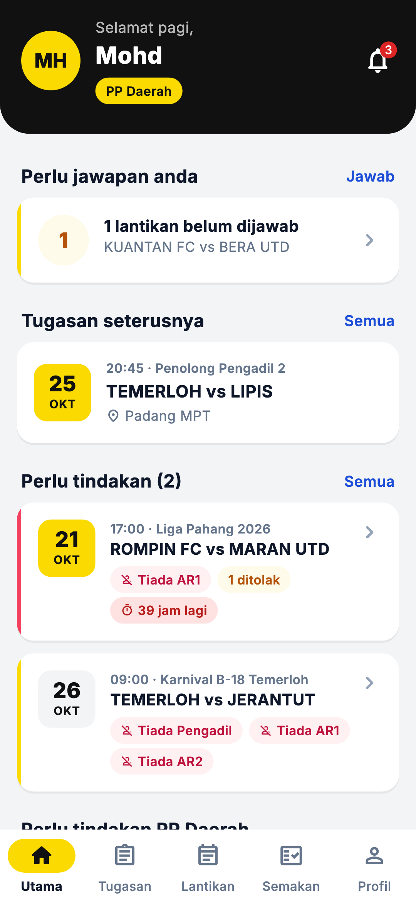

1. Utama: semak perkara perlu tindakan bagi daerah.
2. Tugasan: semak dan jawab lantikan sendiri. Lantikan: urus lantikan kejohanan daerah yang dibenarkan.
3. Semakan: pilih permohonan atau rekod perlawanan, baca butiran dan lakukan pengesahan yang tersedia.
4. Profil: semak identiti, notifikasi dan Telegram. Menu Lagi memberi akses tambahan seperti Permohonan Saya atau Tugasan Penilai apabila layak.
5. Untuk semakan jadual lebar, import Excel dan pengurusan lanjut, gunakan Website.

## Permohonan daerah: Semak pendaftaran akaun baharu
Halaman PDF 16

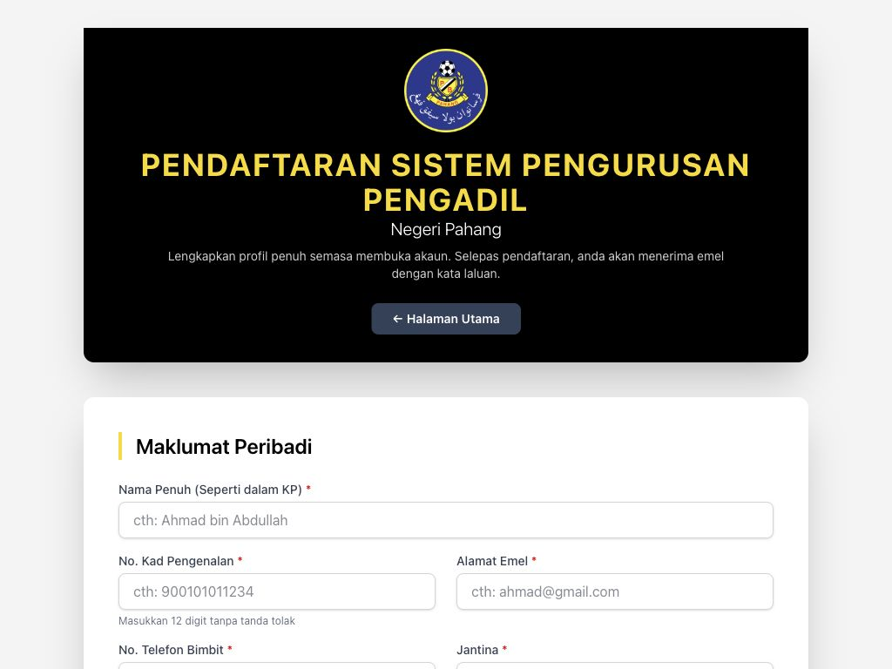

1. Pemohon awam membuka Daftar Akaun Baharu dan memilih Pengadil atau Penilai, mengisi profil serta menghantar gambar.
2. Semak persatuan daerah dan maklumat akaun jika pemohon memerlukan bantuan. Pendaftaran akaun tidak sama dengan permohonan tahunan.
3. Akaun PP Daerah dan Admin disediakan oleh pentadbir. PP tidak perlu mendaftarkan akaun awam baharu untuk mendapatkan peranan pentadbiran.
4. Jika pengguna sudah mempunyai emel/KP berdaftar, gunakan pemulihan akses atau minta Admin membetulkan akaun, bukannya mewujudkan pendua.

> Tiada tindakan “luluskan akaun baharu” yang menggantikan pengesahan permohonan tahunan. Semakan PP dibuat pada modul permohonan yang dihantar.

## Permohonan daerah: Tapis dan baca permohonan daerah
Halaman PDF 17

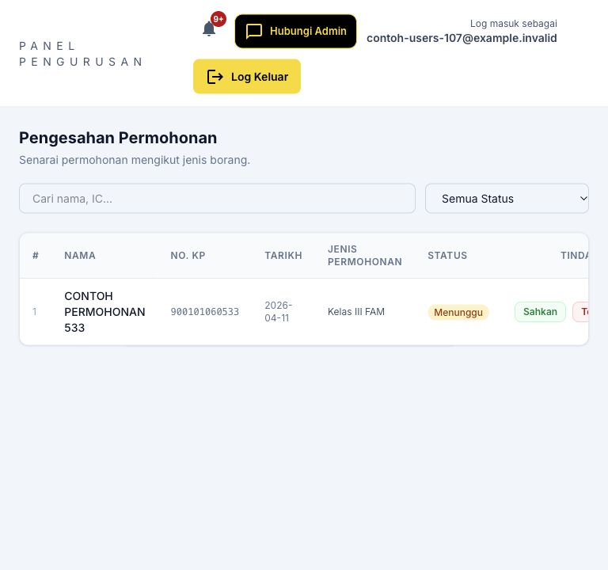

1. Buka Pengesahan Permohonan bagi permohonan yang menunggu tindakan PP. Gunakan carian dan penapis status.
2. Untuk mengikut jenis, buka kumpulan Permohonan: Pengadil Berdaftar, Penilai Pengadil Berdaftar, Kelas III FAM atau Ujian Kelas I FAM.
3. Semak nama, nombor KP, tahun, jenis borang, persatuan, dokumen dan maklumat pemohon sebelum membuat keputusan.
4. Jika tiada rekod, semak jenis, status dan daerah pada akaun. Permohonan sendiri dikecualikan daripada senarai pengesahan PP.

> PP tidak boleh mengesahkan permohonan sendiri. Hubungi Admin untuk laluan pemprosesan yang sesuai.

## Permohonan daerah: Sahkan permohonan ke peringkat Admin
Halaman PDF 18

1. Buka permohonan yang berada pada Menunggu PP Daerah dan pastikan pemohon dalam daerah anda.
2. Semak kelengkapan profil, borang, perakuan dan dokumen bayaran yang berkaitan.
3. Tekan Sahkan dan baca dialog nama pemohon sebelum mengesahkan.
4. Tunggu mesej berjaya. Pastikan status menjadi Menunggu Admin dan tidak lagi tersenarai sebagai kerja PP yang belum diproses.
5. Maklumkan pemohon bahawa pengesahan PP bukan kelulusan akhir Admin atau keputusan ujian.

## Permohonan daerah: Tolak permohonan dengan sebab
Halaman PDF 19

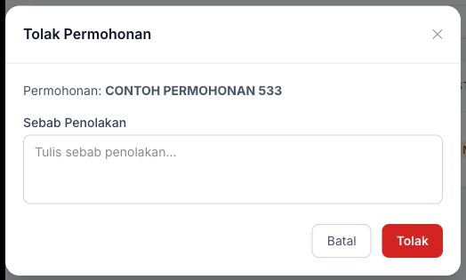

1. Pada permohonan yang memerlukan pembetulan atau tidak memenuhi syarat, tekan Tolak.
2. Isi sebab penolakan yang khusus, contohnya dokumen tidak lengkap atau butiran yang perlu dibetulkan.
3. Semak nama dan sebab pada dialog, kemudian sahkan penolakan.
4. Pastikan status bertukar kepada Ditolak. Pemohon perlu membaca catatan dan menghubungi pihak berkaitan untuk tindakan lanjut.

> Jangan menganggap penolakan automatik membuka butang permohonan baharu untuk sesi sama. Sistem menyemak permohonan sedia ada; pemohon perlu rujuk arahan dalam portal.

## Pegawai dan rekod daerah: Senarai Pengadil daerah dan profil
Halaman PDF 20

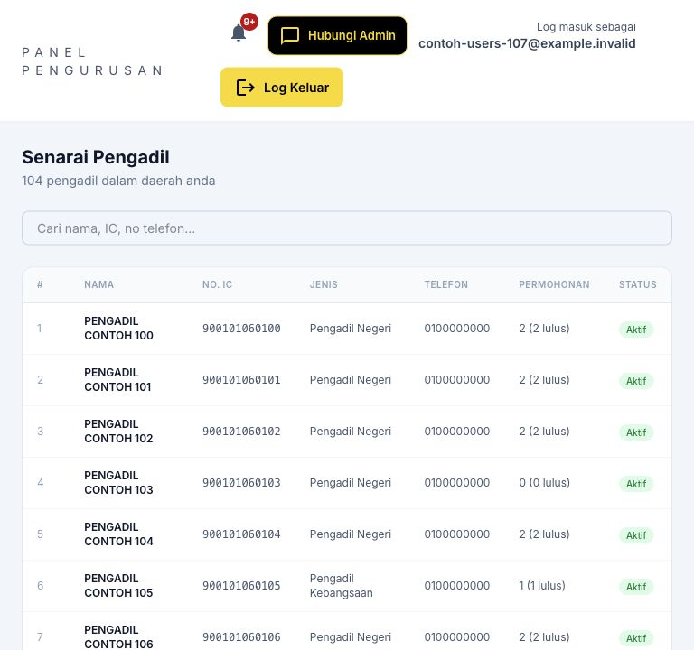

1. Buka Pengadil Berdaftar dan gunakan carian atau penapis yang tersedia.
2. Buka profil pegawai untuk menyemak identiti, persatuan, permohonan, kelayakan dan rekod perlawanan.
3. Jika tindakan kemas kini disediakan, betulkan maklumat dalam skop daerah dan simpan. Perubahan persatuan atau status akses perlu dirujuk kepada Admin.
4. Semak semula rekod selepas simpan. Bezakan status akaun aktif daripada pendaftaran yang diluluskan bagi tahun tertentu.

## Pegawai dan rekod daerah: Senarai RA dan laporan daerah
Halaman PDF 21

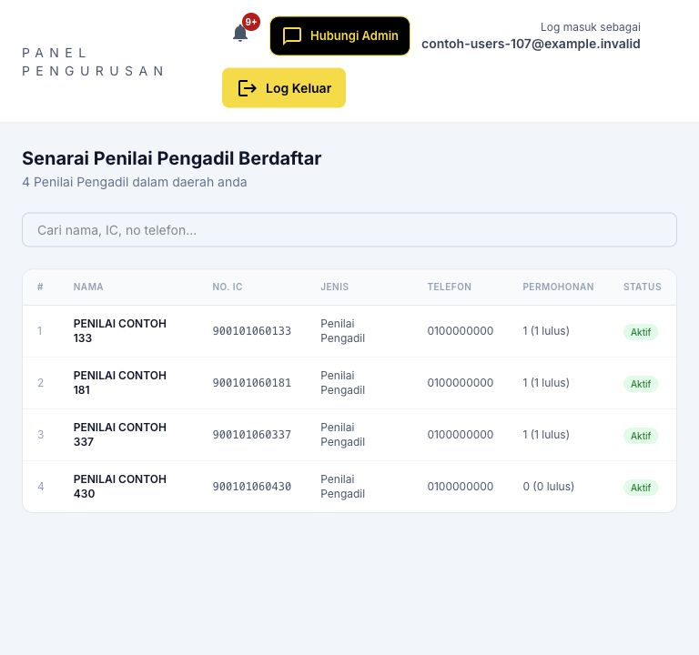

1. Buka Penilai Pengadil Berdaftar untuk melihat RA dalam skop daerah.
2. Gunakan carian serta butiran profil untuk menyemak identiti, pendaftaran dan maklumat hubungan.
3. Buka Laporan Penilaian untuk membaca laporan yang boleh dicapai dalam daerah. Semak perlawanan, penilai, tarikh dan status.
4. Gunakan Lihat untuk membaca laporan atau ikon muat turun bagi dokumen yang diperlukan.

> Akses membaca laporan daerah tidak memberikan kuasa menulis laporan atas nama RA lain atau membuat pengesahan Pengerusi.

## Pengesahan perlawanan: Semak rekod perlawanan yang menunggu
Halaman PDF 22

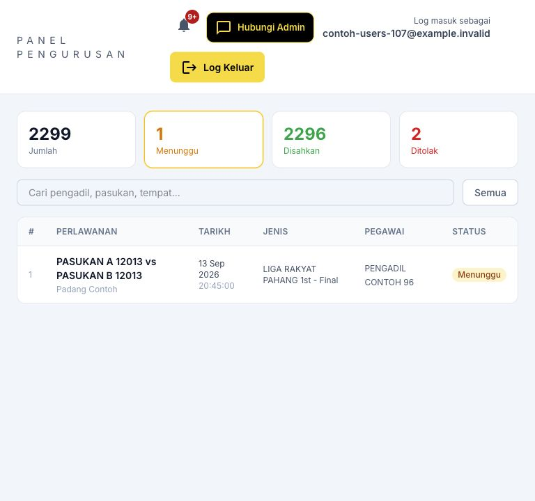

1. Buka Pengesahan Perlawanan. Pilih tahun dan status Menunggu, Disahkan atau Ditolak.
2. Cari pengadil, pasukan atau tempat. Buka baris perlawanan untuk menyemak maklumat terperinci.
3. Semak tarikh, tempat, pasukan, tugas pegawai, kumpulan rekod dan sebarang pertindihan yang dipaparkan.
4. Bandingkan dengan bukti tugas atau rekod kejohanan sebelum membuka tindakan pengesahan.

> Rekod kumpulan boleh mewakili beberapa pegawai bagi satu perlawanan. Baca unit senarai dan jumlah anggota sebelum memilih tindakan.

## Pengesahan perlawanan: Sahkan, tolak atau semak semula perlawanan
Halaman PDF 23

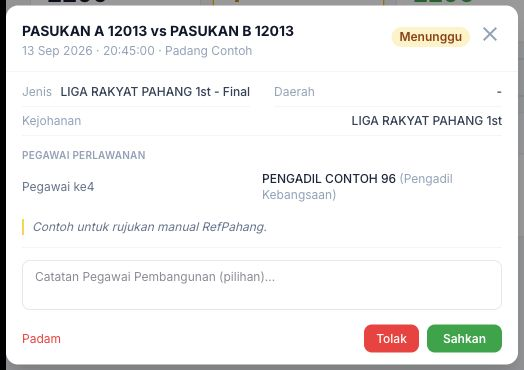

1. Dalam butiran rekod, buka tindakan dan isi catatan yang diperlukan.
2. Jika pertindihan dipaparkan, semak butiran konflik, tandakan pengesahan semakan dan isi penjelasan sebelum Sahkan boleh digunakan.
3. Tekan Sahkan atau Sahkan Semua untuk kumpulan yang telah disemak. Jika tidak sah, pilih Tolak dengan sebab yang jelas.
4. Bagi rekod yang sudah disahkan, Edit Semula membolehkan pengesahan disemak mengikut tindakan yang tersedia.
5. Pastikan status semua rekod sasaran berubah seperti dimaksudkan. Gunakan Padam hanya selepas semakan dan pengesahan, bukan untuk menggantikan penolakan.

> Tindakan berkumpulan boleh melibatkan beberapa rekod pegawai. Semak anggota kumpulan terlebih dahulu dan jangan menghantar semula daripada dialog lama.

## Pegawai dan rekod daerah: Baca laporan RA daerah
Halaman PDF 24

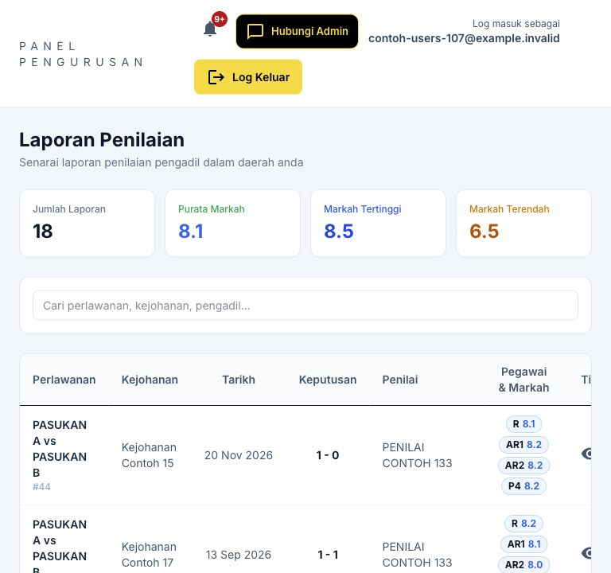

1. Buka Laporan Penilaian dan semak ringkasan jumlah, purata markah serta julat markah.
2. Gunakan carian kejohanan, penilai atau pengadil untuk mendapatkan laporan yang diperlukan.
3. Tekan Lihat / ikon mata untuk membaca markah, kriteria dan nasihat bagi setiap pegawai.
4. Gunakan ikon muat turun apabila perlu menyimpan dokumen. Semak identiti perlawanan serta status sebelum menggunakannya.
5. Jika laporan atau pemetaan daerah salah, rujuk RA / Admin dengan nombor perlawanan dan laporan.

## Lantikan daerah: Cipta kejohanan lantikan daerah
Halaman PDF 25

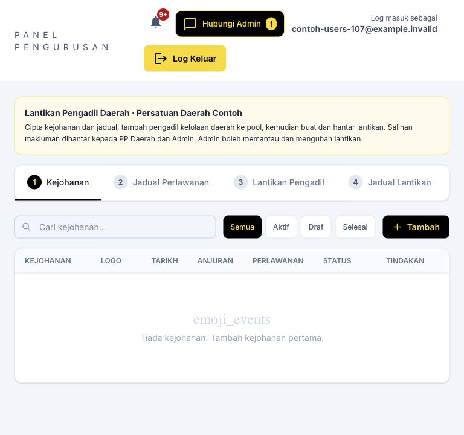

1. Buka Lantikan Pengadil Daerah dan tab 1 Kejohanan. Tekan Tambah untuk mencipta kejohanan milik daerah.
2. Isi nama, jenis, tarikh, tempat, anjuran dan status. Peringkat kejohanan daerah ditetapkan oleh skop PP.
3. Simpan dan pilih kejohanan yang betul. PP mengurus lantikan milik daerahnya, sementara Admin mempunyai pengawasan negeri.
4. Semak bahagian pool dan jadual sebelum memulakan pelantikan. Untuk perkara di luar kuasa daerah, hubungi Admin.

## Lantikan daerah: Pool dan jadual lantikan daerah
Halaman PDF 26

Struktur tab jadual digunakan bersama modul lantikan. Rajah menunjukkan komponen jadual yang sama dalam panel Admin; pilihan PP dihadkan kepada daerah.

1. Pilih kejohanan dan Tambah ke Pool. Pilih Pengadil Kelolaan Daerah dan tandakan calon yang dibenarkan.
2. Jika menggunakan fail nama, muat turun template pool, semak padanan dan pilih calon yang betul.
3. Buka tab 2 Jadual Perlawanan. Tambah satu perlawanan atau gunakan Muat Naik Excel dan template jadual.
4. Semak tarikh, masa, pasukan, kategori, tempat dan wilayah sebelum menyimpan atau menghantar import.

> PP tidak mendapat tab Pengadil Luar atau Blast Pautan Telegram pengadil luar seperti Admin. Rujuk Admin jika memerlukan pegawai luar skop daerah.

## Lantikan daerah: Lantik, hantar notifikasi dan ganti pegawai
Halaman PDF 27

Rajah menunjukkan komponen pemilihan pegawai yang sama. Dalam panel PP, senarai dan tindakan mengikut skop kejohanan daerah.

1. Buka tab 3 Lantikan Pengadil atau Lantik pada perlawanan. Semak nombor, tarikh dan jawatan.
2. Pilih R, AR1 dan AR2 daripada pool daerah, serta Pegawai ke4/RA jika tersedia dan diperlukan.
3. Semak pertindihan serta amaran dan sahkan slot. Hantar notifikasi kepada pegawai yang Belum Jawab selepas semua butiran betul.
4. Pantau Diterima/ Ditolak. Gunakan Ganti apabila perlu, dan semak semula notifikasi serta tarikh akhir jawapan pegawai pengganti.
5. Gunakan Pautan & Log bagi semakan saluran dan penghantaran manual yang dibenarkan.

> Pelantikan disimpan, notifikasi dihantar dan jawapan diterima ialah tiga keadaan berbeza.

## Lantikan daerah: Dokumen, pembatalan dan sempadan kuasa
Halaman PDF 28

Rajah ialah komponen Jadual Lantikan. Semak pemilik lantikan dan kejohanan daerah sebelum mencetak atau menukar status.

1. Buka tab 4 Jadual Lantikan, pilih kejohanan dan semak pegawai serta tarikh perlawanan.
2. Isi pengesahan dokumen apabila dibenarkan, kemudian muat turun PDF versi terkini.
3. Jika perlawanan ditangguhkan atau dibatalkan, pilih status yang tepat dan isi sebab; pastikan pegawai dimaklumkan.
4. Jangan padam rekod bersejarah untuk memintas sekatan. Hubungi Admin jika tindakan tidak tersedia atau melibatkan kejohanan pihak lain.
5. Penetapan Pengerusi dan pengawasan pengesahan laporan RA diurus oleh Admin. Panel PP tidak memaparkan tab pengurusan laporan negeri yang sama.

## Statistik dan tugas sendiri: Statistik daerah: baca unit dengan betul
Halaman PDF 29

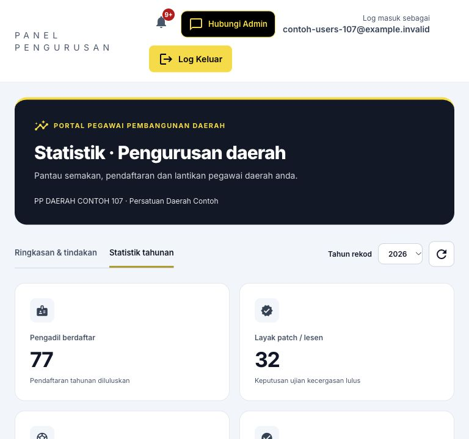

1. Buka Statistik Daerah dan pilih tahun rujukan.
2. Semak jumlah pengadil berdaftar, kelayakan lesen, rekod pegawai, perlawanan dikenal pasti dan perkara menunggu tindakan.
3. Baca carta bulanan, pecahan permohonan dan senarai aktiviti/pegawai yang disediakan.
4. Tekan kad tindakan untuk meneliti rekod sumber. Bandingkan unit yang sama sebelum menyediakan laporan.
5. Bagi statistik aplikasi, gunakan status penggunaan/notifikasi untuk susulan pegawai daerah, bukan bukti notis sudah dibaca.

> Rekod lama yang belum dipadankan kekal sebagai rekod berasingan. Jumlah rekod pegawai tidak sama dengan jumlah perlawanan unik.

## Statistik dan tugas sendiri: PP yang turut menjadi Pengadil atau RA
Halaman PDF 30

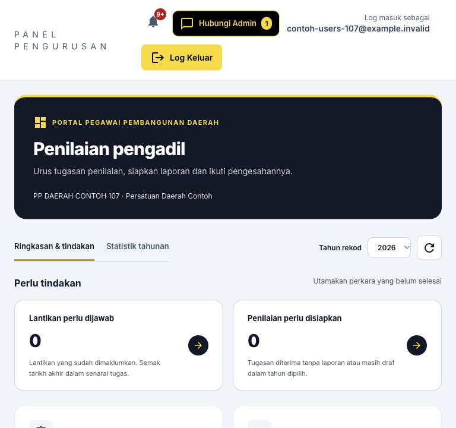

1. Semak bahagian Tugasan saya pada menu. Tugasan Lantikan Saya dan Profil Saya tersedia untuk akaun PP.
2. Jika mempunyai keupayaan Pengadil, menu Rekod Perlawanan Saya, Pendaftaran Pengadil Saya dan permohonan Kelas III / I boleh muncul.
3. Jika mempunyai keupayaan RA, buka Panel Penilai Pengadil Saya dan Pendaftaran Penilai Saya (R1). Laporan yang ditulis tetap milik RA tersebut.
4. Gunakan aliran Pengadil/RA untuk tugasan peribadi; kembali ke Pengurusan daerah apabila membuat pengesahan orang lain.
5. Jika menu tidak sepadan dengan kelayakan, minta Admin menyemak rekod. Jangan memilih peranan atau kategori lain semata-mata untuk membuka menu.

> PP tidak boleh mengesahkan permohonan sendiri. Menu tambahan tidak menjadikan semua PP sebagai RA atau Pengadil secara automatik.

## Tugasan dan lantikan: Semak dan jawab lantikan sendiri
Halaman PDF 31

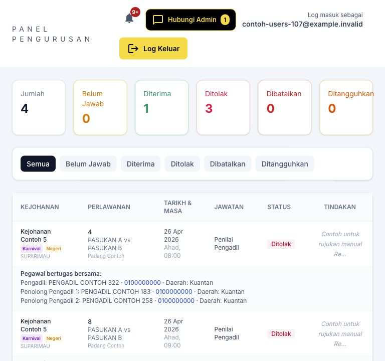

1. Buka Tugasan / Notifikasi Lantikan atau pautan tindakan pada Dashboard. Tapis Belum Jawab untuk mencari lantikan yang memerlukan keputusan.
2. Semak kejohanan, nombor perlawanan, tarikh, masa, tempat dan jawatan. Semak juga tempoh jawapan yang dipaparkan.
3. Jika bersedia, tekan Terima dan sahkan. Jika tidak dapat bertugas, tekan Tolak dan isi sebab penolakan sebelum menghantar.
4. Tunggu mesej berjaya dan pastikan status berubah kepada Diterima atau Ditolak. Jika butang tiada, semak status dan hubungi pelantik.

> Pautan emel/Telegram boleh membuka halaman jawapan peribadi. Semak identiti dan perlawanan sebelum menjawab; jangan jawab bagi pihak pegawai lain.

## Tugasan dan lantikan: Tarikh akhir dan perubahan lantikan
Halaman PDF 32

| Keadaan | Cara bertindak |
|---|---|
| Liga | Had biasa ialah 48 jam sebelum sepak mula, dikira daripada jadual perlawanan. |
| Selain Liga | Had biasa ialah 3 jam sebelum sepak mula. |
| Lantikan lewat | Jika notifikasi pertama dihantar selepas had biasa, pegawai boleh menjawab sehingga sepak mula. Baca tarikh sebenar pada pautan. |
| Belum Jawab | Semak sama ada notifikasi sudah dihantar. Lantikan biasa yang tidak dijawab boleh ditolak automatik pada had berkenaan. |
| Dibatalkan / Ditangguhkan | Jangan menganggap surat lama masih berkuat kuasa. Semak notis terbaru dan hubungi pelantik. |
| Sudah terima tetapi ada halangan | Maklumkan segera kepada Admin / PP Daerah. Pelantik perlu mengurus pembatalan atau penggantian; jangan hanya mengabaikan tugasan. |

> Had ini bukan tempoh 48 jam atau 3 jam selepas emel diterima. Masa rujukan ialah waktu sepak mula dan notifikasi lantikan yang direkodkan.

## Tugasan dan lantikan: Surat lantikan dan butiran perlawanan
Halaman PDF 33

1. Buka butiran tugasan yang berkenaan. Semak jawatan dan maklumat perlawanan pada kad atau senarai.
2. Jika pautan Surat / Surat Lantikan disediakan, bukanya dan simpan PDF melalui fungsi muat turun / kongsi peranti.
3. Semak status semasa sebelum menggunakan surat. Cetakan lama tidak menggantikan maklumat pembatalan atau penangguhan terbaru.
4. Selepas bertugas, lakukan urusan peranan masing-masing: Pengadil menyemak rekod; RA menyediakan laporan; PP mengurus semakan daerah.

> Rajah ialah butiran tugasan pada aplikasi mobile. Pada portal, fungsi surat dan jawapan terletak pada baris lantikan atau pautan emel/Telegram.

## Statistik dan tugas sendiri: Profil PP dan senarai semak harian
Halaman PDF 34

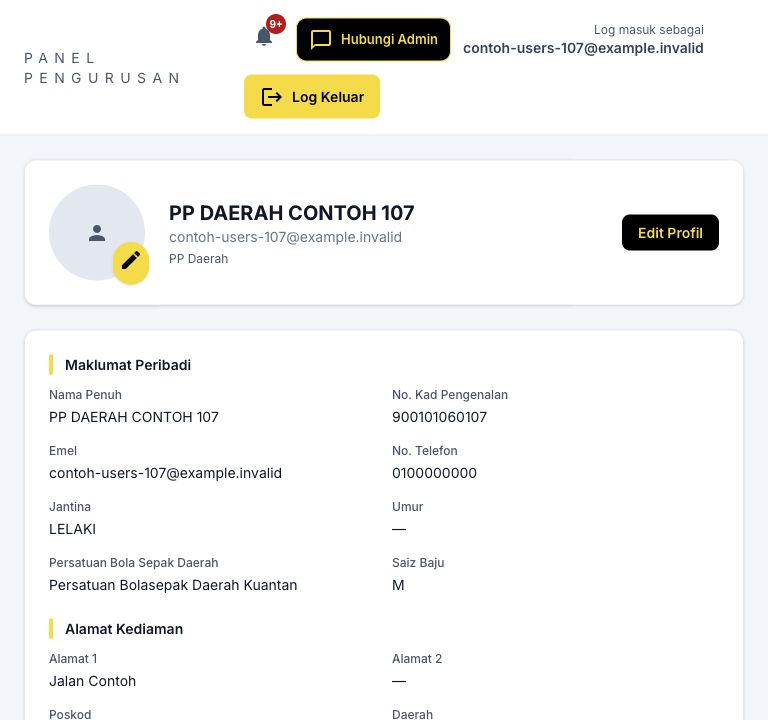

1. Buka Profil Saya. Semak persatuan daerah, emel, telefon, Telegram dan gambar; gunakan Edit Profil apabila perlu.
2. Semak Pengesahan Permohonan dan Pengesahan Perlawanan yang menunggu tindakan setiap hari.
3. Pantau jawapan lantikan daerah dan urus penggantian sebelum tarikh akhir.
4. Semak tugasan sendiri dan laporan RA peribadi secara berasingan daripada kerja pengesahan daerah.
5. Simpan nombor rujukan kes yang perlu dirujuk kepada Admin dan log keluar selepas selesai.

## Bantuan dan rujukan: Penyelesaian masalah harian
Halaman PDF 35

| Masalah | Tindakan pengguna |
|---|---|
| Menu tidak kelihatan | Semak peranan; buka menu telefon; fungsi tambahan PP memerlukan keupayaan yang diberikan. |
| Senarai kosong | Semak tahun, status, daerah, kata carian dan halaman senarai. Kosong tidak bermakna semua data telah dipadam. |
| Borang tidak boleh dihantar | Lengkapkan profil, dokumen dan perakuan; semak tempoh buka/tutup serta permohonan sedia ada untuk sesi sama. |
| Fail ditolak | Semak format dan saiz; resit JPG/PNG/PDF; gambar JPG/PNG yang berjaya diproses. Jangan sekadar menukar nama sambungan fail. |
| Sesi tamat | Log masuk semula. Semak dahulu sama ada tindakan terakhir berjaya sebelum menghantar semula. |
| Mesej rekod telah berubah | Muat semula butiran dan semak keadaan terkini. Elakkan mengulang tindakan daripada tab lama. |
| PDF tidak terbuka | Benarkan tab baharu / muat turun untuk portal; semak Downloads. Jangan kongsi PDF yang mengandungi data peribadi kepada umum. |

## Bantuan dan rujukan: Cara mendapatkan bantuan
Halaman PDF 36

Hubungi Admin atau Pegawai Pembangunan Daerah untuk urusan rekod, kelayakan dan permohonan. Sokongan teknikal yang tertera pada portal: sokongan@pbnppahang.my.

1. Sediakan nama peranan, menu yang digunakan, tahun / sesi, nombor permohonan atau nombor perlawanan dan masa masalah berlaku.
2. Sertakan screenshot mesej ralat. Lindungi kata laluan, pautan peribadi, nombor akaun dan data sensitif sebelum berkongsi.
3. Terangkan tindakan terakhir yang dibuat dan hasil yang dijangka. Nyatakan sama ada menggunakan web komputer, Android APK atau aplikasi skrin utama iPhone.
4. Jika berkaitan transaksi simpan / hantar, semak status semasa dan maklumkan jika rekod telah muncul. Elakkan membuat akaun atau permohonan pendua.
5. Selepas penyelesaian, buka semula rekod, sahkan status betul dan simpan nombor rujukan untuk susulan.

> Manual ini menerangkan tatacara pengguna. Ia tidak mengesahkan penghantaran emel/push pada setiap peranti atau memberi kuasa meluluskan di luar skop peranan.

## Lampiran kemas kini: Lampiran: sebab Akaun Tidak Aktif
Halaman PDF 37

Akaun Tidak Aktif tidak boleh log masuk. Popup menerangkan sebab sekatan selepas kata laluan disahkan.

1. Pendaftaran: bagi akaun Pengadil yang melalui dua tahun kalendar penuh, sistem memeriksa dua tahun lengkap sebelumnya. Untuk 2026, tahun rujukan ialah 2024 dan 2025.
2. Permohonan yang telah dihantar sudah dikira walaupun belum diluluskan. Akaun baharu tidak dikenakan tahun sebelum melalui dua tahun penuh.
3. Manual: Admin boleh menandakan akaun Tidak Aktif dengan sebab. Aktiviti: semua pengguna kecuali Admin disekat selepas 8 bulan tanpa aktiviti atau log masuk.
4. Popup menunjukkan sebab apabila maklumat log masuk betul. Hanya Admin boleh mengaktifkan semula akaun; sejarah permohonan, perlawanan dan laporan dikekalkan.

> Pengaktifan semula memerlukan log masuk baharu. Tempoh 8 bulan bermula semula; semakan pendaftaran seterusnya berlaku pada tahun kalendar berikutnya.
