# Manual Pengguna RefPahang - Pengadil

Akaun, tugasan, rekod dan permohonan

Edisi 20 Oktober 2026. Screenshot antaramuka sebenar dengan data contoh.

## Mula di sini: Cara menggunakan manual ini
Halaman PDF 3

Manual ini khusus untuk Pengadil. Gunakan portal https://refpahang.com pada komputer atau telefon; aplikasi mobile menggunakan akaun yang sama.

1. Cari tugas melalui Kandungan yang boleh diklik atau penanda buku PDF. Ikut nama menu dan butang yang dicetak tebal dalam arahan.
2. Screenshot ialah antaramuka aplikasi sebenar dengan identiti dianonimkan dan keadaan contoh. Nama, jumlah, tarikh, keputusan dan butiran bayaran dalam rajah bukan data operasi semasa.
3. Pada telefon, tekan butang menu untuk membuka navigasi. Jadual lebar boleh ditatal mendatar; tatal ke bawah untuk melihat dokumen, butang simpan dan halaman seterusnya.
4. Selepas menghantar atau menyimpan, tunggu mesej berjaya dan semak semula status rekod. Jika gagal, kekalkan maklumat ralat untuk rujukan sokongan.
5. Rujukan edisi: 20 Oktober 2026. Lampiran Akaun Tidak Aktif menerangkan sekatan akses dan pengaktifan semula oleh Admin.

## Mula di sini: Peranan, pendaftaran dan status
Halaman PDF 4

Empat perkara ini mempunyai maksud berbeza. Semak tahun atau sesi sebelum membuat kesimpulan tentang kelayakan seseorang.

| Istilah | Maksud kepada pengguna |
|---|---|
| Peranan akaun | Admin, PP Daerah, Pengadil atau Penilai. Menentukan panel dan menu. RA ialah Penilai Pengadil. |
| Jenis Pengadil | Kategori atau kelayakan pengadil; bukan bukti pendaftaran tahun semasa. |
| Pendaftaran tahunan | Permohonan pengadil atau penilai untuk sesi tertentu; kelulusan tahun lalu tidak meliputi tahun baharu. |
| Status permohonan | Contohnya Menunggu PP Daerah, Menunggu Admin, Lengkap atau Ditolak. |
| Seminar / kecergasan | Rekod berasingan. Kecergasan menentukan kelayakan patch / lesen negeri; seminar tidak menggantikan keputusan kecergasan. |
| KUP dan RA | KUP: R, AR1, AR2 dan pegawai keempat. RA menilai KUP dan bukan salah satu daripada empat pegawai tersebut. |

## Akses dan akaun: Log masuk dan buka panel sendiri
Halaman PDF 5

Buka https://refpahang.com. Gunakan emel akaun yang didaftarkan dan kata laluan peribadi.

1. Isi Emel dan Kata Laluan, kemudian tekan Log Masuk. Semak ejaan emel dan elakkan ruang kosong yang tersalin bersama kata laluan.
2. Pastikan panel yang dibuka ialah Dashboard Pengadil. Jika sistem meminta pertukaran kata laluan kali pertama, lengkapkan proses itu dahulu.
3. Jika maklumat salah, betulkan emel atau kata laluan dan cuba semula. Cubaan gagal yang terlalu banyak boleh dihadkan sementara.
4. Jika akaun tidak aktif atau sistem dalam penyelenggaraan, baca mesej yang dipaparkan. Hubungi Admin jika akses memerlukan semakan.

## Akses dan akaun: Lupa kata laluan dan log keluar
Halaman PDF 6

1. Pada halaman Log Masuk, tekan Lupa kata laluan?. Masukkan emel akaun dan hantar permintaan.
2. Semak peti masuk serta folder Spam / Junk. Buka pautan pemulihan yang dihantar kepada emel sendiri dan tetapkan kata laluan baharu.
3. Jika pautan tamat tempoh atau telah digunakan, minta pautan baharu. Jika tiada emel, semak alamat dengan Admin; jangan cipta akaun kedua untuk mengatasi masalah ini.
4. Selepas selesai bekerja, tekan Log Keluar. Pada telefon atau komputer yang dikongsi, pastikan halaman log masuk muncul semula.

> Jangan kongsi kata laluan, pautan pemulihan, pautan jawapan lantikan atau pautan laporan peribadi kepada orang lain.

## Akses dan akaun: Tukar kata laluan sendiri
Halaman PDF 7

1. Buka Profil / Profil Saya dan cari bahagian Tukar Kata Laluan. Pada aplikasi, fungsi ini tersedia melalui Profil atau menu Lagi.
2. Masukkan kata laluan semasa, kata laluan baharu dan pengesahan kata laluan seperti diminta.
3. Patuhi syarat panjang dan pengesahan yang dipaparkan, kemudian tekan Tukar Kata Laluan.
4. Tunggu pengesahan berjaya. Jika sesi tamat atau diminta log masuk semula, gunakan kata laluan baharu.

## Aplikasi dan notifikasi: Pasang aplikasi pada Android
Halaman PDF 8

Gunakan pautan Android pada halaman Log Masuk atau https://refpahang.com/app/refpahang.apk.

1. Muat turun APK rasmi dan tunggu fail selesai dimuat turun. Buka fail melalui Downloads / Files.
2. Jika diminta, benarkan Install unknown apps / Allow from this source untuk pelayar atau pengurus fail yang digunakan.
3. Kembali ke pemasang, tekan Install / Pasang dan kemudian Open / Buka.
4. Log masuk menggunakan akaun portal. Benarkan notifikasi apabila diminta dan semak panel peranan anda.
5. Jika pemasangan disekat oleh dasar peranti, simpan mesej ralat dan hubungi sokongan. Gunakan aplikasi web sementara menunggu bantuan.

> Nama tetapan Android berbeza mengikut jenama. Screenshot ini menunjukkan skrin aplikasi, bukan skrin tetapan setiap jenama telefon.

## Aplikasi dan notifikasi: Pasang aplikasi pada iPhone
Halaman PDF 9

iPhone menggunakan aplikasi web RefPahang yang ditambah ke skrin utama melalui Safari.

1. Buka Safari dan pergi ke https://refpahang.com/app/.
2. Tekan Kongsi / Share, pilih Add to Home Screen / Tambah ke Skrin Utama dan tekan Add / Tambah.
3. Jika pilihan Open as Web App dipaparkan, hidupkannya. Buka RefPahang melalui ikon skrin utama.
4. Log masuk, cari kad Aktifkan notifikasi pada Utama atau Profil, dan ikuti langkah pengaktifan pada halaman berikut.
5. Jika kad menyatakan aplikasi perlu dipasang, tutup tab biasa dan buka semula melalui ikon skrin utama.

> Pemasangan ini tidak menggunakan fail APK Android. Rajah menunjukkan mesej bantuan dalam aplikasi; paparan Share Safari boleh berbeza mengikut versi iOS.

## Aplikasi dan notifikasi: Aktifkan notifikasi telefon
Halaman PDF 10

1. Buka RefPahang dan log masuk. Cari kad Aktifkan notifikasi pada Utama atau Profil.
2. Tekan Aktifkan notifikasi, kemudian pilih Allow / Benarkan apabila pelayar atau telefon meminta kebenaran.
3. Pada iPhone, lakukan langkah ini daripada aplikasi skrin utama. Pada Android APK, semak kebenaran notifikasi RefPahang dalam tetapan aplikasi.
4. Pastikan status kad bertukar kepada Notifikasi aktif. Kembali ke Profil jika perlu untuk menyemak keadaan semasa.
5. Buka ikon loceng dalam portal atau menu Notifikasi aplikasi untuk membaca butiran notis. Push, notis dalam portal, emel dan Telegram ialah saluran berasingan.

> Rajah kad kebenaran ialah render widget sebenar dengan keadaan contoh; ia bukan bukti kebenaran OS telah diberikan pada telefon anda.

## Aplikasi dan notifikasi: Notifikasi disekat atau tidak sampai
Halaman PDF 11

1. Jika kad menunjukkan Disekat, buka tetapan laman / aplikasi pada telefon dan benarkan notifikasi untuk RefPahang.
2. Semak Focus / Jangan Ganggu, mod senyap, sambungan internet dan had bateri. Buka semula aplikasi selepas mengubah tetapan.
3. Pada iPhone, pastikan ikon skrin utama digunakan. Pada Android, semak Settings > Apps > RefPahang > Notifications mengikut jenama.
4. Log masuk semula jika sesi telah tamat. Minta Admin menyemak bahawa notifikasi berkaitan benar-benar telah dihantar.
5. Jika masih gagal, laporkan jenis telefon, versi aplikasi, status kad notifikasi dan masa kejadian. Semak notis dalam portal sementara menunggu bantuan.

> Status Notifikasi aktif menunjukkan langganan tersedia; ia tidak membuktikan setiap notis telah dibaca. Jangan terlepas tarikh tindakan kerana hanya menunggu popup telefon.

## Aplikasi dan notifikasi: Hubungkan akaun Telegram
Halaman PDF 12

1. Buka Profil / Profil Saya dan cari Pemautan Telegram. Semak sama ada status menyatakan Telegram belum dipaut atau berjaya dipaut.
2. Tekan Hubungkan Telegram dan buka pautan peribadi dalam aplikasi Telegram.
3. Tekan Mula / Start pada bot. Kembali ke RefPahang dan tekan Semak Status Pemautan jika status belum berubah.
4. Pastikan status menunjukkan Telegram berjaya dipaut. Jika bot pernah disekat, nyahsekat bot dan mulakan semula pemautan.
5. Jika akaun Telegram lama dinyahaktifkan atau pautan tamat tempoh, dapatkan pautan baharu melalui profil atau hubungi Admin.

> Jangan gunakan pautan pemautan milik orang lain. Pemautan Telegram tidak secara automatik memberikan kebenaran push telefon.

## Aplikasi dan notifikasi: Kemas kini aplikasi
Halaman PDF 13

1. Jika aplikasi memaklumkan versi baharu, baca maklumat kemas kini dan tekan pilihan kemas kini yang tersedia.
2. Android: muat turun APK terkini daripada pautan rasmi dan pasang menindih aplikasi sedia ada. Lengkapkan pemasangan, kemudian buka semula.
3. iPhone / aplikasi web: tutup aplikasi dan buka semula ketika bersambung internet. Jika masih paparan lama, muat semula laman dan cuba lagi.
4. Log masuk semula jika diminta. Semak Profil, Tugasan dan notifikasi selepas kemas kini.
5. Jika versi minimum diwajibkan oleh sistem, selesaikan kemas kini sebelum meneruskan penggunaan.

> Simpan bukti atau draf yang belum dihantar sebelum menutup aplikasi. Versi dan saiz muat turun berubah mengikut keluaran; gunakan maklumat pada aplikasi semasa.

## Panduan Pengadil: Menu dan rutin pertama Pengadil
Halaman PDF 14

Dashboard menghubungkan tugasan, rekod perlawanan, permohonan dan perkara yang perlu tindakan bagi akaun sendiri.

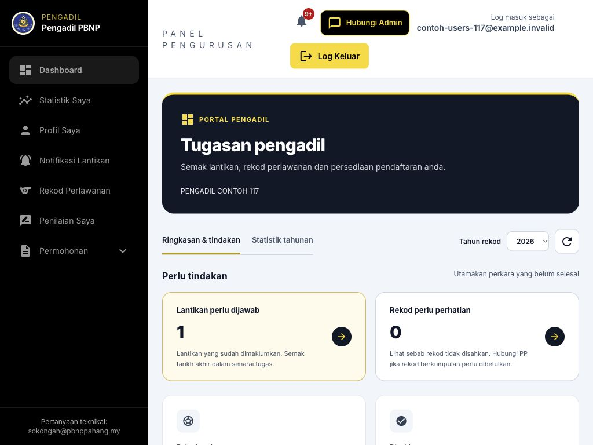

1. Semak tahun pada Dashboard dan kad yang menunggu tindakan. Buka tugasan yang perlu dijawab atau rekod yang perlu dilengkapkan.
2. Profil Saya: lengkapkan identiti, persatuan, waris, gambar dan hubungan. Rekod Perlawanan: tambah dan pantau pengesahan.
3. Permohonan: pilih Pendaftaran Tahunan (R1), Kelas III FAM atau Ujian Kelas I FAM. Penilaian Saya: baca laporan yang dibenarkan.
4. Gunakan Statistik Saya untuk ringkasan tahun. Semak loceng notifikasi serta mesej sokongan secara berkala.

> Menu Notifikasi Lantikan membuka senarai tugasan. Anda juga boleh membukanya melalui Dashboard atau https://refpahang.com/pengadil/tugasan.

## Panduan Pengadil: Menu Pengadil dalam aplikasi mobile
Halaman PDF 15

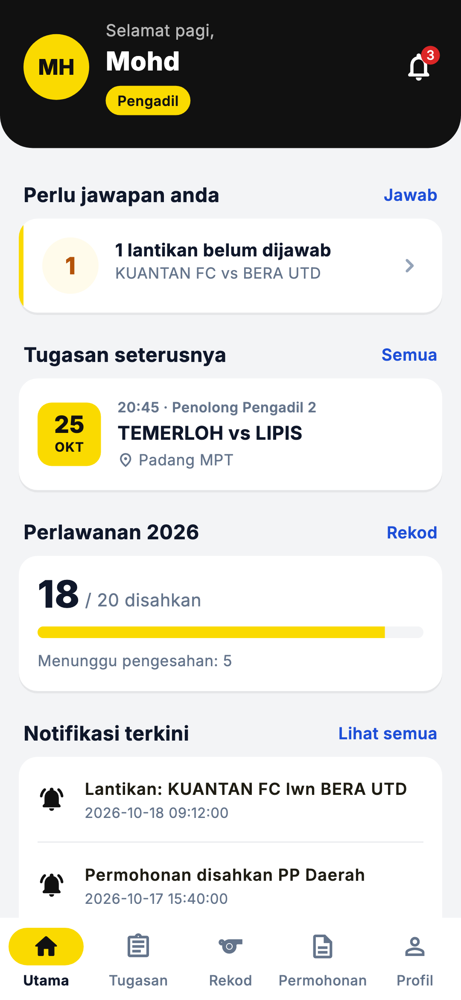

1. Utama: semak tugasan dan perkara yang memerlukan tindakan.
2. Tugasan: baca butiran lantikan, jawab Terima / Tolak dan buka surat apabila tersedia.
3. Rekod: semak perlawanan serta status PP dan tambah rekod mengikut pilihan yang disediakan.
4. Permohonan: semak status, butiran dan sejarah; buka Website bagi borang baharu yang memerlukannya.
5. Profil: kemas kini maklumat yang dibenarkan, pautkan Telegram, aktifkan notifikasi dan gunakan menu Lagi untuk fungsi tambahan.

## Pendaftaran akaun: Daftar akaun baharu: pilih peranan
Halaman PDF 16

Pendaftaran akaun dan permohonan pendaftaran tahunan ialah dua urusan berbeza. Akaun baharu belum bermaksud sudah menjadi pengadil atau penilai berdaftar bagi sesuatu tahun.

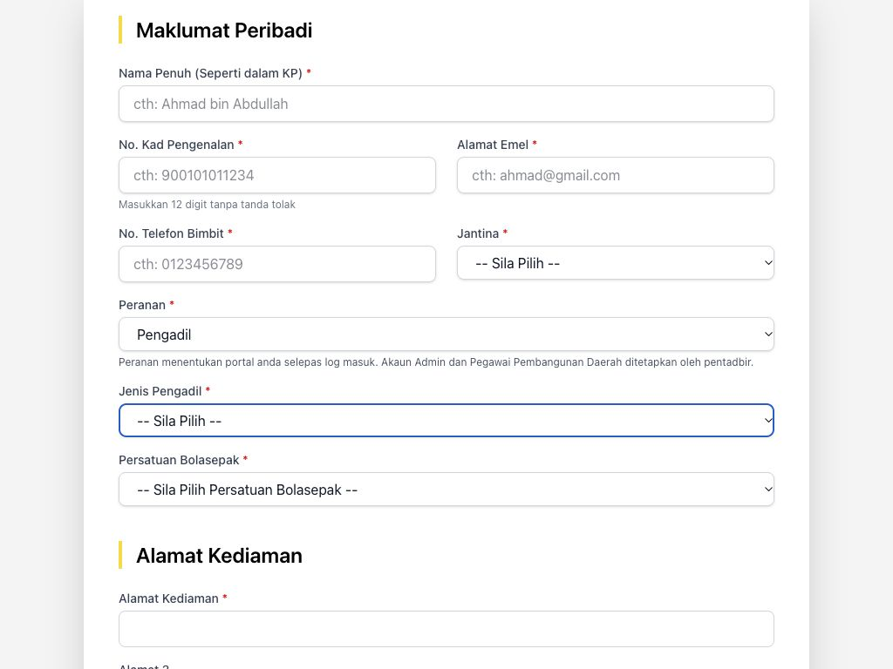

1. Pada Log Masuk, tekan Daftar Akaun Baharu. Halaman hanya menerima pendaftaran ketika tempoh yang ditetapkan Admin dibuka.
2. Isi nama seperti KP, nombor KP 12 digit tanpa tanda sengkang, emel, telefon, jantina dan persatuan daerah.
3. Pilih peranan Pengadil. Pilihan awam hanya Pengadil dan Penilai; akaun Admin serta PP Daerah diwujudkan oleh pentadbir.
4. Jika memilih Pengadil, pilih Jenis Pengadil yang sesuai: Pengadil Baharu, Pengadil Negeri atau Pengadil Kebangsaan. Jangan memilih kategori semata-mata untuk membuka menu lain.

## Pendaftaran akaun: Daftar akaun: profil dan dokumen
Halaman PDF 17

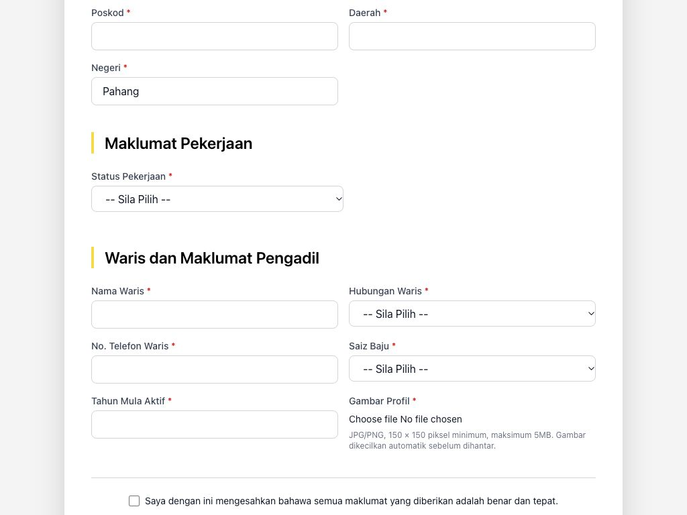

1. Lengkapkan alamat kediaman, poskod lima digit, daerah, negeri dan status pekerjaan.
2. Jika status pekerjaan memerlukan maklumat majikan, lengkapkan jawatan, institusi, alamat dan poskod majikan. Isi maklumat waris dan telefon waris 10 atau 11 digit.
3. Untuk Pengadil, isi saiz baju dan tahun mula aktif yang sah. Muat naik gambar profil JPG/PNG dan tunggu pemprosesan gambar selesai.
4. Semak semula semua maklumat, tandakan pengesahan data dan tekan Hantar Pendaftaran. Betulkan medan merah jika pengesahan gagal.

> Gambar yang diproses perlu berada dalam julat 150-400 piksel dan maksimum 200KB. Sistem memproses gambar; jangan hanya menukar sambungan fail.

## Pendaftaran akaun: Selepas pendaftaran akaun berjaya
Halaman PDF 18

1. Baca mesej Pendaftaran Berjaya dan semak emel untuk maklumat akses / kata laluan yang dihantar sistem.
2. Jika pautan Telegram diberikan, buka pautan itu dengan akaun Telegram sendiri dan tekan Start. Jangan berkongsi pautan peribadi.
3. Log masuk dan tukar kata laluan apabila diminta. Semak profil sebelum memulakan permohonan tahunan.
4. Jika emel atau nombor KP sudah berdaftar, gunakan pemulihan kata laluan atau minta Admin menyemak akaun sedia ada.
5. Jika pendaftaran berjaya tetapi emel tidak diterima, maklumkan kepada Admin. Jangan menghantar pendaftaran berulang dengan alamat lain.

> Kelulusan pendaftaran tahunan, keputusan ujian dan kelayakan lesen diproses melalui menu permohonan selepas akaun diwujudkan.

## Profil dan kelayakan: Lengkapkan dan kemas kini profil
Halaman PDF 19

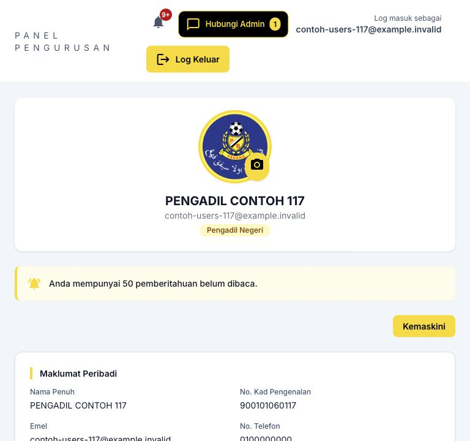

1. Buka Profil Saya. Jika Profil belum lengkap dipaparkan, baca senarai medan yang perlu dilengkapkan.
2. Tekan Kemaskini dan semak maklumat peribadi, alamat, pekerjaan, waris, persatuan dan maklumat kelayakan.
3. Muat naik / tukar gambar jika perlu. Gunakan pemotongan gambar yang disediakan dan tunggu pemprosesan selesai.
4. Semak emel, nombor telefon serta maklumat waris sebelum menyimpan. Bagi pekerjaan yang memerlukannya, lengkapkan maklumat majikan.
5. Semak hasil selepas simpan. Perubahan persatuan atau jenis/kelayakan tertentu boleh dihadkan; rujuk Admin apabila diminta.

> Maklumat profil digunakan semula dalam permohonan. Membetulkan profil tidak dengan sendirinya mengubah dokumen permohonan lama.

## Profil dan kelayakan: Semak jenis, tahun kelayakan dan lesen
Halaman PDF 20

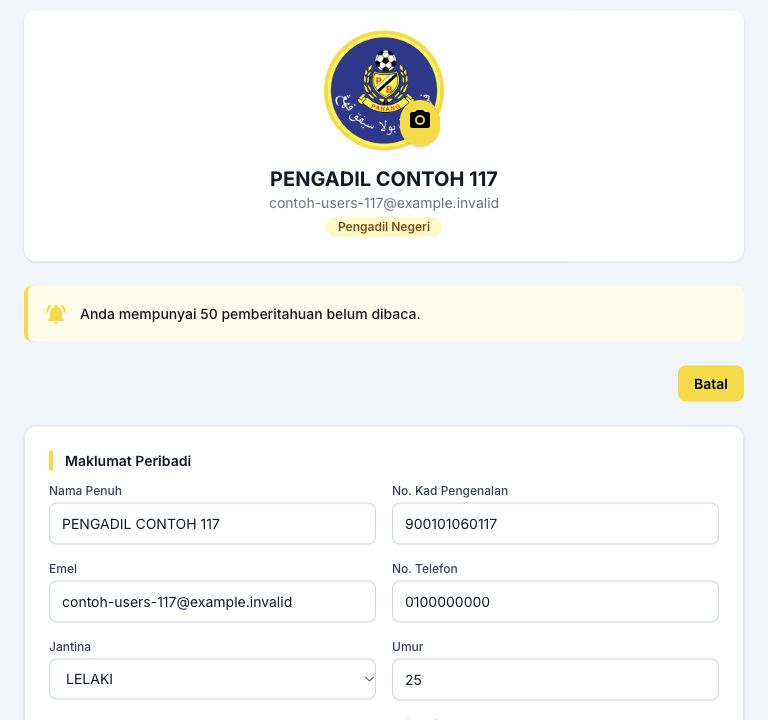

1. Semak Jenis Pengadil dan tahun mula aktif berdasarkan rekod sebenar, bukan untuk mendapatkan laluan permohonan tertentu.
2. Jika tahun mohon/lulus Kelas III atau Kelas I perlu dibetulkan, gunakan medan yang dibenarkan atau kemukakan bukti kepada Admin / PP.
3. Buka Dashboard / status permohonan tahun semasa untuk membezakan pendaftaran diluluskan daripada kelayakan patch atau lesen.
4. Jika belum lulus kecergasan bagi sesi yang berkaitan, jangan menganggap kelulusan dokumen membuktikan kelayakan patch/lesen.
5. Semak seminar pada statusnya sendiri. Rekod seminar tidak menggantikan keputusan kecergasan.

## Tugasan dan lantikan: Semak dan jawab lantikan sendiri
Halaman PDF 21

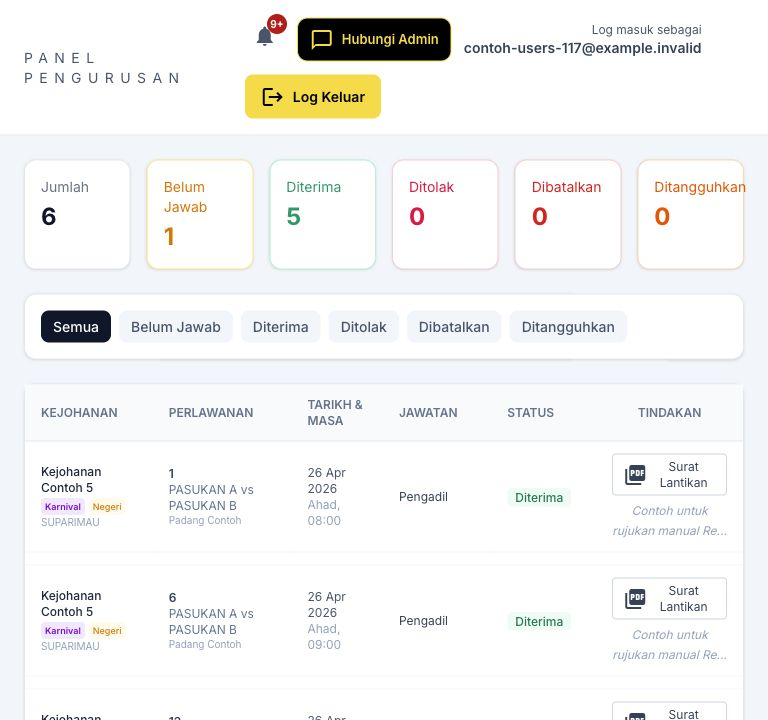

1. Buka Tugasan / Notifikasi Lantikan atau pautan tindakan pada Dashboard. Tapis Belum Jawab untuk mencari lantikan yang memerlukan keputusan.
2. Semak kejohanan, nombor perlawanan, tarikh, masa, tempat dan jawatan. Semak juga tempoh jawapan yang dipaparkan.
3. Jika bersedia, tekan Terima dan sahkan. Jika tidak dapat bertugas, tekan Tolak dan isi sebab penolakan sebelum menghantar.
4. Tunggu mesej berjaya dan pastikan status berubah kepada Diterima atau Ditolak. Jika butang tiada, semak status dan hubungi pelantik.

> Pautan emel/Telegram boleh membuka halaman jawapan peribadi. Semak identiti dan perlawanan sebelum menjawab; jangan jawab bagi pihak pegawai lain.

## Tugasan dan lantikan: Tarikh akhir dan perubahan lantikan
Halaman PDF 22

| Keadaan | Cara bertindak |
|---|---|
| Liga | Had biasa ialah 48 jam sebelum sepak mula, dikira daripada jadual perlawanan. |
| Selain Liga | Had biasa ialah 3 jam sebelum sepak mula. |
| Lantikan lewat | Jika notifikasi pertama dihantar selepas had biasa, pegawai boleh menjawab sehingga sepak mula. Baca tarikh sebenar pada pautan. |
| Belum Jawab | Semak sama ada notifikasi sudah dihantar. Lantikan biasa yang tidak dijawab boleh ditolak automatik pada had berkenaan. |
| Dibatalkan / Ditangguhkan | Jangan menganggap surat lama masih berkuat kuasa. Semak notis terbaru dan hubungi pelantik. |
| Sudah terima tetapi ada halangan | Maklumkan segera kepada Admin / PP Daerah. Pelantik perlu mengurus pembatalan atau penggantian; jangan hanya mengabaikan tugasan. |

> Had ini bukan tempoh 48 jam atau 3 jam selepas emel diterima. Masa rujukan ialah waktu sepak mula dan notifikasi lantikan yang direkodkan.

## Tugasan dan lantikan: Surat lantikan dan butiran perlawanan
Halaman PDF 23

1. Buka butiran tugasan yang berkenaan. Semak jawatan dan maklumat perlawanan pada kad atau senarai.
2. Jika pautan Surat / Surat Lantikan disediakan, bukanya dan simpan PDF melalui fungsi muat turun / kongsi peranti.
3. Semak status semasa sebelum menggunakan surat. Cetakan lama tidak menggantikan maklumat pembatalan atau penangguhan terbaru.
4. Selepas bertugas, lakukan urusan peranan masing-masing: Pengadil menyemak rekod; RA menyediakan laporan; PP mengurus semakan daerah.

> Rajah ialah butiran tugasan pada aplikasi mobile. Pada portal, fungsi surat dan jawapan terletak pada baris lantikan atau pautan emel/Telegram.

## Rekod perlawanan: Senarai rekod perlawanan sendiri
Halaman PDF 24

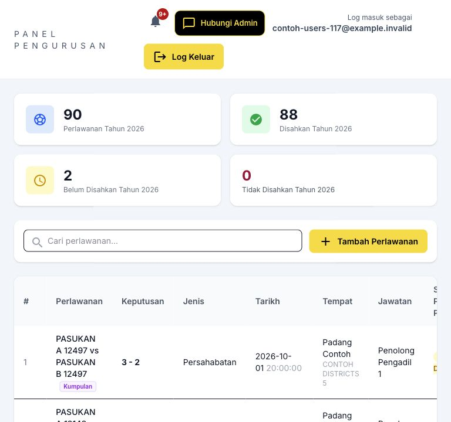

1. Buka Rekod Perlawanan. Semak tahun, jumlah Disahkan, Belum Disahkan dan Tidak Disahkan.
2. Gunakan carian atau pautan statistik untuk meneliti perlawanan yang berkaitan.
3. Baca tarikh, pasukan, tempat, jawatan dan status PP bagi setiap rekod. Semak catatan jika rekod ditolak.
4. Jika perlawanan datang daripada lantikan sistem, semak dahulu sama ada rekod sudah wujud supaya tidak memasukkan pendua.
5. Gunakan Tambah Perlawanan untuk rekod yang benar-benar perlu dilengkapkan mengikut tatacara sistem.

> Jumlah sepanjang masa dan jumlah tahun dipilih ialah ukuran berbeza. Status pengesahan rekod bukan status jawapan lantikan.

## Rekod perlawanan: Tambah perlawanan: butiran utama
Halaman PDF 25

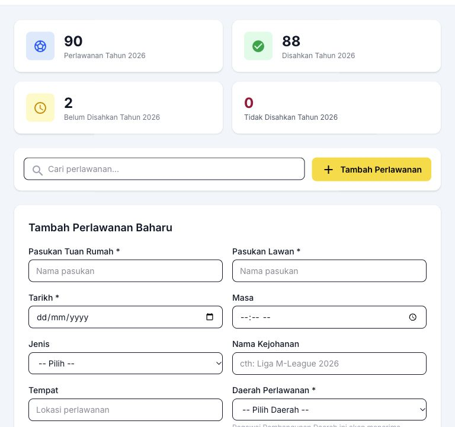

1. Pada Rekod Perlawanan, tekan Tambah Perlawanan. Semak borang dan isi tarikh, masa, jenis/kejohanan, kategori dan peringkat yang diminta.
2. Isi pasukan tuan rumah/pelawat, tempat serta daerah perlawanan dengan tepat.
3. Pilih jawatan sendiri dan pegawai KUP lain melalui pilihan yang disediakan; isi identiti/telefon yang diminta apabila berkenaan.
4. Semak setiap pegawai dan elakkan orang sama diletakkan pada jawatan yang bercanggah. Rujuk sistem jika pegawai tidak dijumpai.
5. Tatal ke bawah untuk semakan akhir dan butang simpan. Jangan anggap borang tersimpan ketika masih dibuka.

## Rekod perlawanan: Simpan rekod dan pantau pengesahan PP
Halaman PDF 26

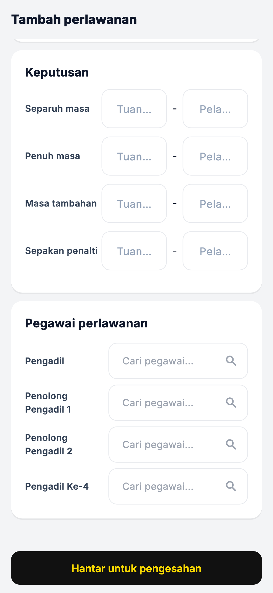

1. Baca semua maklumat perlawanan dan senarai pegawai sekali lagi sebelum menekan Simpan / Hantar.
2. Tunggu mesej berjaya, kemudian semak rekod muncul dalam senarai dengan status Belum Disahkan atau status yang dipaparkan.
3. PP Daerah akan menyemak rekod dalam skop pengesahannya. Jika terdapat pertindihan atau butiran tidak lengkap, rekod mungkin memerlukan penjelasan.
4. Jika Tidak Disahkan, baca catatan PP dan gunakan tindakan pembetulan yang dibenarkan; hubungi PP jika tidak boleh diedit.
5. Padam hanya rekod tersalah dimasukkan apabila tindakan itu tersedia. Jangan memadam rekod betul untuk menukar statistik.

> Satu rekod pegawai dan satu perlawanan berkumpulan tidak semestinya unit sama. Pastikan rekod semua KUP konsisten.

## Permohonan dan pendaftaran tahunan: Pendaftaran tahunan R1 + R2 + R4
Halaman PDF 27

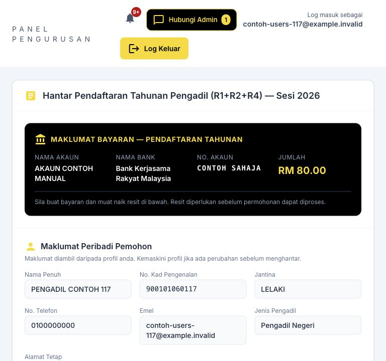

1. Buka Permohonan > Pendaftaran Tahunan (R1). Baca nama borang, sesi dan tempoh penerimaan yang dipaparkan.
2. Jika profil belum lengkap, lengkapkan melalui Profil Saya dan kembali ke borang.
3. Semak profil praisi, waris dan maklumat bayaran untuk sesi berkenaan. Isi medan tambahan yang diperlukan.
4. Sediakan resit bayaran, gambar terkini, saiz baju serta semua perakuan sebelum meneruskan.
5. Jika permohonan sesi sama sudah wujud, semak status/sejarahnya; sistem tidak semestinya membenarkan permohonan kedua.

> Halaman boleh memaparkan belum dibuka atau ditutup berdasarkan tetapan Admin. Akaun aktif tidak bermakna semua borang sedang dibuka.

## Permohonan dan pendaftaran tahunan: Dokumen, kesihatan dan hantar permohonan
Halaman PDF 28

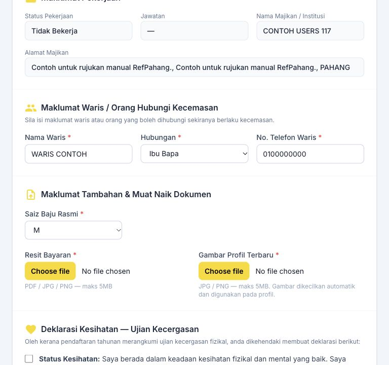

1. Muat naik resit bayaran yang sah dalam format JPG, PNG atau PDF, maksimum 5MB. Pastikan bukti jelas dan sepadan dengan sesi.
2. Pilih gambar JPG/PNG dan tunggu pemprosesan. Hasil gambar profil perlu memenuhi saiz/piksel yang dibenarkan oleh sistem.
3. Isi saiz baju dan semak maklumat waris. Baca semua perakuan am serta perakuan kesihatan pada pendaftaran Pengadil.
4. Tandakan hanya perakuan yang benar, kemudian tekan Hantar Permohonan. Betulkan ralat jika diminta.
5. Selepas berjaya, semak sejarah permohonan dan tahun. Simpan nombor rujukan atau PDF yang disediakan.

> Jangan menyalin nombor akaun atau amaun daripada screenshot manual. Gunakan butiran semasa pada borang dan arahan rasmi.

## Permohonan dan pendaftaran tahunan: Baca perjalanan status permohonan
Halaman PDF 29

| Status / peringkat | Tindakan Pengadil |
|---|---|
| Menunggu PP Daerah | Tunggu pengesahan daerah; hubungi PP jika dokumen atau maklumat perlu semakan. |
| Menunggu Admin | PP telah mengesahkan; tunggu keputusan Admin. |
| Approved / Lengkap | Pendaftaran/permohonan diluluskan mengikut jenis dan sesi. Semak syarat kecergasan secara berasingan. |
| Admin Diluluskan | Bagi pendaftaran Pengadil sesi 2027+, dokumen diluluskan; keputusan kecergasan menentukan patch/lesen. |
| Ditolak / Rejected | Baca sebab dan rujuk PP/Admin. Jangan menganggap boleh menghantar permohonan pendua sesi sama. |
| Lulus / Tidak Lulus / Tidak Hadir | Keputusan ujian; bukan peranan akaun atau bukti Telegram aktif. |
| Hadir / Tidak Hadir seminar | Rekod seminar berasingan daripada keputusan kecergasan. |

## Permohonan dan pendaftaran tahunan: Permohonan Kelas III FAM
Halaman PDF 30

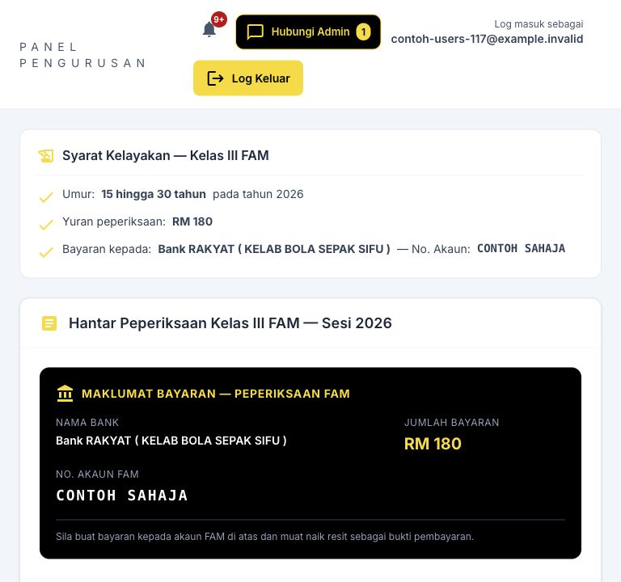

1. Buka Permohonan > Kelas III FAM. Semak sesi, tempoh pembukaan, umur dan syarat yang dipaparkan.
2. Semak profil dan waris. Rujuk arahan yuran / akaun FAM semasa dan muat naik resit yang diminta.
3. Baca dan tandakan perakuan yang berkaitan, kemudian tekan Hantar Permohonan.
4. Semak sejarah bagi status pengesahan PP/Admin serta keputusan peperiksaan selepas direkodkan.
5. Jika tidak memenuhi umur atau dokumen ditolak, baca ralat dan rujuk pihak berkenaan; jangan menukar tarikh lahir untuk memintas syarat.

## Permohonan dan pendaftaran tahunan: Permohonan Ujian Kelas I FAM
Halaman PDF 31

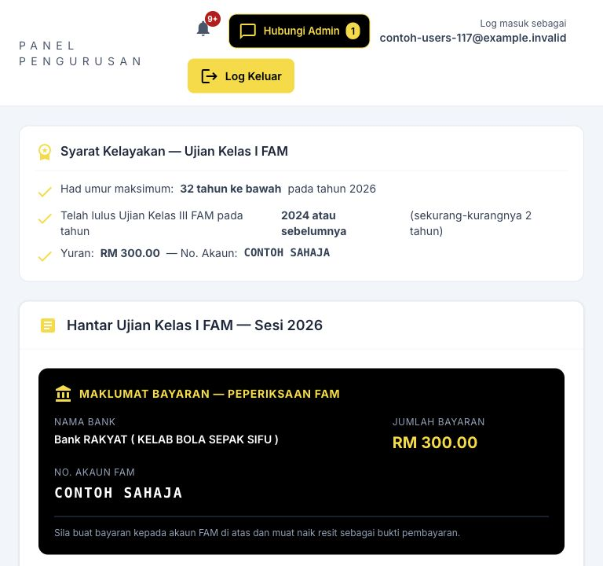

1. Buka Permohonan > Ujian Kelas I FAM dan baca syarat sesi semasa.
2. Semak had umur dan rekod lulus Kelas III. Sistem memerlukan sijil Kelas III sekurang-kurangnya dua tahun sebelum sesi berkenaan.
3. Jika rekod tahun kelayakan salah atau tiada, rujuk Admin / PP dengan bukti sebelum meneruskan.
4. Lengkapkan waris, resit bayaran FAM dan perakuan, kemudian hantar apabila semua syarat dipenuhi.
5. Pantau status dan keputusan pada sejarah permohonan. Had umur/yuran boleh berubah melalui tetapan sesi.

> Gunakan syarat yang dipaparkan serta keputusan pelayan. Paparan borang sahaja tidak membuktikan pemohon sudah layak.

## Permohonan dan pendaftaran tahunan: Muat turun borang dan sejarah permohonan
Halaman PDF 32

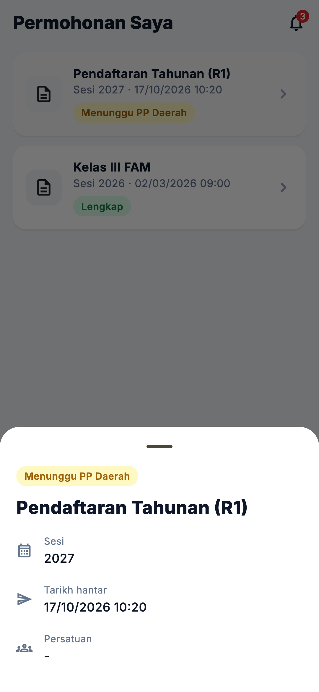

1. Buka menu permohonan yang berkaitan dan tatal ke Sejarah Permohonan. Pada aplikasi, buka Permohonan dan pilih rekod.
2. Semak jenis, tahun, status serta catatan sebelum membuka butiran.
3. Gunakan pautan borang / PDF / muat turun yang tersedia pada rekod berkenaan.
4. Semak nama, sesi dan jenis borang pada dokumen yang dibuka. Simpan dalam Downloads atau kongsi hanya untuk urusan rasmi.
5. Jika dokumen tidak tersedia, semak status dan syarat penerbitan pada portal; hubungi Admin dengan nombor permohonan.

## Penilaian dan statistik: Penilaian Saya dan laporan KUP
Halaman PDF 33

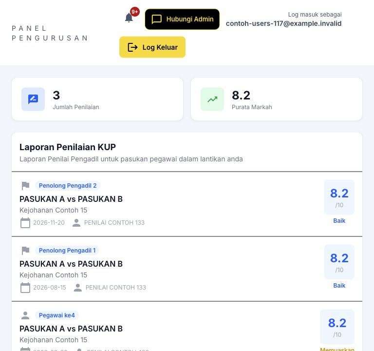

1. Buka Penilaian Saya dan semak senarai laporan yang boleh dicapai.
2. Pilih perlawanan untuk membaca markah, prestasi, kekuatan, kelemahan dan nasihat penilai.
3. KUP dalam perlawanan sama boleh membaca laporan pegawai KUP pada perlawanan tersebut mengikut akses sistem. Laporan perlawanan lain tidak termasuk.
4. Baca status laporan/pengesahan dan catatan, kemudian gunakan nasihat untuk penambahbaikan prestasi.
5. Jika pegawai atau perlawanan tidak sepadan, laporkan kepada Admin / RA dengan nombor rujukan.

> Akses membaca laporan tidak membenarkan Pengadil menulis, mengubah markah atau mengesahkan laporan RA.

## Penilaian dan statistik: Statistik Saya dan rutin selepas perlawanan
Halaman PDF 34

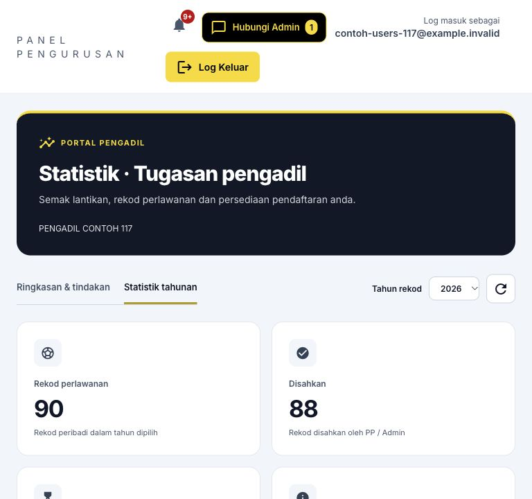

1. Buka Statistik Saya dan pilih tahun. Semak rekod disahkan, menunggu, ditolak serta tugasan yang perlu tindakan.
2. Gunakan pautan pada kad untuk menyemak rekod sumber. Semak unit tahunan berbanding sepanjang masa.
3. Selepas menerima tugas, simpan maklumat rasmi. Selepas perlawanan, semak rekod dan butiran yang memerlukan kemas kini.
4. Pantau pengesahan PP, penilaian RA serta pendaftaran tahunan. Semak Telegram dan notis portal tanpa hanya bergantung pada push.
5. Pastikan profil dan waris terkini, kemudian log keluar selepas selesai.

## Penilaian dan statistik: Pengadil luar dan bantuan kepada Admin
Halaman PDF 35

1. Pengadil luar ialah pegawai dalam direktori jemputan yang diurus oleh Admin. Mereka tidak semestinya mempunyai akaun portal.
2. Jika menerima pautan lantikan sebagai pengadil luar, semak nama/perlawanan dan jawab melalui pautan peribadi yang diberikan.
3. Jika anda sudah mempunyai akaun RefPahang tetapi tersenarai sebagai luar, maklumkan kepada Admin untuk semakan padanan; jangan cipta identiti kedua.
4. Jika memerlukan bantuan, gunakan Hubungi Admin / chat pada portal atau rujuk PP Daerah. Sertakan nombor perlawanan/permohonan dan mesej ralat.
5. Pengadil tidak mempunyai menu untuk mencipta pegawai luar, meluluskan permohonan orang lain atau mengurus pool kejohanan.

## Bantuan dan rujukan: Penyelesaian masalah harian
Halaman PDF 36

| Masalah | Tindakan pengguna |
|---|---|
| Menu tidak kelihatan | Semak peranan; buka menu telefon; fungsi tambahan PP memerlukan keupayaan yang diberikan. |
| Senarai kosong | Semak tahun, status, daerah, kata carian dan halaman senarai. Kosong tidak bermakna semua data telah dipadam. |
| Borang tidak boleh dihantar | Lengkapkan profil, dokumen dan perakuan; semak tempoh buka/tutup serta permohonan sedia ada untuk sesi sama. |
| Fail ditolak | Semak format dan saiz; resit JPG/PNG/PDF; gambar JPG/PNG yang berjaya diproses. Jangan sekadar menukar nama sambungan fail. |
| Sesi tamat | Log masuk semula. Semak dahulu sama ada tindakan terakhir berjaya sebelum menghantar semula. |
| Mesej rekod telah berubah | Muat semula butiran dan semak keadaan terkini. Elakkan mengulang tindakan daripada tab lama. |
| PDF tidak terbuka | Benarkan tab baharu / muat turun untuk portal; semak Downloads. Jangan kongsi PDF yang mengandungi data peribadi kepada umum. |

## Bantuan dan rujukan: Cara mendapatkan bantuan
Halaman PDF 37

Hubungi Admin atau Pegawai Pembangunan Daerah untuk urusan rekod, kelayakan dan permohonan. Sokongan teknikal yang tertera pada portal: sokongan@pbnppahang.my.

1. Sediakan nama peranan, menu yang digunakan, tahun / sesi, nombor permohonan atau nombor perlawanan dan masa masalah berlaku.
2. Sertakan screenshot mesej ralat. Lindungi kata laluan, pautan peribadi, nombor akaun dan data sensitif sebelum berkongsi.
3. Terangkan tindakan terakhir yang dibuat dan hasil yang dijangka. Nyatakan sama ada menggunakan web komputer, Android APK atau aplikasi skrin utama iPhone.
4. Jika berkaitan transaksi simpan / hantar, semak status semasa dan maklumkan jika rekod telah muncul. Elakkan membuat akaun atau permohonan pendua.
5. Selepas penyelesaian, buka semula rekod, sahkan status betul dan simpan nombor rujukan untuk susulan.

> Manual ini menerangkan tatacara pengguna. Ia tidak mengesahkan penghantaran emel/push pada setiap peranti atau memberi kuasa meluluskan di luar skop peranan.

## Lampiran kemas kini: Lampiran: sebab Akaun Tidak Aktif
Halaman PDF 38

Akaun Tidak Aktif tidak boleh log masuk. Popup menerangkan sebab sekatan selepas kata laluan disahkan.

1. Pendaftaran: bagi akaun Pengadil yang melalui dua tahun kalendar penuh, sistem memeriksa dua tahun lengkap sebelumnya. Untuk 2026, tahun rujukan ialah 2024 dan 2025.
2. Permohonan yang telah dihantar sudah dikira walaupun belum diluluskan. Akaun baharu tidak dikenakan tahun sebelum melalui dua tahun penuh.
3. Manual: Admin boleh menandakan akaun Tidak Aktif dengan sebab. Aktiviti: semua pengguna kecuali Admin disekat selepas 8 bulan tanpa aktiviti atau log masuk.
4. Popup menunjukkan sebab apabila maklumat log masuk betul. Hanya Admin boleh mengaktifkan semula akaun; sejarah permohonan, perlawanan dan laporan dikekalkan.

> Pengaktifan semula memerlukan log masuk baharu. Tempoh 8 bulan bermula semula; semakan pendaftaran seterusnya berlaku pada tahun kalendar berikutnya.
