# Manual Pengguna RefPahang - RA / Penilai Pengadil

Lantikan, penilaian KUP dan laporan

Edisi 20 Oktober 2026. Screenshot antaramuka sebenar dengan data contoh.

## Mula di sini: Cara menggunakan manual ini
Halaman PDF 3

Manual ini khusus untuk RA / Penilai Pengadil. Gunakan portal https://refpahang.com pada komputer atau telefon; aplikasi mobile menggunakan akaun yang sama.

1. Cari tugas melalui Kandungan yang boleh diklik atau penanda buku PDF. Ikut nama menu dan butang yang dicetak tebal dalam arahan.
2. Screenshot ialah antaramuka aplikasi sebenar dengan identiti dianonimkan dan keadaan contoh. Nama, jumlah, tarikh, keputusan dan butiran bayaran dalam rajah bukan data operasi semasa.
3. Pada telefon, tekan butang menu untuk membuka navigasi. Jadual lebar boleh ditatal mendatar; tatal ke bawah untuk melihat dokumen, butang simpan dan halaman seterusnya.
4. Selepas menghantar atau menyimpan, tunggu mesej berjaya dan semak semula status rekod. Jika gagal, kekalkan maklumat ralat untuk rujukan sokongan.
5. Rujukan edisi: 20 Oktober 2026. Lampiran Akaun Tidak Aktif menerangkan sekatan akses dan pengaktifan semula oleh Admin.

## Mula di sini: Peranan, pendaftaran dan status
Halaman PDF 4

Empat perkara ini mempunyai maksud berbeza. Semak tahun atau sesi sebelum membuat kesimpulan tentang kelayakan seseorang.

| Istilah | Maksud kepada pengguna |
|---|---|
| Peranan akaun | Admin, PP Daerah, Pengadil atau Penilai. Menentukan panel dan menu. RA ialah Penilai Pengadil. |
| Jenis Pengadil | Kategori atau kelayakan pengadil; bukan bukti pendaftaran tahun semasa. |
| Pendaftaran tahunan | Permohonan pengadil atau penilai untuk sesi tertentu; kelulusan tahun lalu tidak meliputi tahun baharu. |
| Status permohonan | Contohnya Menunggu PP Daerah, Menunggu Admin, Lengkap atau Ditolak. |
| Seminar / kecergasan | Rekod berasingan. Kecergasan menentukan kelayakan patch / lesen negeri; seminar tidak menggantikan keputusan kecergasan. |
| KUP dan RA | KUP: R, AR1, AR2 dan pegawai keempat. RA menilai KUP dan bukan salah satu daripada empat pegawai tersebut. |

## Akses dan akaun: Log masuk dan buka panel sendiri
Halaman PDF 5

Buka https://refpahang.com. Gunakan emel akaun yang didaftarkan dan kata laluan peribadi.

1. Isi Emel dan Kata Laluan, kemudian tekan Log Masuk. Semak ejaan emel dan elakkan ruang kosong yang tersalin bersama kata laluan.
2. Pastikan panel yang dibuka ialah Dashboard Penilai. Jika sistem meminta pertukaran kata laluan kali pertama, lengkapkan proses itu dahulu.
3. Jika maklumat salah, betulkan emel atau kata laluan dan cuba semula. Cubaan gagal yang terlalu banyak boleh dihadkan sementara.
4. Jika akaun tidak aktif atau sistem dalam penyelenggaraan, baca mesej yang dipaparkan. Hubungi Admin jika akses memerlukan semakan.

## Akses dan akaun: Lupa kata laluan dan log keluar
Halaman PDF 6

1. Pada halaman Log Masuk, tekan Lupa kata laluan?. Masukkan emel akaun dan hantar permintaan.
2. Semak peti masuk serta folder Spam / Junk. Buka pautan pemulihan yang dihantar kepada emel sendiri dan tetapkan kata laluan baharu.
3. Jika pautan tamat tempoh atau telah digunakan, minta pautan baharu. Jika tiada emel, semak alamat dengan Admin; jangan cipta akaun kedua untuk mengatasi masalah ini.
4. Selepas selesai bekerja, tekan Log Keluar. Pada telefon atau komputer yang dikongsi, pastikan halaman log masuk muncul semula.

> Jangan kongsi kata laluan, pautan pemulihan, pautan jawapan lantikan atau pautan laporan peribadi kepada orang lain.

## Akses dan akaun: Tukar kata laluan sendiri
Halaman PDF 7

1. Buka Profil / Profil Saya dan cari bahagian Tukar Kata Laluan. Pada aplikasi, fungsi ini tersedia melalui Profil atau menu Lagi.
2. Masukkan kata laluan semasa, kata laluan baharu dan pengesahan kata laluan seperti diminta.
3. Patuhi syarat panjang dan pengesahan yang dipaparkan, kemudian tekan Tukar Kata Laluan.
4. Tunggu pengesahan berjaya. Jika sesi tamat atau diminta log masuk semula, gunakan kata laluan baharu.

## Aplikasi dan notifikasi: Pasang aplikasi pada Android
Halaman PDF 8

Gunakan pautan Android pada halaman Log Masuk atau https://refpahang.com/app/refpahang.apk.

1. Muat turun APK rasmi dan tunggu fail selesai dimuat turun. Buka fail melalui Downloads / Files.
2. Jika diminta, benarkan Install unknown apps / Allow from this source untuk pelayar atau pengurus fail yang digunakan.
3. Kembali ke pemasang, tekan Install / Pasang dan kemudian Open / Buka.
4. Log masuk menggunakan akaun portal. Benarkan notifikasi apabila diminta dan semak panel peranan anda.
5. Jika pemasangan disekat oleh dasar peranti, simpan mesej ralat dan hubungi sokongan. Gunakan aplikasi web sementara menunggu bantuan.

> Nama tetapan Android berbeza mengikut jenama. Screenshot ini menunjukkan skrin aplikasi, bukan skrin tetapan setiap jenama telefon.

## Aplikasi dan notifikasi: Pasang aplikasi pada iPhone
Halaman PDF 9

iPhone menggunakan aplikasi web RefPahang yang ditambah ke skrin utama melalui Safari.

1. Buka Safari dan pergi ke https://refpahang.com/app/.
2. Tekan Kongsi / Share, pilih Add to Home Screen / Tambah ke Skrin Utama dan tekan Add / Tambah.
3. Jika pilihan Open as Web App dipaparkan, hidupkannya. Buka RefPahang melalui ikon skrin utama.
4. Log masuk, cari kad Aktifkan notifikasi pada Utama atau Profil, dan ikuti langkah pengaktifan pada halaman berikut.
5. Jika kad menyatakan aplikasi perlu dipasang, tutup tab biasa dan buka semula melalui ikon skrin utama.

> Pemasangan ini tidak menggunakan fail APK Android. Rajah menunjukkan mesej bantuan dalam aplikasi; paparan Share Safari boleh berbeza mengikut versi iOS.

## Aplikasi dan notifikasi: Aktifkan notifikasi telefon
Halaman PDF 10

1. Buka RefPahang dan log masuk. Cari kad Aktifkan notifikasi pada Utama atau Profil.
2. Tekan Aktifkan notifikasi, kemudian pilih Allow / Benarkan apabila pelayar atau telefon meminta kebenaran.
3. Pada iPhone, lakukan langkah ini daripada aplikasi skrin utama. Pada Android APK, semak kebenaran notifikasi RefPahang dalam tetapan aplikasi.
4. Pastikan status kad bertukar kepada Notifikasi aktif. Kembali ke Profil jika perlu untuk menyemak keadaan semasa.
5. Buka ikon loceng dalam portal atau menu Notifikasi aplikasi untuk membaca butiran notis. Push, notis dalam portal, emel dan Telegram ialah saluran berasingan.

> Rajah kad kebenaran ialah render widget sebenar dengan keadaan contoh; ia bukan bukti kebenaran OS telah diberikan pada telefon anda.

## Aplikasi dan notifikasi: Notifikasi disekat atau tidak sampai
Halaman PDF 11

1. Jika kad menunjukkan Disekat, buka tetapan laman / aplikasi pada telefon dan benarkan notifikasi untuk RefPahang.
2. Semak Focus / Jangan Ganggu, mod senyap, sambungan internet dan had bateri. Buka semula aplikasi selepas mengubah tetapan.
3. Pada iPhone, pastikan ikon skrin utama digunakan. Pada Android, semak Settings > Apps > RefPahang > Notifications mengikut jenama.
4. Log masuk semula jika sesi telah tamat. Minta Admin menyemak bahawa notifikasi berkaitan benar-benar telah dihantar.
5. Jika masih gagal, laporkan jenis telefon, versi aplikasi, status kad notifikasi dan masa kejadian. Semak notis dalam portal sementara menunggu bantuan.

> Status Notifikasi aktif menunjukkan langganan tersedia; ia tidak membuktikan setiap notis telah dibaca. Jangan terlepas tarikh tindakan kerana hanya menunggu popup telefon.

## Aplikasi dan notifikasi: Hubungkan akaun Telegram
Halaman PDF 12

1. Buka Profil / Profil Saya dan cari Pemautan Telegram. Semak sama ada status menyatakan Telegram belum dipaut atau berjaya dipaut.
2. Tekan Hubungkan Telegram dan buka pautan peribadi dalam aplikasi Telegram.
3. Tekan Mula / Start pada bot. Kembali ke RefPahang dan tekan Semak Status Pemautan jika status belum berubah.
4. Pastikan status menunjukkan Telegram berjaya dipaut. Jika bot pernah disekat, nyahsekat bot dan mulakan semula pemautan.
5. Jika akaun Telegram lama dinyahaktifkan atau pautan tamat tempoh, dapatkan pautan baharu melalui profil atau hubungi Admin.

> Jangan gunakan pautan pemautan milik orang lain. Pemautan Telegram tidak secara automatik memberikan kebenaran push telefon.

## Aplikasi dan notifikasi: Kemas kini aplikasi
Halaman PDF 13

1. Jika aplikasi memaklumkan versi baharu, baca maklumat kemas kini dan tekan pilihan kemas kini yang tersedia.
2. Android: muat turun APK terkini daripada pautan rasmi dan pasang menindih aplikasi sedia ada. Lengkapkan pemasangan, kemudian buka semula.
3. iPhone / aplikasi web: tutup aplikasi dan buka semula ketika bersambung internet. Jika masih paparan lama, muat semula laman dan cuba lagi.
4. Log masuk semula jika diminta. Semak Profil, Tugasan dan notifikasi selepas kemas kini.
5. Jika versi minimum diwajibkan oleh sistem, selesaikan kemas kini sebelum meneruskan penggunaan.

> Simpan bukti atau draf yang belum dihantar sebelum menutup aplikasi. Versi dan saiz muat turun berubah mengikut keluaran; gunakan maklumat pada aplikasi semasa.

## Panduan RA: Skop RA dan menu Penilai Pengadil
Halaman PDF 14

RA ialah Penilai Pengadil. Akaun portal menggunakan peranan Penilai; RA menilai KUP dan tidak menggantikan jawatan R, AR1, AR2 atau pegawai keempat.

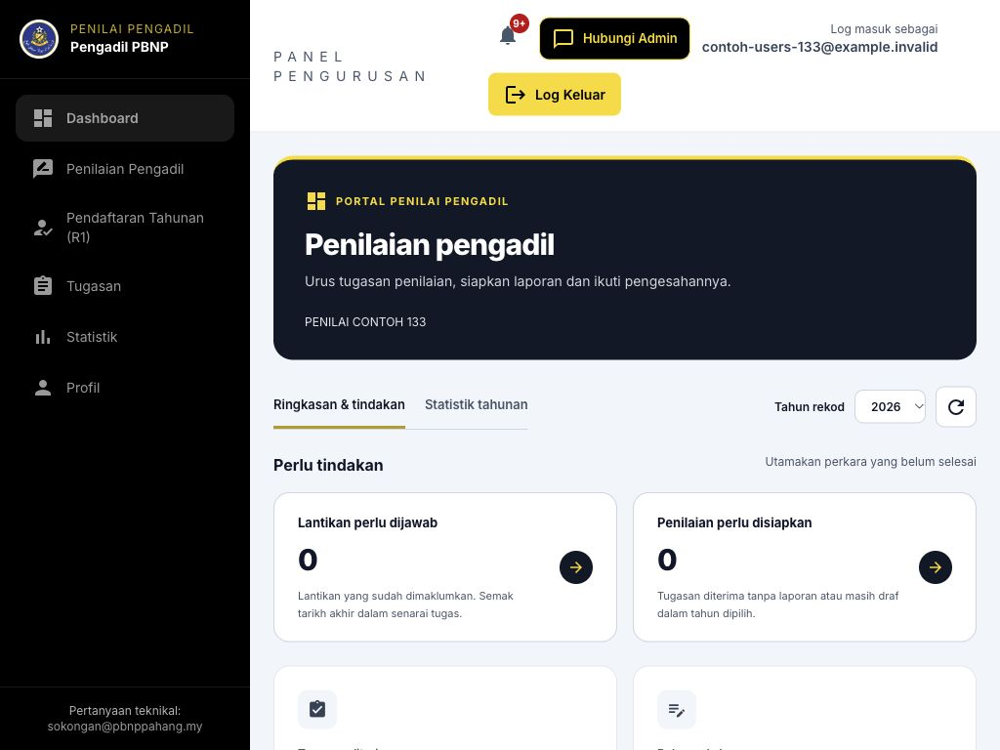

1. Dashboard menunjukkan tugasan, laporan perlu disiapkan dan status pendaftaran bagi tahun dipilih.
2. Penilaian Pengadil membuka Perlu Dinilai dan Laporan Saya. Tugasan ialah tempat menyemak dan menjawab lantikan.
3. Pendaftaran Tahunan (R1), Statistik dan Profil menyokong urusan peribadi RA.
4. Jika anda PP yang turut menjadi RA, gunakan Panel Penilai Pengadil Saya; kuasa pengesahan daerah kekal berasingan.

## Panduan RA: Menu RA dalam aplikasi mobile
Halaman PDF 15

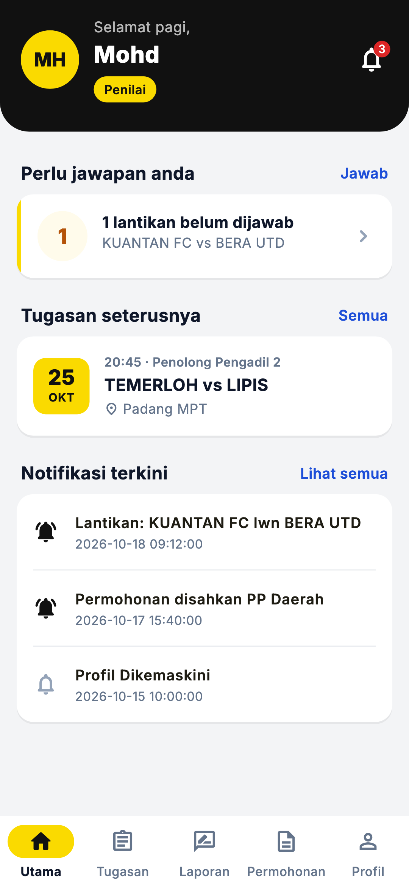

1. Utama: semak tugasan dan laporan yang perlu tindakan.
2. Tugasan: terima atau tolak lantikan RA serta baca butiran dan surat.
3. Laporan: pilih perlawanan, buka borang penilaian, simpan draf atau hantar laporan yang lengkap.
4. Permohonan: lihat status / sejarah permohonan; gunakan Website apabila pautan borang membawa ke portal.
5. Profil: semak akaun, Telegram, notifikasi dan menu bantuan.

## Pendaftaran akaun: Daftar akaun baharu: pilih peranan
Halaman PDF 16

Pendaftaran akaun dan permohonan pendaftaran tahunan ialah dua urusan berbeza. Akaun baharu belum bermaksud sudah menjadi pengadil atau penilai berdaftar bagi sesuatu tahun.

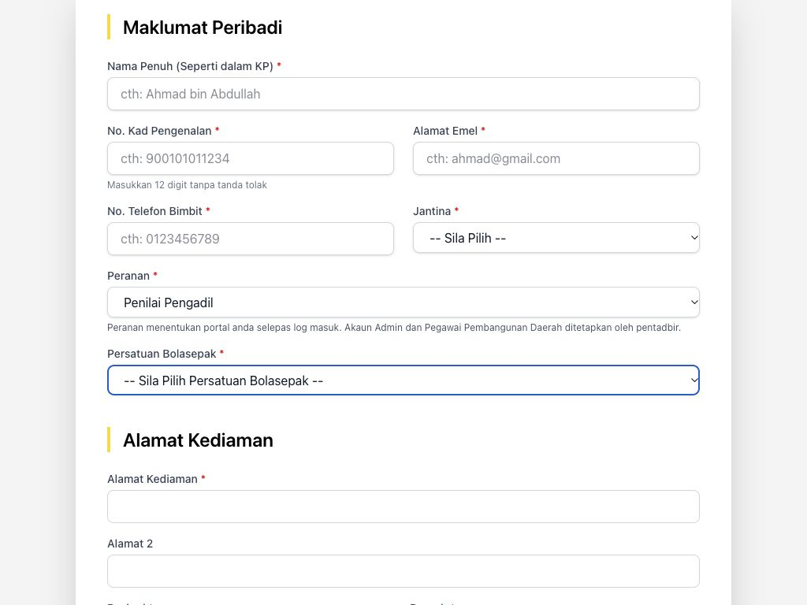

1. Pada Log Masuk, tekan Daftar Akaun Baharu. Halaman hanya menerima pendaftaran ketika tempoh yang ditetapkan Admin dibuka.
2. Isi nama seperti KP, nombor KP 12 digit tanpa tanda sengkang, emel, telefon, jantina dan persatuan daerah.
3. Pilih peranan Penilai Pengadil. Pilihan awam hanya Pengadil dan Penilai; akaun Admin serta PP Daerah diwujudkan oleh pentadbir.
4. Jika memilih Pengadil, pilih Jenis Pengadil yang sesuai: Pengadil Baharu, Pengadil Negeri atau Pengadil Kebangsaan. Jangan memilih kategori semata-mata untuk membuka menu lain.

## Pendaftaran akaun: Daftar akaun: profil dan dokumen
Halaman PDF 17

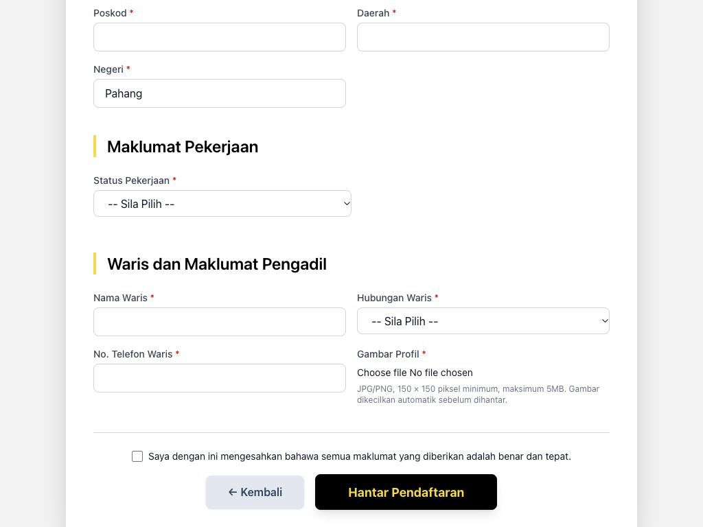

1. Lengkapkan alamat kediaman, poskod lima digit, daerah, negeri dan status pekerjaan.
2. Jika status pekerjaan memerlukan maklumat majikan, lengkapkan jawatan, institusi, alamat dan poskod majikan. Isi maklumat waris dan telefon waris 10 atau 11 digit.
3. Untuk Pengadil, isi saiz baju dan tahun mula aktif yang sah. Muat naik gambar profil JPG/PNG dan tunggu pemprosesan gambar selesai.
4. Semak semula semua maklumat, tandakan pengesahan data dan tekan Hantar Pendaftaran. Betulkan medan merah jika pengesahan gagal.

> Gambar yang diproses perlu berada dalam julat 150-400 piksel dan maksimum 200KB. Sistem memproses gambar; jangan hanya menukar sambungan fail.

## Pendaftaran akaun: Selepas pendaftaran akaun berjaya
Halaman PDF 18

1. Baca mesej Pendaftaran Berjaya dan semak emel untuk maklumat akses / kata laluan yang dihantar sistem.
2. Jika pautan Telegram diberikan, buka pautan itu dengan akaun Telegram sendiri dan tekan Start. Jangan berkongsi pautan peribadi.
3. Log masuk dan tukar kata laluan apabila diminta. Semak profil sebelum memulakan permohonan tahunan.
4. Jika emel atau nombor KP sudah berdaftar, gunakan pemulihan kata laluan atau minta Admin menyemak akaun sedia ada.
5. Jika pendaftaran berjaya tetapi emel tidak diterima, maklumkan kepada Admin. Jangan menghantar pendaftaran berulang dengan alamat lain.

> Kelulusan pendaftaran tahunan, keputusan ujian dan kelayakan lesen diproses melalui menu permohonan selepas akaun diwujudkan.

## Pendaftaran tahunan RA: Profil dan pendaftaran tahunan RA
Halaman PDF 19

1. Buka Profil dan semak identiti, emel, nombor telefon, persatuan, waris serta gambar. Betulkan profil sebelum memohon.
2. Buka Pendaftaran Tahunan (R1). Semak sesi, tempoh pembukaan dan maklumat bayaran semasa.
3. Lengkapkan maklumat tambahan, saiz baju, resit dan gambar yang diminta pada borang. Tandakan semua perakuan berkaitan.
4. Tekan Hantar Permohonan dan semak status serta sejarah. Pendaftaran akaun sahaja tidak meluluskan R1 tahunan.

> Gunakan maklumat bayaran pada borang semasa. Screenshot mengandungi contoh; jangan menyalin butiran akaun daripada rajah.

## Pendaftaran tahunan RA: Status permohonan dan dokumen RA
Halaman PDF 20

1. Buka Pendaftaran Tahunan dan tatal ke Sejarah Permohonan. Padankan tahun dan jenis Penilai Pengadil.
2. Semak Menunggu PP Daerah, Menunggu Admin, diluluskan/Lengkap atau Ditolak serta catatan jika diberikan.
3. Jika diminta pembetulan, semak catatan dan hubungi PP/Admin. Jangan menganggap boleh menghantar permohonan kedua bagi sesi sama.
4. Gunakan pilihan muat turun borang/PDF yang disediakan pada rekod. Pastikan PDF merujuk sesi dan pemohon yang betul.
5. Permohonan RA tidak sama dengan keputusan ujian kecergasan Pengadil; rujuk syarat bagi peranan dan borang yang dipilih.

## Tugasan dan lantikan: Semak dan jawab lantikan sendiri
Halaman PDF 21

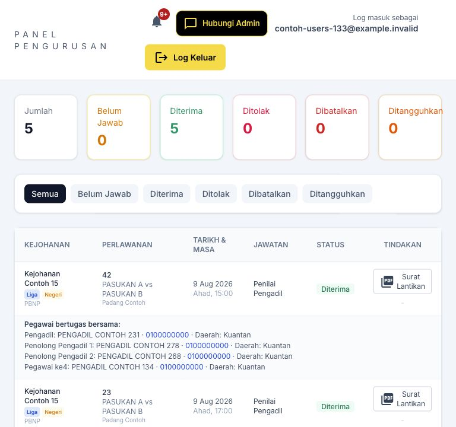

1. Buka Tugasan / Notifikasi Lantikan atau pautan tindakan pada Dashboard. Tapis Belum Jawab untuk mencari lantikan yang memerlukan keputusan.
2. Semak kejohanan, nombor perlawanan, tarikh, masa, tempat dan jawatan. Semak juga tempoh jawapan yang dipaparkan.
3. Jika bersedia, tekan Terima dan sahkan. Jika tidak dapat bertugas, tekan Tolak dan isi sebab penolakan sebelum menghantar.
4. Tunggu mesej berjaya dan pastikan status berubah kepada Diterima atau Ditolak. Jika butang tiada, semak status dan hubungi pelantik.

> Pautan emel/Telegram boleh membuka halaman jawapan peribadi. Semak identiti dan perlawanan sebelum menjawab; jangan jawab bagi pihak pegawai lain.

## Tugasan dan lantikan: Tarikh akhir dan perubahan lantikan
Halaman PDF 22

| Keadaan | Cara bertindak |
|---|---|
| Liga | Had biasa ialah 48 jam sebelum sepak mula, dikira daripada jadual perlawanan. |
| Selain Liga | Had biasa ialah 3 jam sebelum sepak mula. |
| Lantikan lewat | Jika notifikasi pertama dihantar selepas had biasa, pegawai boleh menjawab sehingga sepak mula. Baca tarikh sebenar pada pautan. |
| Belum Jawab | Semak sama ada notifikasi sudah dihantar. Lantikan biasa yang tidak dijawab boleh ditolak automatik pada had berkenaan. |
| Dibatalkan / Ditangguhkan | Jangan menganggap surat lama masih berkuat kuasa. Semak notis terbaru dan hubungi pelantik. |
| Sudah terima tetapi ada halangan | Maklumkan segera kepada Admin / PP Daerah. Pelantik perlu mengurus pembatalan atau penggantian; jangan hanya mengabaikan tugasan. |

> Had ini bukan tempoh 48 jam atau 3 jam selepas emel diterima. Masa rujukan ialah waktu sepak mula dan notifikasi lantikan yang direkodkan.

## Tugasan dan lantikan: Surat lantikan dan butiran perlawanan
Halaman PDF 23

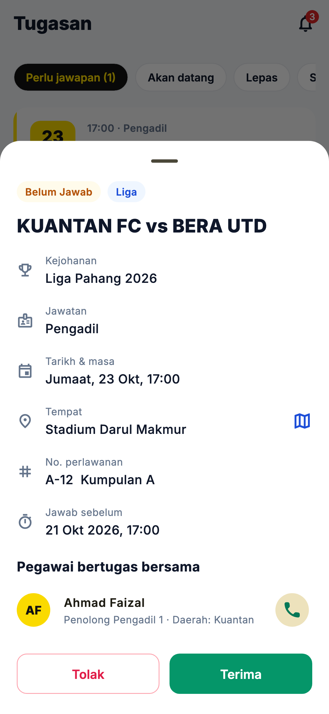

1. Buka butiran tugasan yang berkenaan. Semak jawatan dan maklumat perlawanan pada kad atau senarai.
2. Jika pautan Surat / Surat Lantikan disediakan, bukanya dan simpan PDF melalui fungsi muat turun / kongsi peranti.
3. Semak status semasa sebelum menggunakan surat. Cetakan lama tidak menggantikan maklumat pembatalan atau penangguhan terbaru.
4. Selepas bertugas, lakukan urusan peranan masing-masing: Pengadil menyemak rekod; RA menyediakan laporan; PP mengurus semakan daerah.

> Rajah ialah butiran tugasan pada aplikasi mobile. Pada portal, fungsi surat dan jawapan terletak pada baris lantikan atau pautan emel/Telegram.

## Laporan penilaian: Pilih perlawanan yang perlu dinilai
Halaman PDF 24

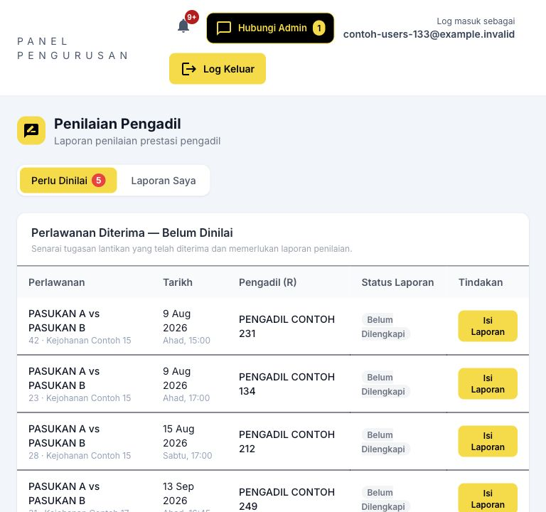

1. Buka Penilaian Pengadil > Perlu Dinilai. Semak tugasan RA yang telah Diterima.
2. Padankan kejohanan, nombor perlawanan, tarikh, pasukan dan tempat dengan tugasan sebenar.
3. Tekan Isi Laporan bagi tugasan baharu atau sambung draf yang belum dihantar.
4. Jika hanya Lihat tersedia, semak status laporan sedia ada. Laporan yang sudah dihantar tidak boleh diedit semula sebagai draf.
5. Jika lantikan tiada atau pegawai salah, hubungi pelantik sebelum mengisi laporan. Jangan memilih perlawanan lain untuk menggantikannya.

## Laporan penilaian: Isi maklumat perlawanan dan pegawai
Halaman PDF 25

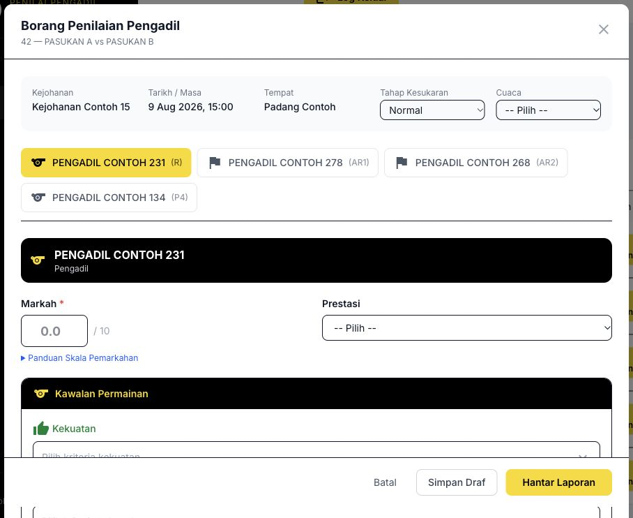

1. Dalam Borang Penilaian Pengadil, semak identiti perlawanan serta pegawai KUP yang dimuatkan.
2. Pilih Tahap Kesukaran dan Cuaca. Gunakan Normal, Susah atau Sangat Susah berdasarkan pemerhatian sebenar.
3. Pilih tab setiap pegawai: R, AR1, AR2 dan P4 jika ada. Setiap tab mempunyai markah, prestasi dan kriteria sendiri.
4. Semak nama/jawatan sebelum mengisi. Jika pegawai tidak lengkap atau salah, hentikan dan rujuk pelantik / Admin.
5. Isi Ulasan Keseluruhan yang menerangkan konteks prestasi perlawanan.

> Sistem memerlukan pegawai KUP yang sah pada perlawanan tersebut. RA tidak dimasukkan sebagai salah satu pegawai yang dinilai.

## Laporan penilaian: Kriteria: kekuatan, kelemahan dan nasihat
Halaman PDF 26

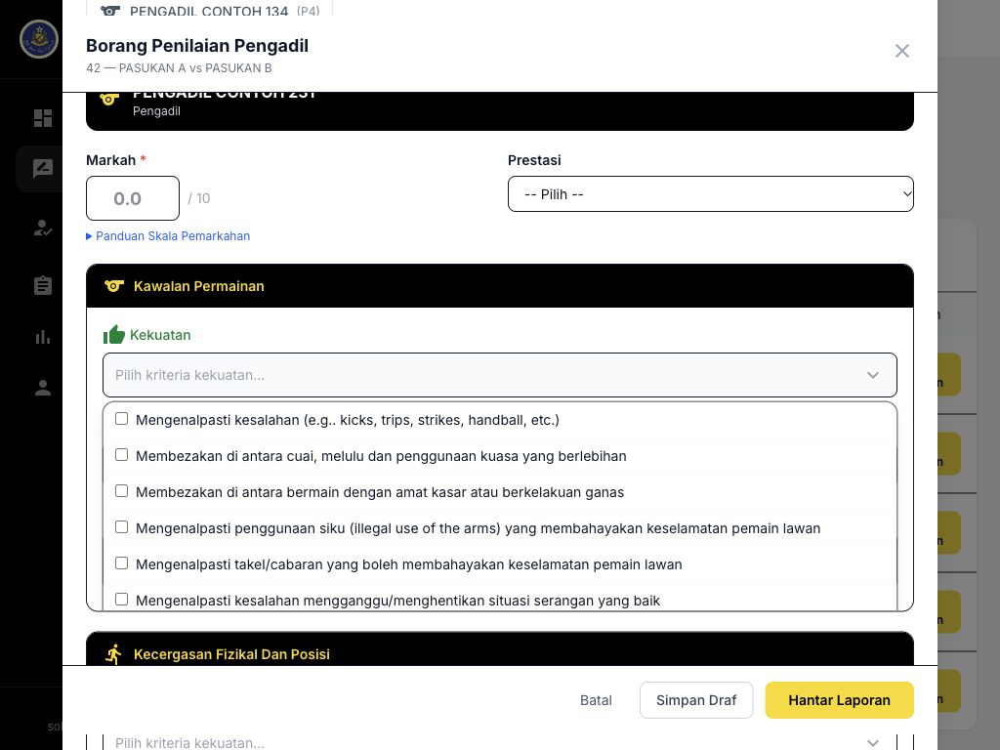

1. Pada pegawai yang dipilih, semak tiga kelompok: Kawalan Permainan, Kecergasan Fizikal/Posisi dan Kerjasama Berpasukan.
2. Tekan Pilih kriteria kekuatan atau kelemahan dan tandakan item yang benar-benar diperhatikan. Pilihan berbeza mengikut jawatan pegawai.
3. Isi Nasihat pada kelompok yang berkenaan untuk menerangkan pembaikan yang boleh dilaksanakan.
4. Ulang bagi setiap tab pegawai. Jangan meninggalkan catatan AR1 pada tab AR2 atau menyalin ulasan tanpa menyemak konteks.
5. Semak padanan markah dengan bukti dan ulasan sebelum menyimpan.

> Kriteria ialah penjelasan prestasi, bukan hanya senarai semak. Bezakan kekuatan, kelemahan dan cadangan supaya penerima boleh mengambil tindakan.

## Laporan penilaian: Rujukan skala pemarkahan pada borang
Halaman PDF 27

| Julat | Penerangan ringkas paparan sistem |
|---|---|
| 9.0-10 / 8.5-8.9 | Prestasi sangat baik; banyak keputusan sukar dibuat dengan betul. |
| 8.3-8.4 | Prestasi baik; banyak keputusan dijangka dibuat dengan betul. |
| 8.0-8.2 | Prestasi baik dengan beberapa perkara untuk penambahbaikan. |
| 7.9 | Satu key match incident; jika tiada, prestasi pada 8.3 atau ke atas. |
| 7.8 | Satu key match incident; jika tiada, prestasi pada 8.0-8.2. |
| 7.5-7.7 | Prestasi tidak memuaskan melibatkan dua key match incident. |
| 7.4 | Satu key match incident yang mempengaruhi pemenang perlawanan. |
| 7.0-7.4 | Prestasi buruk dengan tiga atau lebih key match incident. |

> Ini rujukan pilihan yang dipaparkan dalam aplikasi, bukan arahan menggantikan garis panduan penilaian rasmi. Gunakan skala dan arahan rasmi semasa ketika menilai.

## Laporan penilaian: Simpan draf dan sambung kemudian
Halaman PDF 28

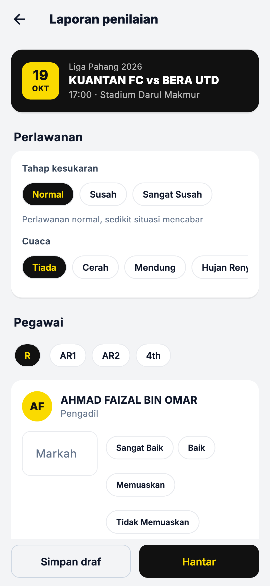

1. Semak tab pegawai dan maklumat yang sudah diisi. Tekan Simpan Draf apabila mahu menyimpan kerja tanpa menghantar untuk pengesahan.
2. Tunggu mesej Draf laporan disimpan. Jangan menganggap teks tersimpan hanya kerana borang masih kelihatan.
3. Buka Laporan Saya atau tugasan berkenaan untuk menyambung draf. Semak data yang dimuatkan sebelum menambah catatan.
4. Jika draf telah berubah atau simpanan gagal, muat semula dan semak versi terkini sebelum mengulangi simpanan.
5. Elakkan mengedit laporan sama pada dua tab atau peranti serentak.

> Simpan Draf tidak menghantar laporan kepada Pengerusi. Gunakan Hantar Laporan selepas lengkap dan disemak.

## Laporan penilaian: Hantar laporan untuk pengesahan
Halaman PDF 29

1. Semak maklumat perlawanan dan setiap pegawai. Semua markah pegawai yang diperlukan mesti diisi.
2. Baca semula kekuatan, kelemahan, nasihat, prestasi dan ulasan keseluruhan. Pastikan catatan sesuai dikongsi dengan pegawai yang berhak.
3. Tekan Hantar Laporan dan tunggu pengesahan berjaya. Semak rekod menjadi Dihantar.
4. Laporan dihantar kepada Pengerusi Pengadil untuk pengesahan; Admin menerima salinan. Jika Pengerusi belum tersedia, penghantaran boleh menunggu tindakan Admin.
5. Jika langkah simpan berjaya tetapi hantar gagal, semak draf/rekod sebelum menghantar semula.

> Laporan Dihantar belum semestinya Disahkan. Setelah dihantar, laporan tidak boleh diedit semula melalui aliran draf biasa.

## Laporan penilaian: Laporan Saya, PDF dan status pengesahan
Halaman PDF 30

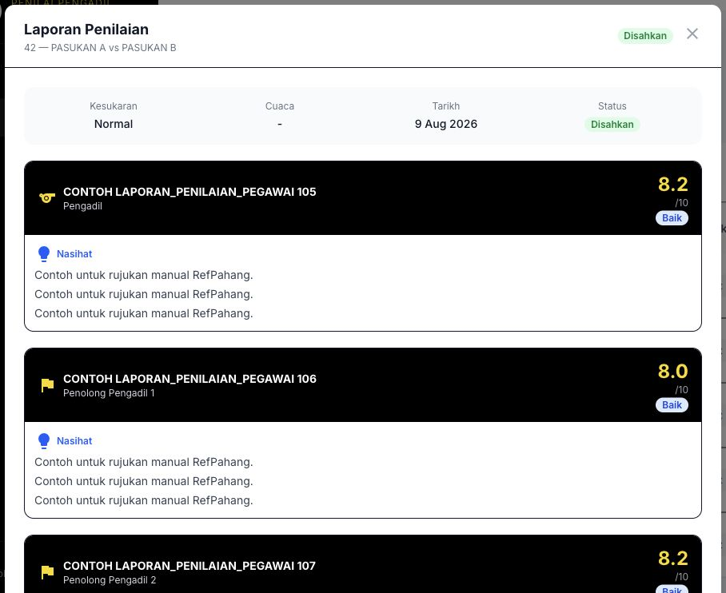

1. Buka Penilaian Pengadil > Laporan Saya. Cari perlawanan dan semak Draf, Dihantar atau Disahkan.
2. Tekan Lihat untuk menyemak markah serta ulasan setiap pegawai. Semak butiran Pengerusi/catatan jika dipaparkan.
3. Gunakan PDF / muat turun untuk laporan yang diperlukan dan pastikan perlawanan serta statusnya betul.
4. Jika pengesahan menunggu terlalu lama atau pihak pengesah salah, maklumkan kepada Admin dengan nombor laporan.
5. Jangan mengedarkan pautan pengesahan peribadi atau laporan pegawai lain di luar urusan yang dibenarkan.

## Laporan penilaian: RA jemputan tanpa akaun portal
Halaman PDF 31

1. Pengadil/RA luar boleh menerima lantikan melalui pautan peribadi emel atau Telegram tanpa menjadi pengguna portal.
2. Semak nama, jawatan RA dan perlawanan pada pautan sebelum menjawab atau membuka borang laporan yang diberikan.
3. Isi dan simpan/hantar melalui halaman pautan yang sah. Jangan cuba log masuk portal menggunakan emel rekod pengadil luar jika tiada akaun pengguna.
4. Jika pautan tidak sah, tamat tempoh atau butiran tidak sepadan, minta Admin menyemak lantikan dan menghantar pautan yang betul.
5. Jika kemudian mempunyai akaun portal, minta Admin menyemak padanan identiti agar sejarah tidak berpecah.

> Rekod Pengadil Luar, akaun portal Penilai dan pendaftaran tahunan RA ialah tiga perkara berasingan.

## Statistik dan rutin RA: Statistik RA dan senarai semak harian
Halaman PDF 32

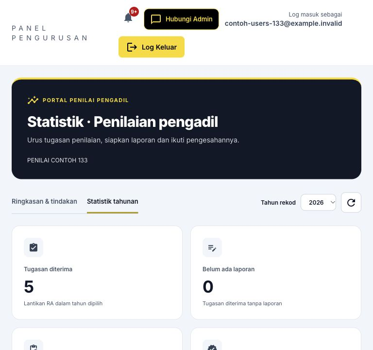

1. Buka Statistik dan pilih tahun untuk menyemak tugasan, laporan draf, dihantar, disahkan dan pegawai dinilai.
2. Gunakan perkara perlu tindakan untuk mencari tugasan diterima yang belum mempunyai laporan.
3. Semak tugasan Belum Jawab dan selesaikan laporan selepas perlawanan mengikut arahan penganjur.
4. Pantau status pengesahan, pendaftaran tahunan dan mesej dalam portal.
5. Pastikan notifikasi aktif, Telegram dipaut dan maklumat hubungan terkini. Log keluar selepas selesai.

> Jumlah pegawai dinilai tidak semestinya sama dengan bilangan laporan: satu laporan boleh menilai beberapa KUP dan orang yang sama boleh dinilai berkali-kali.

## Bantuan dan rujukan: Penyelesaian masalah harian
Halaman PDF 33

| Masalah | Tindakan pengguna |
|---|---|
| Menu tidak kelihatan | Semak peranan; buka menu telefon; fungsi tambahan PP memerlukan keupayaan yang diberikan. |
| Senarai kosong | Semak tahun, status, daerah, kata carian dan halaman senarai. Kosong tidak bermakna semua data telah dipadam. |
| Borang tidak boleh dihantar | Lengkapkan profil, dokumen dan perakuan; semak tempoh buka/tutup serta permohonan sedia ada untuk sesi sama. |
| Fail ditolak | Semak format dan saiz; resit JPG/PNG/PDF; gambar JPG/PNG yang berjaya diproses. Jangan sekadar menukar nama sambungan fail. |
| Sesi tamat | Log masuk semula. Semak dahulu sama ada tindakan terakhir berjaya sebelum menghantar semula. |
| Mesej rekod telah berubah | Muat semula butiran dan semak keadaan terkini. Elakkan mengulang tindakan daripada tab lama. |
| PDF tidak terbuka | Benarkan tab baharu / muat turun untuk portal; semak Downloads. Jangan kongsi PDF yang mengandungi data peribadi kepada umum. |

## Bantuan dan rujukan: Cara mendapatkan bantuan
Halaman PDF 34

Hubungi Admin atau Pegawai Pembangunan Daerah untuk urusan rekod, kelayakan dan permohonan. Sokongan teknikal yang tertera pada portal: sokongan@pbnppahang.my.

1. Sediakan nama peranan, menu yang digunakan, tahun / sesi, nombor permohonan atau nombor perlawanan dan masa masalah berlaku.
2. Sertakan screenshot mesej ralat. Lindungi kata laluan, pautan peribadi, nombor akaun dan data sensitif sebelum berkongsi.
3. Terangkan tindakan terakhir yang dibuat dan hasil yang dijangka. Nyatakan sama ada menggunakan web komputer, Android APK atau aplikasi skrin utama iPhone.
4. Jika berkaitan transaksi simpan / hantar, semak status semasa dan maklumkan jika rekod telah muncul. Elakkan membuat akaun atau permohonan pendua.
5. Selepas penyelesaian, buka semula rekod, sahkan status betul dan simpan nombor rujukan untuk susulan.

> Manual ini menerangkan tatacara pengguna. Ia tidak mengesahkan penghantaran emel/push pada setiap peranti atau memberi kuasa meluluskan di luar skop peranan.

## Lampiran kemas kini: Lampiran: sebab Akaun Tidak Aktif
Halaman PDF 35

Akaun Tidak Aktif tidak boleh log masuk. Popup menerangkan sebab sekatan selepas kata laluan disahkan.

1. Pendaftaran: bagi akaun Pengadil yang melalui dua tahun kalendar penuh, sistem memeriksa dua tahun lengkap sebelumnya. Untuk 2026, tahun rujukan ialah 2024 dan 2025.
2. Permohonan yang telah dihantar sudah dikira walaupun belum diluluskan. Akaun baharu tidak dikenakan tahun sebelum melalui dua tahun penuh.
3. Manual: Admin boleh menandakan akaun Tidak Aktif dengan sebab. Aktiviti: semua pengguna kecuali Admin disekat selepas 8 bulan tanpa aktiviti atau log masuk.
4. Popup menunjukkan sebab apabila maklumat log masuk betul. Hanya Admin boleh mengaktifkan semula akaun; sejarah permohonan, perlawanan dan laporan dikekalkan.

> Pengaktifan semula memerlukan log masuk baharu. Tempoh 8 bulan bermula semula; semakan pendaftaran seterusnya berlaku pada tahun kalendar berikutnya.
